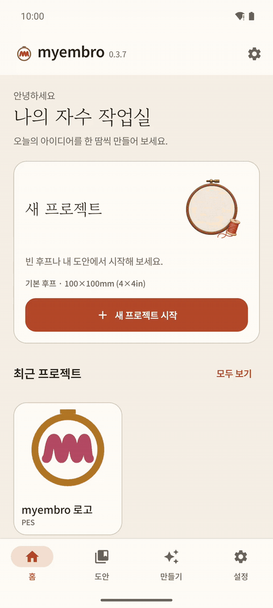

# myembro

[English](README.md) | **한국어**


**안드로이드 폰에서 자수 도안을 만들고 Brother 자수기로 보내는 앱입니다.**
무료 오픈소스입니다.

현재 버전: **v0.4.0-beta.1 (베타)**



## 할 수 있는 것

- 🖼️ **사진·그림 → 자수.** 그림을 고르고 실루엣, 외곽선, 컬러 그림(2–6색) 중에서 고릅니다. 미리보기가 실제 실 색으로 보입니다.
- 🔤 **레터링.** 한글과 영어 글자를 입력합니다. 자수 글꼴 72종과 내 TTF 글꼴을 쓸 수 있고, 안전하게 수놓이는 땀 종류를 앱이 고릅니다.
- 😀 **이모지 → 자수.** 이모지를 한글로도 검색해 도안으로 바꿉니다.
- ✂️ **편집.** 후프 위에서 도안과 글자를 놓고, 크기를 바꾸고, 돌립니다.
- 👀 **보기.** PES, PEC, DST 파일을 엽니다. 실 색, 땀 재생, 땀 수·크기·시간을 봅니다.
- 🔌 **자수기로 보내기.** USB 케이블로 Brother SE400에 바로 보냅니다.
- 💾 **백업.** 디자인, 프로젝트, 글꼴, 설정을 ZIP 하나로 저장하고 다시 복원합니다.

| 컬러 그림 | 레터링 | 봉제 점검 |
|---|---|---|
|  |  |  |

## 설치

1. [최신 릴리스](https://github.com/linker2k/myembro/releases/latest)를 엽니다.
2. `.apk` 파일을 안드로이드 폰에 내려받습니다.
3. 파일을 열고, 폰이 물으면 이 출처의 설치를 허용합니다.

### 0.3.x에서 베타로 옮기기

베타는 새 키로 서명해서 0.3.x 위에 덮어 설치할 수 없습니다. 한 번만 이렇게 하세요.

1. 기존 앱에서 **설정 → 백업 → 백업 저장**을 누르고, ZIP을 앱 밖에 보관합니다.
2. 기존 myembro를 제거합니다.
3. 베타를 설치합니다.
4. **설정 → 백업 → ZIP 복원**에서 백업 파일을 고릅니다.

다시 설치한 뒤에는 USB 폴더 접근을 다시 허용해야 합니다.

## 어디부터 시작할까

앱을 열고 **새 프로젝트 시작**을 누르세요. 빈 후프, 내 디자인, 사진·그림, 이모지, 레터링 중에서 시작할 수 있습니다.

[사용 설명서](docs/manual/user-guide.ko.md)에 모든 화면이 그림과 함께 나옵니다.

## 지원 자수기

| 자수기 | 후프 | 파일 | 상태 |
|---|---|---|---|
| Brother SE400 | 100×100mm | PES | USB 직접 전송, 실제 기계에서 확인 |
| Brother SE600 / SE700 | 100×100mm | PES | 설명서 기반 프로필, 실제 기계 전송은 아직 확인 전 |

## 안전 장치

저장하거나 보내기 전에, 앱이 만든 모든 도안을 실제 봉제를 망치는 다섯 가지 문제로 검사합니다.

1. 작은 한 곳에 땀이 너무 많이 몰림
2. 바늘이 같은 점을 계속 찌름
3. 시작이나 끝에 잠금 땀이 없음
4. 12mm보다 긴 땀
5. 파일 오류, 또는 후프 밖으로 나간 땀

하나라도 걸리면 저장과 전송을 막습니다. 가져온 PES 파일은 고치지 않고, 0.5mm 한 곳에 바늘이 30번 넘게 몰리는 심한 경우만 막습니다.

## 알려진 한계

- SE400에는 자동 실 자르기가 없습니다. 수놓은 뒤 색 사이의 실을 손으로 잘라 주세요. 앱이 안내합니다.
- SE600/SE700 전송은 아직 실제 기계에서 확인하지 않았습니다.
- 컬러 그림에서 아주 작은 조각(3mm² 미만)은 정리되고, 색 영역 사이로 보이는 0.4mm보다 좁은 배경 틈은 색 사이 0.2mm 겹침으로 메워집니다.
- 사진 자수 만들기는 1분이 지나면 멈춥니다. 색 영역이 100개쯤 되는 그림은 여기에 걸릴 수 있으니, 디테일을 낮추거나 더 작게 잘라 주세요.

## 개발자용

### 빌드

필요: JDK 17, Android SDK(platform 35).

```bash
./gradlew :engine:test          # 엔진 테스트
./gradlew :app:assembleDebug    # app/build/outputs/apk/debug/app-debug.apk
```

```
engine/   순수 Kotlin(JVM): 모델, 파일 읽기·쓰기, 땀 생성
app/      안드로이드 앱(Jetpack Compose)
relay/    AI 연결용 선택 Cloudflare Worker
tools/    테스트 픽스처·검사 스크립트
```

땀 생성은 검증된 원본(Ink/Stitch, Potrace, AutoTrace, Wu 양자화)을 기본 설정 그대로 포팅하고, 자동 테스트로 원본과 결과를 비교합니다.

### AI와 PC 제어

- Claude Code, Codex CLI 등 MCP 클라이언트로 PC에서 제어: [docs/agent/mcp.md](docs/agent/mcp.md)
- AI 연결 릴레이(실험): [relay/README.md](relay/README.md)

### 출처와 라이선스

- 제3자 고지와 라이선스 전문: [THIRD_PARTY_NOTICES.md](THIRD_PARTY_NOTICES.md)
- 주요 출처: [Ink/Stitch](https://github.com/inkstitch/inkstitch), [Potrace](https://potrace.sourceforge.net/), [AutoTrace](https://github.com/autotrace/autotrace), [pyembroidery](https://github.com/EmbroidePy/pyembroidery), [DrawingBotV3](https://github.com/SonarSonic/DrawingBotV3)
- 라이선스: [GPL-3.0-or-later](LICENSE). 이슈와 풀 리퀘스트를 환영합니다.
