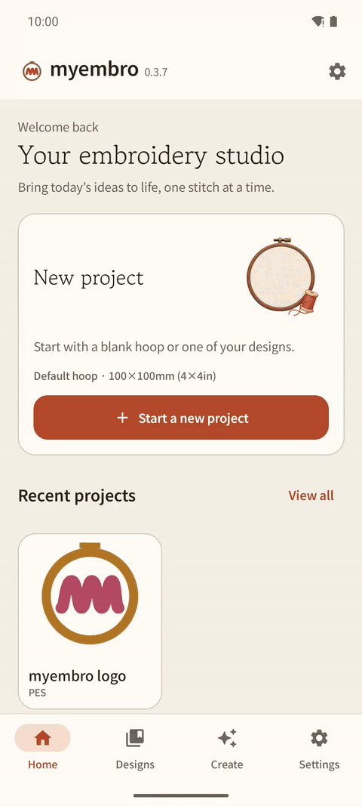

# myembro

**English** | [한국어](README.ko.md)


**Make embroidery designs on your Android phone and send them to your Brother machine.**
Free and open source.

Current version: **v0.4.0-beta.2 (beta)**



## What you can do

- 🖼️ **Photo or drawing → embroidery.** Pick a picture and choose silhouette, outline or color drawing (2–6 colors). The preview shows the real thread colors.
- 🔤 **Lettering.** Type text in Korean or English. 72 embroidery fonts, plus your own TTF fonts. The app picks a stitch type that sews safely.
- 😀 **Emoji → embroidery.** Search emoji (Korean words work too) and turn one into a design.
- ✂️ **Edit.** Place, resize and rotate designs and text on the hoop.
- 👀 **View.** Open PES, PEC and DST files. See thread colors, play the stitches and check stitch count, size and time.
- 🔌 **Send to the machine.** 58 Brother embroidery models from the US and Korea. Send PES over a USB cable (SE400) or a USB flash drive.
- 💾 **Back up.** Save designs, projects, fonts and settings in one ZIP and restore them later.

| Color drawing | Lettering | Sew-out check |
|---|---|---|
|  |  |  |

## Install

1. Open the [latest release](https://github.com/linker2k/myembro/releases/latest).
2. Download the `.apk` file to your Android phone.
3. Open it and allow installing from this source when the phone asks.

### Moving from 0.3.x to the beta

The beta is signed with a new key, so it cannot install over 0.3.x. Do this once:

1. In the old app, go to **Settings → Backup → Save backup**. Keep the ZIP outside the app.
2. Uninstall the old myembro.
3. Install the beta.
4. Go to **Settings → Backup → Restore ZIP** and pick your backup.

After reinstalling, allow USB folder access again.

## Where to start

Open the app and tap **Start a new project**. You can start from a blank hoop, your own design, a photo or drawing, an emoji, or lettering.

The [user guide](docs/manual/user-guide.md) walks through every screen with pictures. Common questions are in the [FAQ](docs/faq.md).

## Machines

Pick your machine in **Settings → Machine model**. The list has 58 Brother embroidery models sold in the United States (30) and Korea (28). Each model has its maximum embroidery area, and the app keeps every design inside it.

| Hoop class | United States | Korea | Max area |
|---|---|---|---|
| 4×4in | SE400, SE425, SE600, SE625, SE630, SE700, SE725, PE535, PE545, PE550D, NS1750D | M370, M380D, LB6950, LB7950, LB8950, Innovis 180 / 180D / 180K, 900 / 900D, 950, 980D / 980K | 100×100mm |
| 5×7in | PE770, PE800, SE1900, SE2000, PE900, NS2750D | F580, Innovis NS2750D, Innovis 1250 | 130×180mm |
| 6×10in | NQ1400E, NQ1600E, NQ1700E, NQ3550W | Innovis 2600, Innovis 2700 | 160×260mm |
| Larger | XE1, XJ1, XP1, XP2, XP3, EV1, PRS100, PR680W, PR1050X | Innovis 4000D, V3, V3LE, V5, V5LE, XJ1, PR680W, PR1050X, PR1060W, PR1X | up to 297×465mm |

- The SE400 is tested on a real machine, including direct transfer over a USB cable.
- The other models use profiles from Brother manuals and product pages. Models larger than 100×100mm are marked **Not verified on a physical machine** in the app.
- Every model gets PES files. Send them over a USB cable (SE400) or a USB flash drive connected to the phone (OTG).
- Full list with sources: [docs/machines.md](docs/machines.md).

## Safety checks

Before you save or send, the app checks every design it makes for five problems that ruin real sew-outs:

1. Too many stitches packed into one small spot
2. The needle hitting the same point again and again
3. Missing lock stitches at the start or end
4. Stitches longer than 12mm
5. A broken file, or stitches outside the hoop

If any one is found, saving and sending are blocked. PES files you import are not changed; they are only blocked for severe needle crowding (more than 30 needles in one 0.5mm spot).

## Known limitations

- Only the SE400 is tested on a real machine. Other models follow Brother's published specifications.
- In color drawing, very small pieces (under 3mm²) are removed, and background slits narrower than 0.4mm between color areas are covered by the 0.2mm color overlap.
- Photo stitch generation stops after 1 minute. Pictures with about 100 color areas can hit this; use lower detail or a smaller crop.

## For developers

### Build

Requirements: JDK 17, Android SDK (platform 35).

```bash
./gradlew :engine:test          # engine tests
./gradlew :app:assembleDebug    # app/build/outputs/apk/debug/app-debug.apk
```

```
engine/   Pure Kotlin (JVM): model, file readers and writers, stitch generation
app/      Android app (Jetpack Compose)
relay/    Optional Cloudflare Worker for AI connection
tools/    Test fixture and check scripts
```

Stitch generation ports verified originals (Ink/Stitch, Potrace, AutoTrace, Wu quantization) with their default settings, and automated tests compare the results with the originals.

### AI and PC control

- PC control from Claude Code, Codex CLI and other MCP clients: [docs/agent/mcp.md](docs/agent/mcp.md)
- AI connection relay (experimental): [relay/README.md](relay/README.md)

### Credits and license

- Third-party notices and license texts: [THIRD_PARTY_NOTICES.md](THIRD_PARTY_NOTICES.md)
- Main sources: [Ink/Stitch](https://github.com/inkstitch/inkstitch), [Potrace](https://potrace.sourceforge.net/), [AutoTrace](https://github.com/autotrace/autotrace), [pyembroidery](https://github.com/EmbroidePy/pyembroidery), [DrawingBotV3](https://github.com/SonarSonic/DrawingBotV3)
- License: [GPL-3.0-or-later](LICENSE). Issues and pull requests are welcome.
