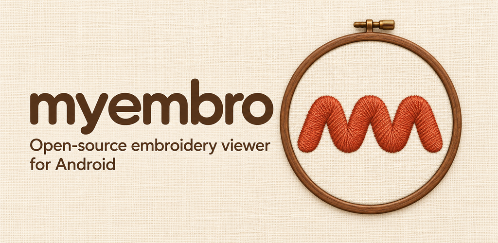
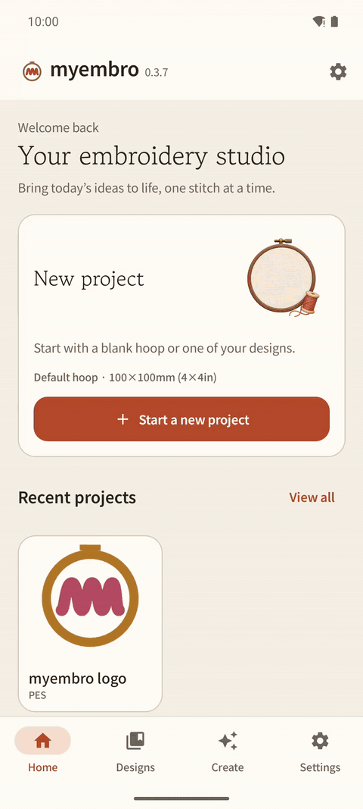
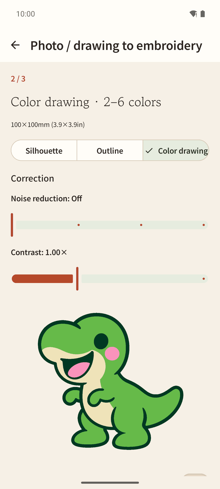
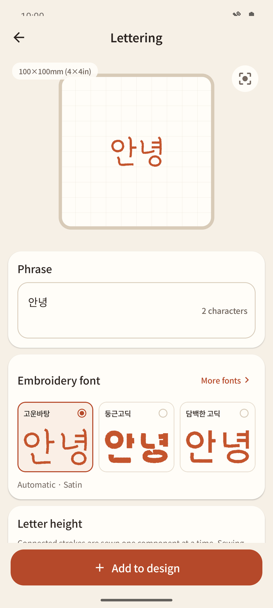
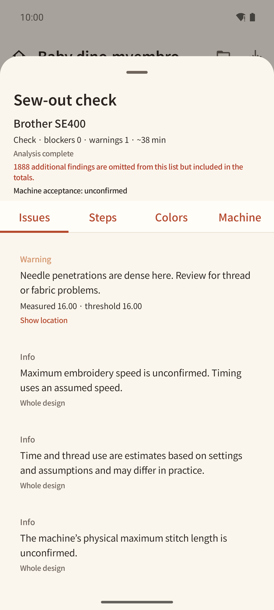
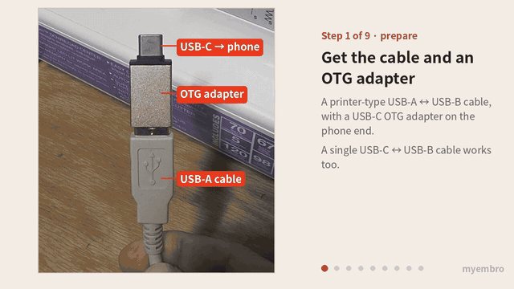

# myembro

**English** | [한국어](README.ko.md)



**Make embroidery designs on your Android phone and send them to your Brother machine.**
Free and open source.

[](https://github.com/linker2k/myembro/releases)

> ### ⬇️ [Download the app (Android)](https://github.com/linker2k/myembro/releases/latest/download/myembro.apk)
> Tap it on your phone and the download starts. Open the file to install. More: [How to install](#install)
>
> 📖 [User guide](docs/manual/user-guide.md) · ❓ [FAQ](docs/faq.md) · This page introduces the app.



## What you can do

- 🎁 **136 sample designs.** Open one from **Sample designs** on Home or **Samples** on the Designs tab and it is copied into your own project to change.
- 🖼️ **Photo or drawing → embroidery.** Pick a picture and choose silhouette, outline or color drawing (2–6 colors). The preview shows the real thread colors.
- 🔍 **Photo crop.** Zoom out so the whole picture fits in the crop.
- 🎚️ **Photo detail.** Set the resolution and the small-piece size separately.
- 🧵 **Thread colors.** Different colors are never merged into the same thread.
- 🔤 **Lettering.** Type text in Korean, English or Japanese kana. 72 embroidery fonts, plus your own TTF fonts. The app picks a stitch type that sews safely.
- 😀 **Emoji → embroidery.** Search emoji (Korean words work too) and turn one into a design.
- 🔎 **Find free designs.** A list of free design sites with their terms of use.
- ✂️ **Edit.** Place, resize and rotate designs and text on the hoop.
- 🧩 **Block editing.** A hand-set fill angle shows as thin slanted lines, and blocks you do not want can be emptied so they are not sewn.
- 👀 **View.** Open PES, PEC and DST files. See them as stitched thread (Realistic), play the stitches and check stitch count, size and time.
- 📤 **Save in other formats.** Save and share as PES, DST, JEF, EXP or VP3.
- 🔌 **Send to the machine.** 58 Brother embroidery models from the US and Korea. Send PES over a USB cable (SE400) or a USB flash drive.
- 💾 **Back up.** Save designs, projects, fonts and settings in one ZIP and restore them later.

| Color drawing | Lettering | Sew-out check |
|---|---|---|
|  |  |  |

## No PC needed: phone → machine over a USB cable

Fix a design on your phone and send it straight to the machine with a USB cable. No computer, no USB stick.



Cable + OTG adapter → choose myembro → Send to USB → ✔ sent → open it on the machine. [Watch the video (MP4, 1 min)](docs/images/usb-direct-en.mp4)

- **Brother SE400:** tested on a real machine with a Galaxy Fold7 (v0.1.0-alpha26). The design opened normally on the machine.
- **SE425, Innovis 900 / 900D:** their manuals describe the same "USB cable → PC" connection, so they should work the same way. Not tested on real machines yet.

When connected, the machine looks to the phone like a small USB disk. myembro writes the design onto it itself and then reads every file back to check it arrived intact. Steps: [user guide, chapter 10.1](docs/manual/user-guide.md#101-sending-directly-over-a-usb-cable-se400-and-similar).

## Install

1. On your Android phone, tap [Download the app](https://github.com/linker2k/myembro/releases/latest/download/myembro.apk).
2. Open the downloaded file (`myembro.apk`).
3. Allow installing from this source when the phone asks.

Older versions and change notes are on the [releases page](https://github.com/linker2k/myembro/releases).

## Where to start

Open the app and tap **Start a new project**. You can start from a blank hoop, your own design, a photo or drawing, an emoji, or lettering.

The [user guide](docs/manual/user-guide.md) explains every screen in the order you use the app, with numbered pictures and tables: home → new project → [editor](docs/manual/user-guide.md#3-editor) → [block editing](docs/manual/user-guide.md#4-block-editing) → lettering, photo and emoji → design list → [sew-out check](docs/manual/user-guide.md#9-sew-out-check) → [sending to the machine](docs/manual/user-guide.md#10-sending-to-the-machine) → [settings](docs/manual/user-guide.md#12-settings). Common questions are in the [FAQ](docs/faq.md).

## Machines

Pick your machine in **Settings → Machine model**. The list has 58 Brother embroidery models sold in the United States (30) and Korea (28). Each model has its maximum embroidery area, and the app keeps every design inside it.

| Hoop class | United States | Korea | Max area |
|---|---|---|---|
| 4×4in | SE400, SE425, SE600, SE625, SE630, SE700, SE725, PE535, PE545, PE550D, NS1750D | M370, M380D, LB6950, LB7950, LB8950, Innovis 180 / 180D / 180K, 900 / 900D, 950, 980D / 980K | 100×100mm |
| 5×7in | PE770, PE800, SE1900, SE2000, PE900, NS2750D | F580, Innovis NS2750D, Innovis 1250 | 130×180mm |
| 6×10in | NQ1400E, NQ1600E, NQ1700E, NQ3550W | Innovis 2600, Innovis 2700 | 160×260mm |
| Larger | XE1, XJ1, XP1, XP2, XP3, EV1, PRS100, PR680W, PR1050X | Innovis 4000D, V3, V3LE, V5, V5LE, XJ1, PR680W, PR1050X, PR1060W, PR1X | up to 297×465mm |

- The SE400 is tested on a real machine, including direct transfer over a USB cable.
- The other models use profiles from Brother manuals and product pages. Models larger than 100×100mm are marked **Not verified on a physical machine** in the app.
- Every model gets PES files. Send them over a USB cable (SE400) or a USB flash drive connected to the phone (OTG).
- Full list with sources: [docs/machines.md](docs/machines.md).

## How stitches are made

- **Automatic underlay** · holds the fabric before the fill goes on.
- **Connected sewing** · travel thread tucks under later stitches instead of sitting on top.
- **Outlines twice** · photo embroidery edges get two running passes, offset by half a stitch, for a crisp line.
- **Korean satin, top-left to bottom-right** · strokes are sewn the way you write them.
- **Trims only between separate parts** · nearest part first, so less thread jumps across.
- **Automatic lock stitches** · start, end and both sides of every trim, so nothing unravels.
- **Change any block** · stitch type, direction and order, with a tap.

More detail: [user guide appendix](docs/manual/user-guide.md#appendix-how-stitches-are-made)

## Safety checks

Before you save or send, the app checks every design it makes for five problems that ruin real sew-outs:

1. Too many stitches packed into one small spot
2. The needle hitting the same point again and again
3. Missing lock stitches at the start or end
4. Stitches longer than 12mm
5. A broken file, or stitches outside the hoop

16–30 needles in one 0.5mm spot is only a warning: the app shows where, and you can still save. More than 30, or any other problem, blocks saving and sending. PES files you import are not changed; they are only blocked for more than 30 needles in one spot. More detail: [user guide, chapter 9](docs/manual/user-guide.md#9-sew-out-check)

## Known limitations

- Only the SE400 is tested on a real machine. Other models follow Brother's published specifications.
- In color drawing, small pieces (by default under about 3mm²) take the surrounding color, and background slits narrower than 0.4mm between color areas are covered by the 0.2mm color overlap.
- Very complex pictures can stop as "too complex"; lower the resolution, raise the piece size or crop smaller.

## Planned

- **Pull compensation** · in progress
- **Chinese (Han character) lettering** · in development
- **Draw a line to set the stitch angle** · planned
- **Edit outline points directly** · under consideration

## For developers

### Build

Requirements: JDK 17, Android SDK (platform 35).

```bash
./gradlew :engine:test          # engine tests
./gradlew :app:assembleDebug    # app/build/outputs/apk/debug/app-debug.apk
```

```
engine/   Pure Kotlin (JVM): model, file readers and writers, stitch generation
app/      Android app (Jetpack Compose)
relay/    Optional Cloudflare Worker for AI connection
tools/    Test fixture and check scripts
```

Stitch generation ports verified originals (Ink/Stitch, Potrace, AutoTrace, Wu quantization) with their default settings, and automated tests compare the results with the originals.

### AI and PC control

- PC control from Claude Code, Codex CLI and other MCP clients: [docs/agent/mcp.md](docs/agent/mcp.md)
- AI connection relay (experimental): [relay/README.md](relay/README.md)

### Credits and license

- Third-party notices and license texts: [THIRD_PARTY_NOTICES.md](THIRD_PARTY_NOTICES.md)
- Main sources: [Ink/Stitch](https://github.com/inkstitch/inkstitch), [Potrace](https://potrace.sourceforge.net/), [AutoTrace](https://github.com/autotrace/autotrace), [pyembroidery](https://github.com/EmbroidePy/pyembroidery), [DrawingBotV3](https://github.com/SonarSonic/DrawingBotV3)
- License: [GPL-3.0-or-later](LICENSE). Issues and pull requests are welcome.
