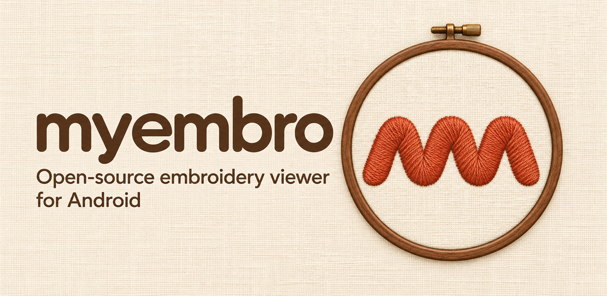

# myembro

**English** | [한국어](README.ko.md)



**Open-source embroidery app for Android** — view, edit, letter and digitize Brother **PES**
designs on your phone and send them to the machine.

Current release: **v0.2.8** (GitHub pre-release).

User guide: [docs/manual/user-guide.md](docs/manual/user-guide.md)

PC control (Claude Code, Codex CLI and other MCP clients): [docs/agent/mcp.md](docs/agent/mcp.md)

## Failure-free designs

Before saving or sending, every PES the app generates is checked in code for the conditions that cause
real sew-out failures: needle crowding in a 0.5mm cell, repeated needle penetrations at the same point,
missing start/end lock stitches, stitches longer than the maximum length, and file errors or designs
outside the hoop. If any one is found, saving and sending are blocked. Stitch generation does not invent
new algorithms: it ports verified originals (Ink/Stitch, Potrace, AutoTrace, Wu quantization) with their
default parameters, and automated comparisons confirm the results match the originals. Choices that can
fail, such as stitch type and allowed size range, are made automatically by the app; detailed settings
are not exposed.

**Hoop range:** stitch coordinates are integers in 0.1mm units starting at 0, so a 100mm hoop allows
0–999 and blocks 1000 and above. The maximum design size is 99.9mm; the only safety margin is that 0.1mm.
The same rule applies to every hoop.

## Features (v0.2.x)

- **Viewer:** opens PES (v1–v10), PEC and DST; thread-color rendering, zoom and pan, stitch playback, statistics (stitch count, size, colors, trims, estimated time), hoop display
- **Editor:** place designs and lettering, resize, rotate, save projects
- **Lettering:**
  - 72 Ink/Stitch embroidery fonts as satin (verified font catalog)
  - TTF fonts (including Korean): the app automatically chooses the stitch type (satin, fill, running) and allowed size range from the letter size
- **Fill:** Ink/Stitch default tatami with underlay
- **Photo to embroidery:** single-color silhouette (fill) and outline modes, size adjustment
- **Sew-out check:** automatically blocks the failure conditions above. Imported PES files are kept byte-for-byte
- **Machines:** Brother SE400 — direct transfer from the phone over a USB cable (confirmed on a real machine), transfer history, and guidance for tidying travel threads on models without automatic thread cutting. SE600/SE700 — machine profiles (100×100mm, USB memory)
- **Full backup/restore:** saves and restores designs, projects, downloaded fonts and settings as one ZIP
- **Versions:** v0.2.N for every release since v0.2.0, published as GitHub pre-releases

## Known limitations

- The SE400 has no automatic thread cutter, so color-change and travel threads must be trimmed by hand after sewing (the app guides you).
- The current APK is signed with a development key. When it switches to the official signing key, it cannot be installed as an update over the existing app; you will need to uninstall once and reinstall. Before that, take a full backup in Settings.
- SE600/SE700 are profiles based on the manuals; transfer to those machines has not been tested on real hardware yet.

## Project layout

```
engine/   Pure Kotlin (JVM) — model and file readers, no Android dependency
app/      Android app (Jetpack Compose)
tools/    make_fixtures.py — builds test fixtures with pyembroidery
```

## Build

Requirements: JDK 17, Android SDK (platform 35).

```bash
./gradlew :engine:test          # reader parity tests
./gradlew :app:assembleDebug    # app/build/outputs/apk/debug/app-debug.apk
```

### Regenerating test fixtures

The engine tests compare our readers stitch-by-stitch with
[pyembroidery](https://github.com/EmbroidePy/pyembroidery):

```bash
pip install pyembroidery==1.5.1
python3 tools/make_fixtures.py engine/src/test/resources/fixtures
```

## Credits

All third-party notices and full license texts: [THIRD_PARTY_NOTICES.md](THIRD_PARTY_NOTICES.md).

- [Ink/Stitch](https://github.com/inkstitch/inkstitch) v3.3.0 — stitch algorithms (satin, tatami fill, locks) ported, and embroidery fonts (GPL-3.0-or-later; fonts under their own licenses)
- [Potrace](https://potrace.sourceforge.net/) 1.16 — bitmap contour tracing (GPL-2.0-or-later)
- [AutoTrace](https://github.com/autotrace/autotrace) — thinning and centerline tracing (LGPL-2.1-or-later / GPL-2.0-or-later parts)
- Xiaolin Wu color quantizer, Graphics Gems II (Graphics Gems permission)
- [pyembroidery](https://github.com/EmbroidePy/pyembroidery) — file format readers ported and used as a test reference (MIT)
- JTS Topology Suite, JGraphT, libaums, AndroidX and bundled fonts (Noto Sans KR, Gowun Batang, Jua, …) — see the notices

## License

[GPL-3.0-or-later](LICENSE). Contributions welcome — issues and pull requests are open.
