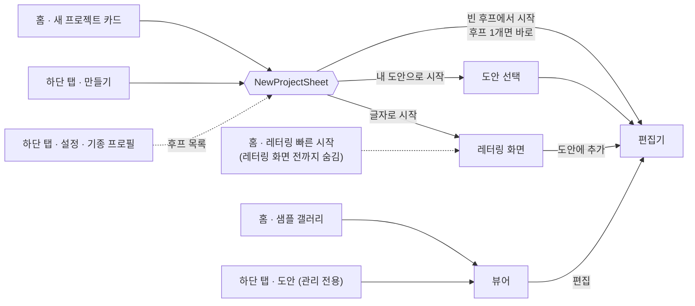

# myembro Design System — Option A "Warm Craft" (Confirmed)

Confirmed 2026-10-22. Canvas options B (Modern Studio) and C (Bright Minimal) are deferred and retained for reference.
(The `BOTANICAL`/`INK` colorways in `Color.kt` are variations of palette A, distinct from canvas options B/C.)

- Canvas: https://claude.ai/artifact/Xa3DHb178qPXu6drysJFW8 — pages "Design Direction" (mockups),
  "Design System" (tokens, typography, components, splash/start-screen prototypes), "Prototype" (screen flows)
- Implementation: `app/.../ui/theme/` — `MyembroTheme`, `Color.kt`, `Type.kt`, `Shape.kt`, `MyembroSplash.kt`
  (See "Implementation integration" below for wiring.)

## Rules

1. All screens use only `MaterialTheme.colorScheme.*`, `MaterialTheme.typography.*`,
   and `MaterialTheme.shapes.*`/`MyembroShapes` inside `MyembroTheme`. **No hardcoded `Color(0x…)`** — exceptions
   are thread colors (design data) and `Color.kt` itself.
2. Text/background pairs must achieve at least 4.5:1 (3:1 for large text). Using the `on*` pairs below satisfies this.
3. **Sage (secondary) and gold (tertiary) are for fills only.** As text on linen, their 2.7:1/2.0:1 ratios fall short.
   Use `onSecondary`/`onTertiary` (ink) for text on those colors; when sage/gold-toned text is needed,
   use `onSecondaryContainer`/`onTertiaryContainer`.
4. Do not distinguish states by color alone (text on badges, icons and wording for warnings).
5. Minimum touch target 48dp (including icon buttons). Minimum body text 12sp.
6. Dark mode uses the dark column below. In dark mode, express elevation with surfaceContainer levels instead of shadows.

## Color tokens

| Token (`colorScheme.`) | Role | Light | Dark |
|---|---|---|---|
| `primary` | Main buttons, selection, emphasis | `#B5492A` | `#EF9A78` |
| `onPrimary` | Text on primary | `#FFFFFF` | `#472314` |
| `primaryContainer` | Selected chips, tab pills, selected layer rows | `#F5DED1` | `#693923` |
| `onPrimaryContainer` | | `#492516` | `#FFDBC8` |
| `secondary` | Sage — fills only | `#7F9A76` | `#A4BC99` |
| `onSecondary` | Text on secondary (ink) | `#2B2420` | `#1F331E` |
| `secondaryContainer` | Tonal buttons, PES badge backgrounds | `#E6ECDF` | `#354A30` |
| `onSecondaryContainer` | Sage-toned text | `#273522` | `#E0EAD8` |
| `tertiary` | Gold — hoop screw, highlight fills | `#D9A441` | `#E8BE68` |
| `onTertiary` | Text on tertiary (ink) | `#2B2420` | `#402E05` |
| `tertiaryContainer` | Caution banners, tips | `#F7E8C6` | `#5C4313` |
| `onTertiaryContainer` | Gold-toned text | `#493506` | `#FFE2A5` |
| `background` | App background (linen) | `#F6F0E6` | `#1C1815` |
| `onBackground`, `onSurface` | Body text (ink) | `#2B2420` | `#F4EBDF` |
| `surface` | Cards, sheets, bottom tabs | `#FFFDF8` | `#26211D` |
| `surfaceVariant` | Input fields, canvas background | `#EEE5D8` | `#443A32` |
| `onSurfaceVariant` | Secondary text/icons | `#72645A` | `#D2C3B4` |
| `outline` | Borders, dividers | `#D8CBB8` | `#998A7A` |
| `outlineVariant` | Subtle dividers | `#E8DED0` | `#50463C` |
| `error` / `onError` | Errors, hoop overflow | `#AD352C` / `#FFFFFF` | `#FFB4AA` / `#690005` |
| `errorContainer` / `onErrorContainer` | Warning banners | `#F9DEDB` / `#4B1715` | `#89251E` / `#FFDAD4` |
| (extension) hoop | Wooden hoop frame (`LightHoopArgb`/`DarkHoopArgb`) | `#916448` | `#D7B58F` |

surfaceContainer levels (light / dark): Lowest `#FFFFFF`/`#15120F`, Low `#FBF6ED`/`#211C18`,
default `#F2E9DC`/`#2B2520`, High `#ECE1D1`/`#362E28`, Highest `#E5D7C4`/`#413831`.

`Color.kt` uses primary `0xFFB5492A` (meeting white-text contrast requirements); the previous `#C4552D` moved to the thread palette (`ThreadTerracotta`).

### Thread palette (content colors, not for UI states)

Terracotta `#C4552D`, cream `#EFE3C8`, sage `#7F9A76`, leaf `#4F6B3A`, gold `#D9A441`,
rose `#D86A7A`, sky `#7FA7D9`, ink `#2B2420`. Actual design thread colors use the design/PEC palette values unchanged.

## Typography (`MyembroTypography`)

Body text uses **Noto Sans KR** (variable, OFL), and display text uses only **Gowun Batang** (OFL). Both are bundled with the app.

| Style | Typeface | Size/line height (sp) | Weight | Usage |
|---|---|---|---|---|
| displayLarge | Gowun Batang | 48/62 | 400 | Splash wordmark |
| displayMedium | Gowun Batang | 40/54 | 400 | Start-screen title |
| displaySmall | Gowun Batang | 34/46 | 400 | Large screen titles |
| headlineLarge/Medium/Small | Gowun Batang | 30/42 · 26/38 · 24/34 | 400 | Section titles |
| titleLarge | Noto Sans KR | 22/32 | 600 | App-bar titles |
| titleMedium | Noto Sans KR | 18/28 | 600 | Card/sheet titles |
| titleSmall | Noto Sans KR | 16/24 | 500 | List titles |
| bodyLarge | Noto Sans KR | 16/26 | 400 | Body text |
| bodyMedium | Noto Sans KR | 14/22 | 400 | Secondary body text |
| bodySmall | Noto Sans KR | 12/18 | 400 | Metadata (minimum body size) |
| labelLarge | Noto Sans KR | 14/22 | 600 | Buttons |
| labelMedium | Noto Sans KR | 12/18 | 500 | Chips, bottom tabs |
| labelSmall | Noto Sans KR | 11/16 | 500 | Badges |

Numbers (mm, stitch counts) use `fontFeatureSettings = "tnum"` for fixed-width digits.

## Spacing · shape · elevation

- Spacing (dp, increments of 4): 4 · 8 · 12 · 16 · 20 · 24 · 32 · 40. Screen horizontal margins 20, card padding 16,
  gaps between list items 12, between sections 24.
- Shapes (`MyembroShapeScheme`): extraSmall 8 (badges/tooltips), small 12 (chips), medium 16 (buttons/input fields),
  large 20 (cards/canvas), extraLarge 28 (bottom-sheet top corners/dialogs), fully rounded (FAB/switches/tab pills).
- Elevation: cards 1dp, floating toolbars/layer panels 3dp, bottom sheets/FAB 6dp. Shadows use ink tones;
  in dark mode, surfaceContainer levels replace them.

## Component specifications (dp)

| Component | Specification |
|---|---|
| Primary button | Height 52, shape medium(16), `primary`/`onPrimary`, labelLarge, icon 18 + gap 8. One per screen |
| Tonal button | Height 52, `secondaryContainer`/`onSecondaryContainer` |
| Outline button | Height 48, 1.5dp `outline` border, `onSurface` text. Disabled: `surfaceVariant` background + `onSurfaceVariant` |
| Filter chip | Height 40, horizontal padding 16, shape small(12). Selected `primary`/`onPrimary`, default `surface` + 1dp `outline` |
| Badge | Horizontal padding 8, vertical padding 4, shape extraSmall(8), labelSmall. PES = `secondaryContainer`, hoop overflow = `errorContainer`, good quality/caution/unsuitable = `secondaryContainer`/`tertiaryContainer`/`errorContainer` + text |
| Design card | shape large(20), `surface`, 1dp `outlineVariant` border, thumbnail height 176 (preview inside hoop, `surfaceContainer` background), body padding 12/14, title titleMedium, metadata bodySmall `onSurfaceVariant` |
| Bottom tabs | Height 80, `surface`, 4 fixed tabs (Home · Designs · Create · Settings; flows in "Screen flows (IA)"). Selected 64×32 pill `primaryContainer`, icon/text `primary`, labelMedium |
| Bottom sheet | Top corners 28, handle 32×4 `outline`, horizontal padding 24, title titleMedium + tabs (Transform/Stitches/Colors), one main button below. Background scrim `onBackground` 40% |
| Slider | Track 4, active `primary`, inactive `surfaceVariant`, thumb 20. Value always shown as number+unit on right |
| Segmented control | Height 44, `surfaceVariant` background + padding 4, selected `primary`/`onPrimary`, corners 12 |
| Input field | Height 52, shape medium(16), `surface` + 1dp `outline`, unit (mm) in bodyMedium on right. Error: 2dp `error` border + text below |
| Search field | Height 52, magnifier 20 on left, filter button on right |
| Status banner | Height at least 52, shape medium. USB connected/hoop fits = `secondaryContainer`, caution = `tertiaryContainer`, error = `errorContainer`. Icon 20 + text |
| New project sheet | Bottom-sheet specification. Title "New project" (headlineMedium) + machine name, hoop-chip row (only when 2 or more hoops are supported), 3 branches: first "Start with an empty hoop" is a `primary` filled card (height 76), others are `surface` + `outline` cards (height 72), circular 44dp icon on left |

Do not use FABs. Creation uses only the single flow in "Screen flows (IA)" below.

## Screen flows (IA)

Confirmed 2026-10-22. **Add new entry points (buttons/cards/tabs/links) only according to this section.** If an entry
point absent here is needed, update this table and diagram first. Canvas: "Screen flows (IA)" and
"New project sheet" on the "Design System" page.

### Rules

1. **One creation path.** The Home "New project" card and bottom "Create" tab open the same `NewProjectSheet`.
   The sheet has only three branches.
   - **Start with an empty hoop** → editor (empty project). The hoop list comes from the machine profile in Settings;
     machines supporting 1 hoop (such as SE400) start immediately without asking. With 2 or more, select a hoop chip in the sheet.
   - **Start with my design** → design picker → editor with a project containing that design.
   - **Start with text** → lettering screen → "Add to design" → editor.
2. **The Home gallery shows actual sample designs only** (no empty-canvas templates). Tap sample → viewer → "Edit" → editor.
3. **The design list is for management only** (import/search/sort/select/delete/USB export). Do not add a "Create" button.
   Tap item → viewer → "Edit" → editor.
4. **Home's "Lettering" quick start** links to the lettering screen once available and stays hidden until then.
   Do not send it to an empty project.
5. The only editor entry points are the sheet's three branches and the viewer's "Edit".

### Bottom tabs

| Tab | Screen | Creation-related action |
|---|---|---|
| Home | New project card, recent work, sample gallery, (lettering quick start) | Card → `NewProjectSheet` |
| Designs | Design list (management only) | None. Item → viewer |
| Create | Opens `NewProjectSheet`, not a screen | Sheet |
| Settings | Machine profile (source of hoop list), thread brand, units, app information | None |

### Screen transition diagram



### Removed entry points

- Empty-canvas templates (square/portrait) in the Home gallery — gallery contains sample designs only.
- "Create" button in the design list, list FAB.
- Direct links to empty projects from Home quick start (including lettering).

## Screen mockups

Mockup images are outside the repository (local Codex output); the same images appear on the canvas "Design Direction" page.
Text/numbers in mockups are examples. This document's tokens take precedence over mockups for colors and spacing.

| Screen | Mockup path |
|---|---|
| A1 splash | `~/.codex/generated_images/myembro-themes-20261022/A1-splash-1080x2520.png` |
| A2 start screen | `~/.codex/generated_images/myembro-themes-20261022/A2-start-1080x2520.png` |
| Editor | `~/.codex/generated_images/01a162d0-39d1-7b21-819b-44594fafe232/exec-59d08e72-95f9-4155-af93-a0055b778bde.png` |
| Design list | `~/.codex/generated_images/01a162d0-39d1-7b21-819b-44594fafe232/exec-a850e7a3-73ee-4ece-88a0-32ff3b188695.png` |
| Viewer | `~/.codex/generated_images/01a162d0-39d1-7b21-819b-44594fafe232/exec-f8b7e243-980e-46f3-884d-e5a6c093b51f.png` |
| Stitch settings | `~/.codex/generated_images/01a162d0-39d1-7b21-819b-44594fafe232/exec-b7d3effa-3b53-4d78-9992-5d8ae9619788.png` |
| Lettering | `~/.codex/generated_images/01a162d0-39d1-7b21-819b-44594fafe232/exec-5b2a6777-b290-4895-bc8e-ac0e47585153.png` |
| Photo → embroidery | `~/.codex/generated_images/01a162d0-39d1-7b21-819b-44594fafe232/exec-e3c010f6-a74b-445a-8b89-37554b64ee2d.png` |
| Export | `~/.codex/generated_images/01a162d0-39d1-7b21-819b-44594fafe232/exec-38c45026-4aba-462b-9bca-68e626a3a6ba.png` |
| Settings | `~/.codex/generated_images/01a162d0-39d1-7b21-819b-44594fafe232/exec-bfe5f9e9-cbd6-43d0-b83b-ac18014da551.png` |

## Implementation integration

Theme/typeface/splash/Home integration guidance written by embro-worker (original content retained).

### Shared theme

`ui/theme/MyembroTheme` provides light/dark themes, typography, and corners. Dynamic color is
not used. Nested legacy `EmbroideryTheme` also preserves the parent's explicit mode/palette.
The list/viewer/settings/export sheet have migrated to the shared theme. MainActivity and editor sources
were not modified because they belong to the integrator's scope.

- `Color.kt`: A `CRAFT` is the default. Linen `#F6F0E6`, surface `#FFFDF8`, terracotta
  `#B5492A`, sage `#7F9A76`, gold `#D9A441`, outline `#D8CBB8`, ink `#2B2420`.
  The previous terracotta `#C4552D` was separated as `ThreadTerracotta` for the thread palette.
  The dark palette uses warm black/brown surfaces and light terracotta/sage/gold.
- Changing just `DefaultColorway` to `BOTANICAL` (B: sage emphasis) or `INK` (C: light ink /
  dark gold emphasis) switches the entire default palette. Per-call `colorway` selection is also supported.
- Android splash/launcher backgrounds are generated by Gradle's `generateMyembroBrandColors` from
  ARGB constants and the default palette selection in the same file. Do not edit generated XML directly.
- `Type.kt`: Body/UI uses Noto Sans KR variable-font axes 400/500/600/700; display/large titles use
  Gowun Batang Regular. The default variable axis is 100, so 400 is explicitly specified.
- `Shape.kt`: Cards 20dp, buttons 16dp, chips 12dp. Screen colors and main corners reference these tokens.

```kotlin
MyembroTheme { /* app navigation */ }
MyembroTheme(darkTheme = true, colorway = MyembroColorway.BOTANICAL) { /* preview */ }
```

### Typeface sources

Both fonts are **unmodified, unsubsetted originals** downloaded from Google Fonts and work offline.
Hangul syllable/jamo/Latin coverage was checked. Original fonts total approximately 18MiB;
full OFL texts are included in `assets/licenses/` and `THIRD_PARTY_NOTICES.md`.

| Font | Source | SHA-256 |
| --- | --- | --- |
| Noto Sans KR | [google/fonts/notosanskr](https://github.com/google/fonts/tree/main/ofl/notosanskr) | `194018e6b2b293a7964f037b25c0249ce1418bc9ab3c971060a03aa57861e252` |
| Gowun Batang Regular | [google/fonts/gowunbatang](https://github.com/google/fonts/tree/main/ofl/gowunbatang) | `466c593e7147412e748af4856d5ad14709b5a860bdf62b9c2546f2c5874e9849` |

### Splash integration

`core-splashscreen:1.2.0` is compatible with this project's SDK 35 / AGP 8.7.3.
The manifest launch theme is `Theme.Myembro.Starting`, followed by `Theme.Myembro`.
A 760ms AVD using the existing launcher hoop/satin-stitch shapes unfolds the hoop and draws thread;
the brand background supports light/dark modes. There is no timer to prolong display.

The integrator must call the following in MainActivity **before super.onCreate**.

```kotlin
installMyembroSplashScreen()
super.onCreate(savedInstanceState)
```

This hook handles compat installation/start-theme transition and a 180ms exit fade. AVD playback is supported on Android
12 and later; earlier versions use the completed static icon.
See [Android splash integration documentation](https://developer.android.com/develop/ui/views/launch/splash-screen/migrate).
Also replace MainActivity's existing dynamic palette block with `MyembroTheme` during integration.

### Home screen integration

> **Changes from the 2026-10-22 IA confirmation** ("Screen flows (IA)" above takes precedence): Remove square/portrait empty-project templates from the gallery;
> `onNewProject` and the Create tab open `NewProjectSheet`. Hide `onLettering` until the lettering screen exists.

```kotlin
HomeScreen(
    onNewProject = { hoop -> /* convert ui.Hoop to the editor model; create project */ },
    onOpenRecent = { file -> /* open the existing local file */ },
    onImport = { /* launch the existing import flow */ },
    onLettering = { /* open the lettering/editor route */ },
    onOpenLibrary = { /* navigate to LibraryScreen */ },
    onSettings = { /* navigate to SettingsScreen */ },
)
```

- Connect the New project card and Create tab to the same `NewProjectSheet`. For machine-specific hoops and creation flows,
  see [Machine profiles and integration notes](machines.md). SE400 is the default; the three machines allow only 100×100.
- On screen resume, `HomeViewModel` reads up to 6 entries from `files/projects/*.myembro` and the existing `files/designs/`
  in reverse modification-time order. It displays actual files only; file IO and thumbnails run in the background.
- Flower samples copy bundled PES into a dedicated cache and pass actual files to the viewer callback. Empty gallery templates were removed.
- Design import connects to the existing callback. Text insertion is hidden until the actual lettering screen is wired; photo→embroidery is disabled as pending.
- Bottom tabs are Home / Designs / Create / Settings; host callbacks handle screen routing.
- `HomeLightPreview` / `HomeDarkPreview` allow reviewing the design without file IO or ViewModel.

## Option A screen components

- The list consists of a studio header, sage USB guidance banner, search/sort/filter, and 20dp cards.
  Hearts are saved as favorites in `myembro_library` and reflected in the favorites filter.
- The viewer uses size/stitch-count/color/estimated-time cards, ordered chips in actual thread colors, and a playback card.
  Save/share are unified in `ExportSheet`. `ViewerScreen.onExportUsb` is an optional callback;
  the host connects it to the existing library USB action. Until connected, that button is disabled in the sheet.
- `ExportSheet`'s `preview`/`designSummary` are optional and pass only actual design information.
  The filename and PES badge indicate the output file; the existing host callback determines the save destination.
- The Settings hoop card saves to the actual default. Thumbnails render with transparent backgrounds;
  canvas fabric/travel lines/needle indicators also use current theme tokens. Thread colors retain design data.

## Dedicated design picker and unfolded layout

`DesignPickerScreen` is a single-selection screen for project creation. It provides only search, My designs/Samples tabs,
and a thumbnail grid, without deletion/favorites/USB management state.
File reading and thumbnails run on IO; unreadable designs cannot be selected.
Search query, tab, and per-tab scroll positions survive resizing.

**Integrator:** Replace the existing `LibraryScreen` call in MainActivity's `Screen.PICK_DESIGN` with the following.
MainActivity and editor sources were not changed.

```kotlin
DesignPickerScreen(
    onBack = back,
    onSelect = { file ->
        editor.editDesign(file)
        stack[stack.lastIndex] = Screen.EDITOR
    },
)
```

- Samples are independent cached copies of the bundled pack. They can be selected again regardless of sample deletion in the list.
  My designs uses the existing `DesignLibrary.isSample` distinction and does not modify original user files.
  The Home gallery also shows up to 6 actual samples from the same bundled catalog.
- `MyembroLayout` uses current container width rather than device type. Home uses vertical sections/horizontal design rows
  below 600dp, 2 columns at 600–839dp, and 3 columns at 840dp or above.
  The list and picker use 1 column below 360dp, 2 at 360–839dp, and 3 at 840dp or above.
- Home's unfolded layout places New project and quick start side by side, with recent projects/samples in grids.
  List headers and search/filter also scroll, keeping designs accessible in short windows.
- At 600dp or above, the viewer places the canvas beside a 280–400dp information panel.
  The panel scrolls independently; statistics use 2×2 and options wrap. Narrow screens retain the vertical layout.
  Playback progress and hoop settings stay in the ViewModel; after switching split layouts, the canvas fits its new size.
- Validation: `:app:assembleDebug` succeeded; Home/list/viewer layouts were checked on 600/840dp emulators.
  Screen size/density were restored after checks; language settings were not changed.
