# myembro 사용 설명서

[English](user-guide.md) | **한국어**

이 설명서는 myembro v0.4.0-beta.2 기준입니다(일부 화면은 이전 버전입니다).

1. [시작하기](#1-시작하기)
2. [새 프로젝트 시작](#2-새-프로젝트-시작)
3. [편집기](#3-편집기)
4. [레터링](#4-레터링)
5. [사진→자수](#5-사진자수)
6. [이모지](#6-이모지)
7. [뷰어: 재생과 통계](#7-뷰어-재생과-통계)
8. [봉제 점검](#8-봉제-점검)
9. [자수기로 보내기](#9-자수기로-보내기)
10. [백업, 복원, 내 실](#10-백업-복원-내-실)
11. [앱 정보와 알려진 한계](#11-앱-정보와-알려진-한계)
12. [AI에게 맡기기](#12-ai에게-맡기기)
13. [AI 연결(실험)](#13-ai-연결실험)

## 1. 시작하기

최신 GitHub pre-release에서 APK를 설치합니다. 앱을 열면 홈 화면이 나옵니다.

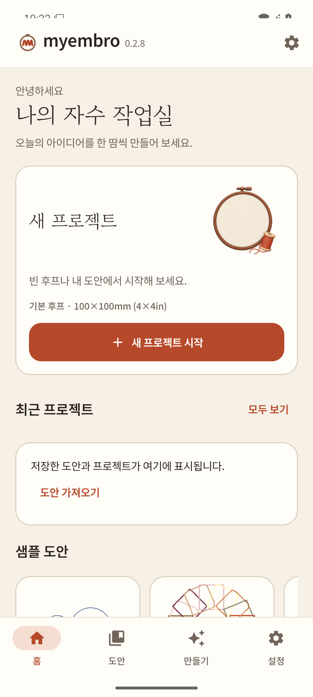

- **새 프로젝트** 카드: 기본 후프(100×100mm, 4×4in)를 보여 줍니다. **새 프로젝트 시작**을 누릅니다.
- **최근 프로젝트**: 저장한 도안과 프로젝트가 표시됩니다. **모두 보기**는 전체 목록, **도안 가져오기**는 휴대폰의 PES/PEC/DST 파일을 엽니다.
- **샘플 도안**: 바로 열어 볼 수 있는 내장 도안입니다.
- 아래 막대: **홈**, **도안**, **만들기**, **설정**. 오른쪽 위 톱니바퀴도 설정을 엽니다.

## 2. 새 프로젝트 시작

**새 프로젝트 시작**을 누르면 다섯 가지 시작 방법이 나옵니다.

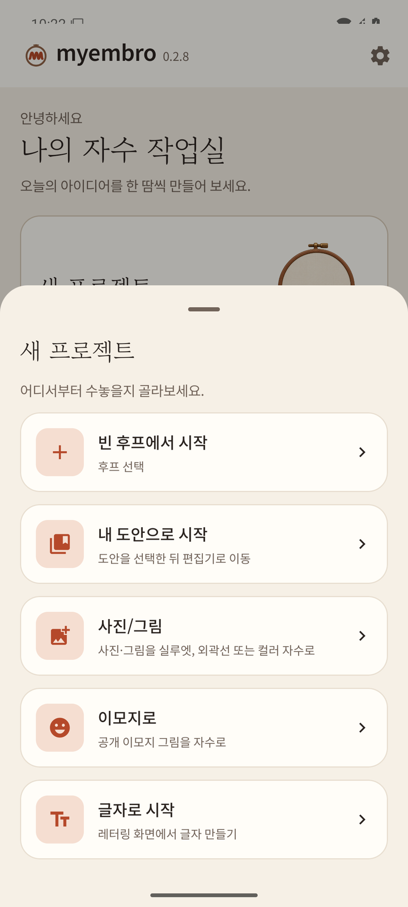

| 항목 | 누르면 |
|---|---|
| 빈 후프에서 시작 | 후프를 고르면 빈 편집기가 열립니다 |
| 내 도안으로 시작 | 저장한 도안을 고르면 그 도안으로 편집기가 열립니다 |
| 사진/그림 | 사진·그림을 실루엣, 외곽선 또는 컬러 자수로 만듭니다(5장) |
| 이모지로 | 공개 이모지 그림을 자수로 만듭니다(6장) |
| 글자로 시작 | 레터링 화면이 열립니다(4장) |

## 3. 편집기

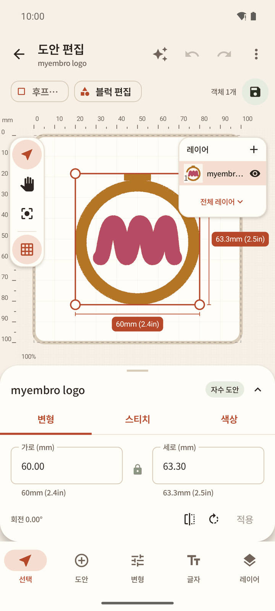

- 위쪽: 뒤로, 홈, **AI에게 맡기기**(반짝이, 12장), 실행 취소/다시 실행, 메뉴. 그 아래 후프 칩(예: **후프 100×100mm**), **블럭 편집**, 객체 수, **저장** 버튼.
- 왼쪽 도구: 선택, 이동(손), 화면 맞춤, 격자.
- **레이어** 패널: 도안과 글자는 각각 레이어입니다. 눈 아이콘으로 보이기/숨기기, **+**로 추가합니다.
- 객체를 눌러 선택하고 모서리 핸들을 끌어 크기를 바꿉니다. 크기 표시는 mm와 인치를 함께 보여 줍니다.
- 아래 시트 탭 **변형**, **스티치**, **색상**. 변형 탭에서 **가로 (mm)**/**세로 (mm)**를 입력하고(자물쇠는 비율 고정), 회전·뒤집기를 정한 뒤 **적용**을 누릅니다.
- 아래 막대: **선택**, **도안**(도안 추가), **변형**, **글자**, **레이어**.
- **색** 시트(팔레트 아이콘): **배경천 색**을 골라 내 천 위에서 어떻게 보일지 미리 보고, **자수실 색**을 다른 Brother 실로 바꿀 수 있습니다(내 실이 먼저 나옵니다). **적용**을 누르면 반영됩니다.

### 블럭 편집

사진, 이모지, SVG로 만든 도안은 색 영역을 블럭으로 가지고 있습니다. **블럭 편집**을 누르면 블럭마다 수놓는 방법을 바꿀 수 있습니다.

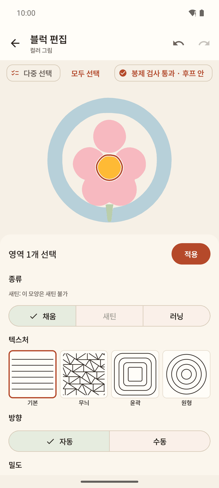

1. 캔버스에서 영역을 누릅니다. 여러 개를 고르려면 **다중 선택**을 켜거나 **모두 선택**을 누릅니다.
2. **종류**를 고릅니다: **채움**, **새틴**, **러닝**. 그 영역에 쓸 수 없는 종류는 흐리게 나오고, 위에 이유가 나옵니다(예: *새틴: 이 모양은 새틴 불가*).
3. 채움이면 **텍스처**를 고릅니다: **기본**, **무늬**(Ink/Stitch 미앤더 타일), **윤곽**, **원형**.
4. **방향**: **자동**, 또는 **수동**으로 바느질 각도를 정합니다.
5. **밀도**: 지금은 **보통**만 됩니다. 촘촘·성김은 다음 버전에서 씁니다.
6. **적용**을 누릅니다. 땀은 뒤에서 만들고 실제 봉제 검사를 거칩니다. 만드는 동안 걸린 시간과 **취소** 버튼이 나옵니다. 검사에 걸리면 아무것도 바뀌지 않고 이전 설정이 남습니다.

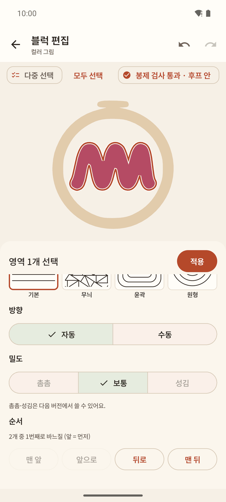

**순서**에는 고른 영역이 몇 번째로 수놓이는지 나옵니다(앞 = 먼저). **맨 앞**, **앞으로**, **뒤로**, **맨 뒤**로 옮깁니다. 바꿀 때마다 되돌리기 한 단계입니다. 위쪽 배지는 도안 전체의 **봉제 검사 통과 · 후프 안**을 보여 줍니다.

땀만 있는 도안(예: 연 PES 파일)은 블럭이 없어서 블럭 편집을 쓸 수 없습니다.

### 후프 크기

기본 후프는 100×100mm입니다. 도안은 후프 안에 있어야 합니다. 좌표는 0.1mm 단위로 0–999이므로 디자인 최대 크기는 99.9mm이고, 앱이 자동으로 지킵니다.

## 4. 레터링

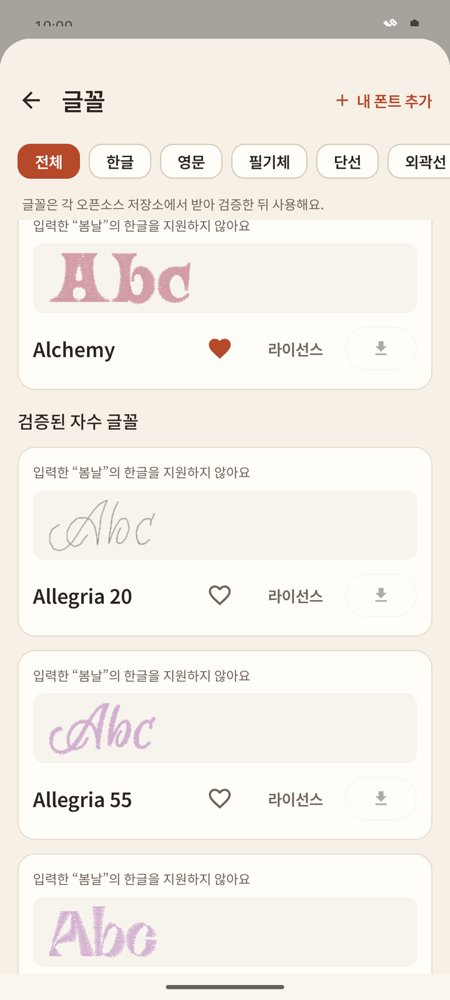

1. 편집기 아래 막대의 **글자**를 누릅니다(또는 **글자로 시작**). 레터링 화면 위쪽에 후프 미리보기가 나옵니다.
2. **문구**에 글자를 입력합니다(글자 수가 표시됩니다).
3. **자수 폰트**에서 글꼴을 고르거나 **글꼴 더 보기**로 글꼴 라이브러리를 엽니다. 필터: **전체**, **한글**, **영문**, **필기체**, **단선**, **외곽선**. **+ 내 폰트 추가**로 내 TTF 글꼴을 넣을 수 있습니다.
4. 글꼴은 각 오픈소스 저장소에서 받아 검증한 뒤 사용합니다. 글꼴 카드의 내려받기 버튼을 누르고, **라이선스**로 라이선스를 보고, 하트로 즐겨찾기합니다. 입력한 글자를 쓸 수 없는 글꼴은 카드에 이유가 표시됩니다(예: 입력한 한글을 지원하지 않아요).
5. **글자 크기**를 정하고 **+ 도안에 추가**를 누릅니다.

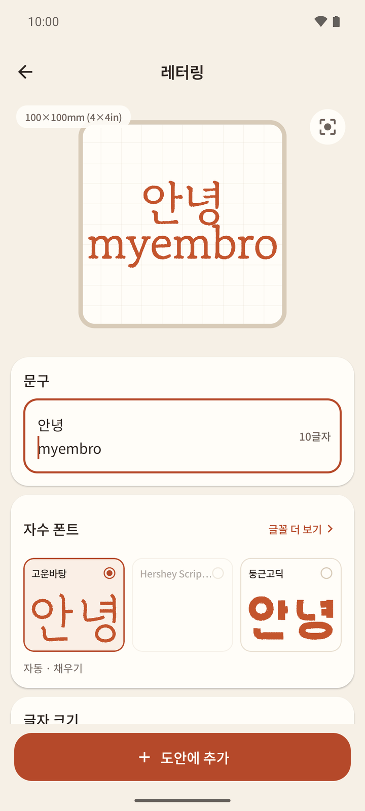
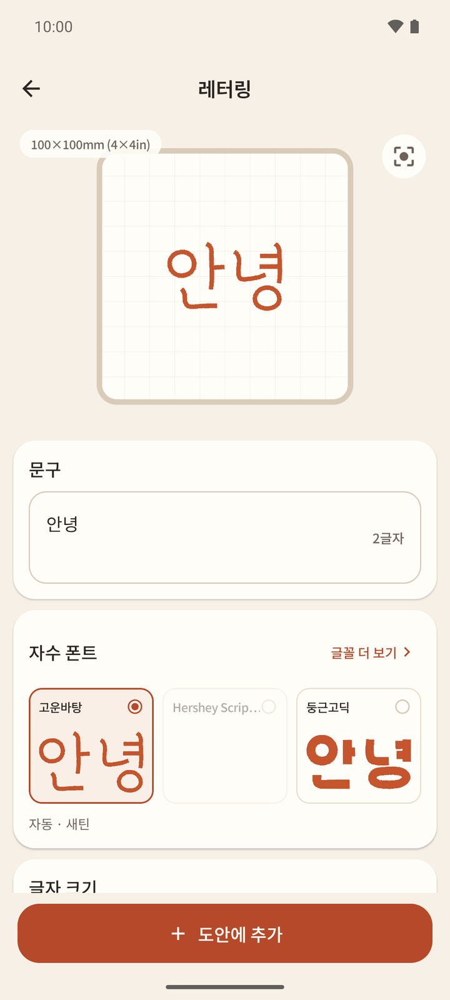

땀 종류는 앱이 정하고 글꼴 목록 아래에 **자동 · 채우기**, **자동 · 새틴**처럼 표시합니다. 스크린샷에서 한글과 영문이 섞인 '안녕 myembro'는 채우기, 한글만 있는 '안녕'은 새틴이 되었습니다. 안전하게 봉제되는 크기만 허용합니다. 검증된 Ink/Stitch 글꼴 72종은 새틴으로 수놓습니다.

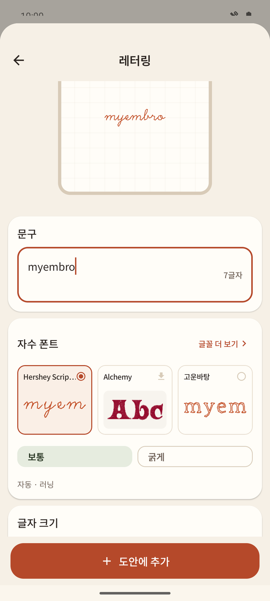
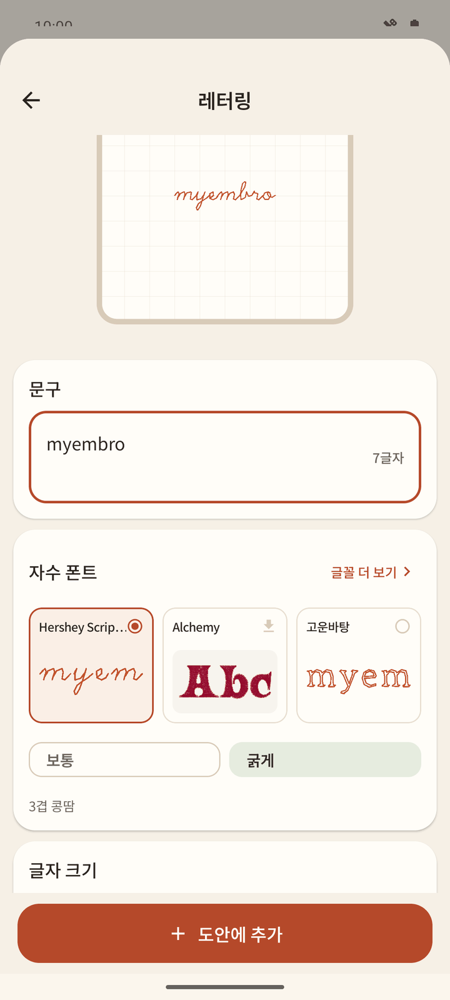

단선 글꼴(예: Hershey Script 1-stroke)은 **보통**(러닝, 1회)과 **굵게**(Ink/Stitch 3겹 콩땀)가 있습니다. 원본 글꼴이 같은 구간을 두 번 지나는 곳은 굵게에서 6회가 될 수 있습니다.

## 5. 사진→자수

새 프로젝트 시트에서 **사진/그림**을 고릅니다. 자르기, 모드 선택, 결과의 3단계입니다.

다른 앱(갤러리, 브라우저, 파일)에서 그림을 myembro로 공유해도 이 화면이 열립니다. SVG 그림은 그대로 쓰고 크기 슬라이더만 나옵니다.

**2단계 — 모드.** **실루엣**, **외곽선**, **컬러 그림** 중 하나를 고릅니다. 처음에는 컬러 그림 4색이 골라져 있습니다.

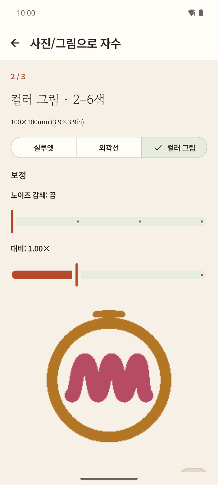

**보정**(모든 모드):
- **노이즈 감쇄**: 끔, 약, 중, 강. 작은 점을 없앱니다.
- **대비**: 0.5×–2.0×. 1.00×는 그림 그대로입니다.
- **흑백 분리**(실루엣·외곽선만): 그림을 어두운 곳과 밝은 곳으로 자동으로 나눕니다.
- 투명 배경이 있는 컬러 그림에는 노이즈 감쇄와 대비를 쓸 수 없습니다.

**컬러 그림**(2–6색):
- **색 수** 슬라이더로 색 수를 정하거나 **흑백**을 켭니다.
- 미리보기는 실제 실 색으로 보여 줍니다.
- 투명 배경은 봉제하지 않고, 테두리에서 가장 많은 색은 배경으로 뺍니다.
- Brother 실에 자동으로 맞춥니다. **내 실**(10장)을 정해 두면 내 실만 씁니다.
- 색 영역마다 채웁니다. 맞닿은 색은 0.2mm 겹쳐서 틈이 보이지 않습니다. 도안 바깥 테두리는 커지지 않습니다.
- 채운 영역마다 같은 색 1겹 러닝 외곽선을 두릅니다. 외곽선이 봉제 점검에 걸리면 그 외곽선은 뺍니다.

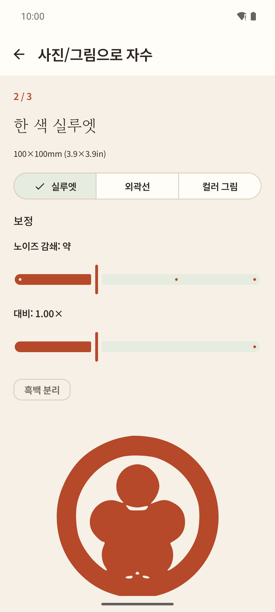

- **실루엣**: 한 색으로 채운 뒤 영역과 구멍마다 같은 색 1겹 러닝 외곽선을 두릅니다. 봉제 점검에 걸리는 외곽선은 뺍니다. **디테일** 슬라이더가 높을수록 작은 윤곽까지 남습니다.

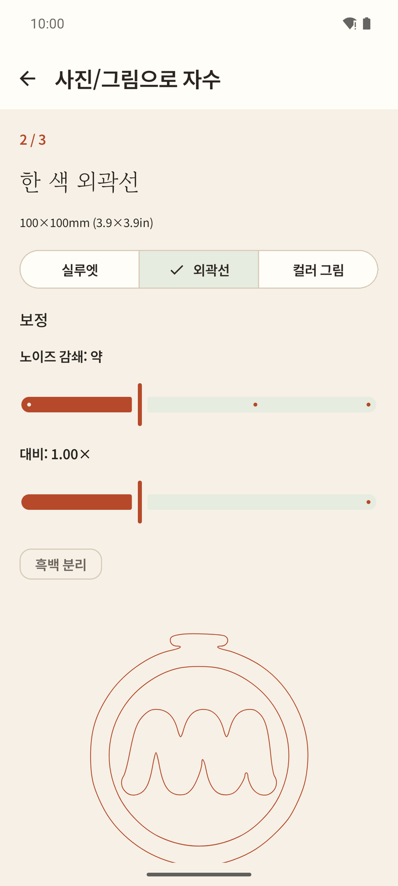

- **외곽선**: 같은 그림을 한 색 윤곽선으로 만듭니다.

**자수 크기 · 가로** 슬라이더(모든 모드): 비율은 그대로입니다. 범위는 그림에 맞게 계산되며, 손을 떼면 다시 계산합니다. 가장 큰 크기는 99.9mm입니다.

**텍스처 표현(실험).** 컬러 그림에서 **텍스처 표현**을 켜면 그림을 스케치처럼 실 선을 겹쳐 수놓습니다.

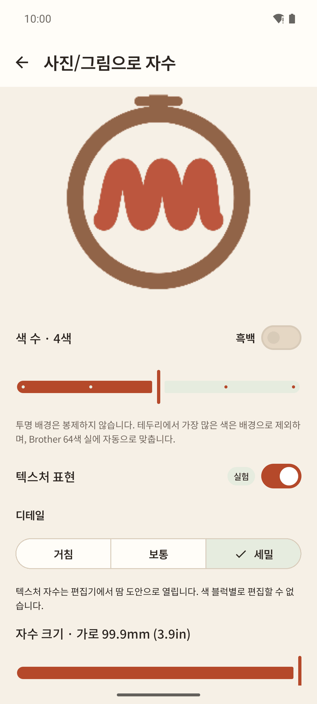

- **디테일**: **거침**, **보통**, **세밀**. 세밀할수록 땀이 많습니다.
- 텍스처 자수는 편집기에서 땀 도안으로 열립니다. 색 블럭별로 편집할 수 없습니다.
- 땀이 너무 많으면 앱이 알려 줍니다. 크기를 줄이거나 거침을 고르세요.

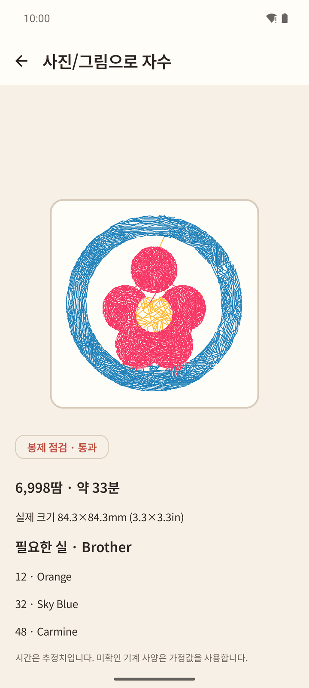

**3단계 — 결과.**

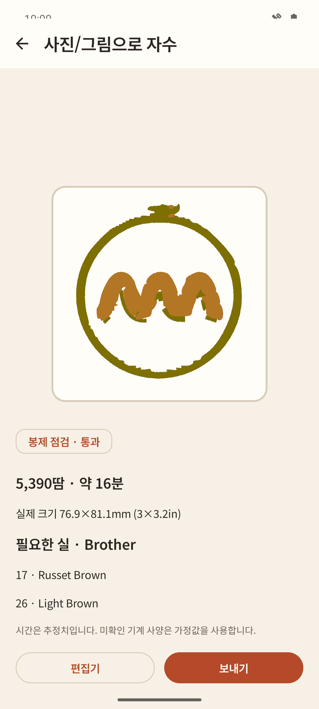

결과에는 **봉제 점검 · 통과**, 땀 수와 예상 시간, 실제 크기, **필요한 실 · Brother**(번호와 이름)가 나옵니다. 가지고 있지 않은 실에는 **내 실에 없음**이 붙습니다. 시간은 추정치입니다. 땀 만들기는 1분이 지나면 멈춥니다. 그때는 디테일을 낮추거나 더 작게 잘라 보세요. **편집기**를 누르면 계속 편집하고(블럭 편집 포함, 3장), **보내기**를 누르면 자수기로 보냅니다.

## 6. 이모지

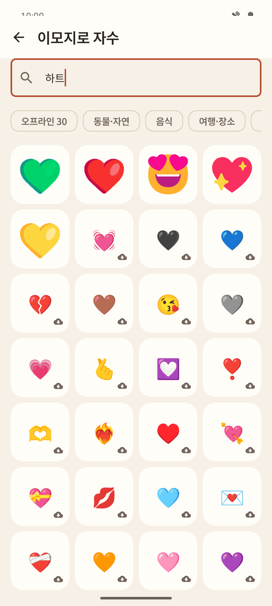

**이모지로**를 고르고 검색합니다. 한국어 검색어가 됩니다(유니코드 CLDR 기반). 스크린샷은 '하트' 검색 결과입니다. 일부 이모지는 먼저 내려받아야 한다고 표시됩니다. 크기는 사진 화면과 같은 자수 크기 슬라이더로 정합니다.

## 7. 뷰어: 재생과 통계

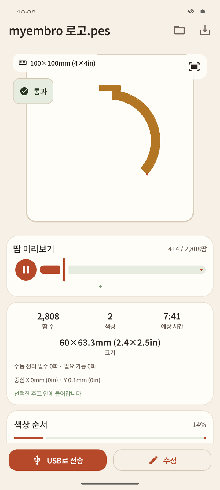

도안을 열면 실 색, 확대·이동, 후프 윤곽과 함께 볼 수 있습니다. 바느질 재생은 진행(예: 414/2,808땀)을 보여 주고, 통계에는 땀 수·색·예상 시간·크기가 나옵니다. PES (v1–v10), PEC, DST를 열 수 있습니다.

## 8. 봉제 점검

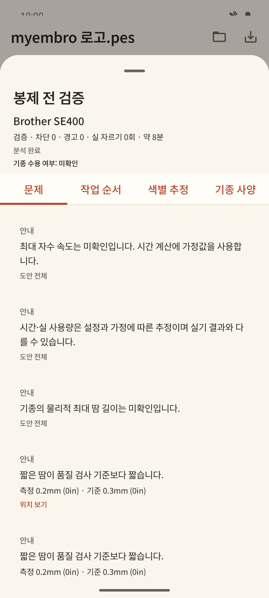

**봉제 전 검증** 시트는 선택한 기종(여기서는 Brother SE400), 차단·경고·실 자르기 횟수, 예상 시간을 보여 줍니다. 탭: **문제**, **작업 순서**, **색별 추정**, **기종 사양**. 안내 항목은 미확인 사항(예: 시간 계산에 쓰는 최대 자수 속도)을 알려 주고, **위치 보기**로 해당 땀으로 이동합니다.

앱이 만든 모든 도안은 저장·전송 전에 실제 봉제 실패를 일으키는 조건을 검사합니다.

- 0.5mm 칸 하나에 바늘이 너무 많음
- 같은 점에 연속으로 바늘이 들어감
- 시작·끝 잠금 땀 누락
- 12.0mm보다 긴 땀
- 파일 오류, 또는 후프 밖 땀(0.1mm 단위 0–999)

하나라도 걸리면 저장·전송을 막습니다. 가져온 PES 파일은 바이트 그대로 유지합니다.

## 9. 자수기로 보내기

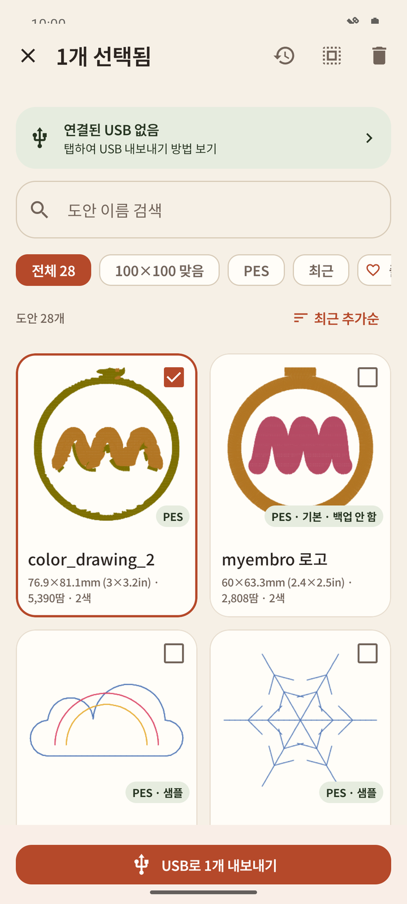

1. 휴대폰과 자수기를 연결합니다. Brother SE400은 USB 케이블로 연결합니다(기계 쪽은 USB-B). 다른 기종은 휴대폰에 USB 메모리를 연결(OTG)해 내보낸 뒤, 그 메모리를 자수기에 꽂습니다.
2. **도안**에서 선택 모드로 들어가 보낼 도안을 체크합니다. 필터: **전체**, **100×100 맞음**, **PES**, **최근**, 즐겨찾기.
3. **USB로 내보내기**를 누릅니다. 연결된 USB가 없으면 **연결된 USB 없음** 안내가 나오고, 누르면 USB 내보내기 방법을 볼 수 있습니다.

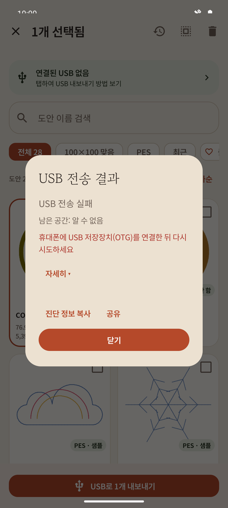

전송에 실패하면 결과 화면에 연결 방법(OTG) 안내와 **진단 정보 복사**가 나옵니다.

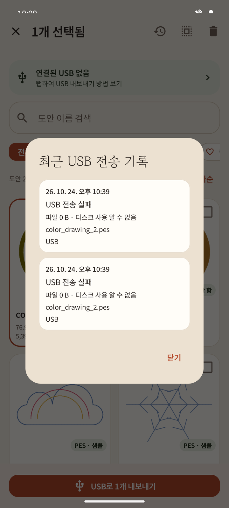

선택 모드의 시계 아이콘을 누르면 최근 USB 전송 기록이 나옵니다(스크린샷은 에뮬레이터라 실패 기록만 있습니다).

**주의:** USB로 보낸 파일은 미싱 내부 메모리에 저장하지 않으면, 전원을 끌 때 지워집니다.

**다른 자수기:** 기종 목록에는 미국·한국에서 판매되는 Brother 자수기 58개가 있습니다(10장). 실제 기계에서 확인한 기종은 SE400뿐이고, 나머지는 Brother 설명서와 제품 페이지를 따릅니다.

## 10. 백업, 복원, 내 실

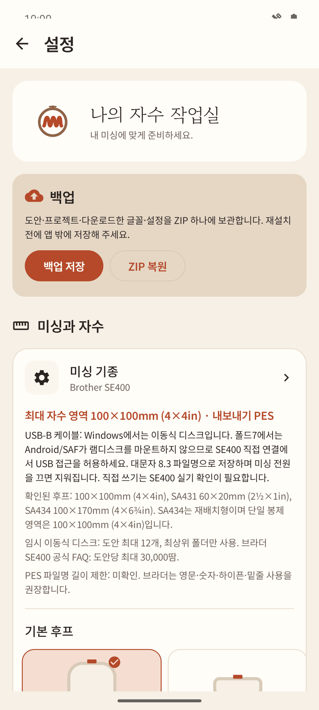

**설정** 맨 위 **백업**은 도안·프로젝트·다운로드한 글꼴·설정을 ZIP 하나에 보관합니다. **백업 저장**을 누르고 ZIP을 앱 밖에 보관하세요. **ZIP 복원**으로 다시 읽어 옵니다. 그 아래에 **AI 연결(실험)**(13장)과 **미싱 기종**이 있습니다. 미싱 기종에는 선택한 기종(Brother SE400)과 최대 자수 영역(100×100mm), 안내가 나옵니다. 목록에는 Brother 자수기 58개가 지역별로 있습니다. 미국 판매 30개(SE, PE, NS, NQ, XE, XJ, XP, EV, PR)와 한국 판매 28개(M, LB, 이노비스, F, PR)입니다. 기종마다 최대 자수 영역이 나오고, 100×100mm보다 큰 기종에는 **실제 기계 미확인**이 표시됩니다. 출처가 있는 전체 목록은 [machines.md](../machines.md)에 있습니다.

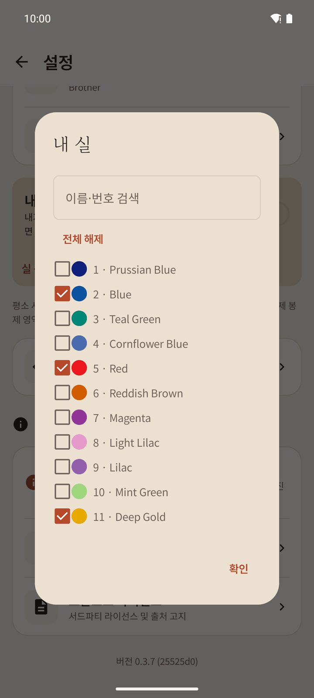

**내 실**(**실과 색상** 아래): 켜고 **실 선택**을 눌러 가지고 있는 Brother 실을 체크합니다. 이름이나 번호로 찾을 수 있습니다. 그러면 컬러 그림은 내 실만 씁니다. 목록이 비어 있으면 모든 색을 씁니다. 내 실 목록도 백업에 들어갑니다.

**알파에서 베타로 옮길 때:** 베타는 정식 키로 서명되어 알파 위에 덮어 설치할 수 없습니다. 알파에서 백업을 저장하고, 앱을 삭제한 뒤 베타를 설치하고 ZIP을 복원하세요. 베타부터는 업데이트가 그대로 설치됩니다.

## 11. 앱 정보와 알려진 한계

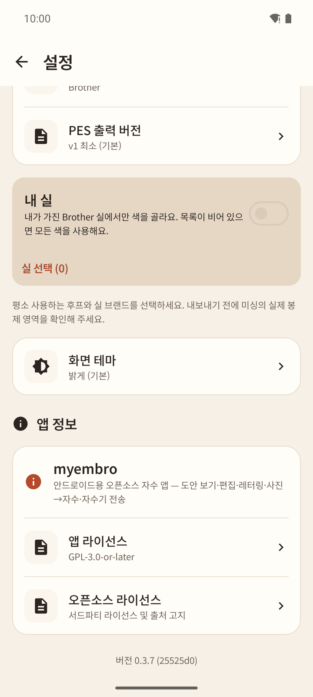

**설정** 아래쪽: **화면 테마**, **앱 정보**(앱 라이선스 GPL-3.0-or-later, 오픈소스 라이선스), 버전(0.3.7과 빌드 커밋). myembro는 GPL-3.0-or-later입니다.

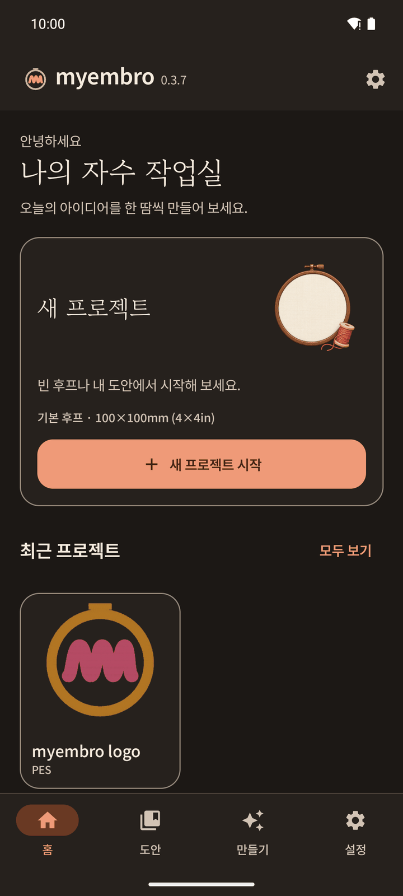

알려진 한계:
- 알파에서 베타로 옮길 때 한 번 삭제·재설치 필요. 먼저 백업.
- 실제 기계에서 확인한 기종은 SE400뿐입니다. 다른 기종은 Brother 공개 사양을 따릅니다.

## 12. AI에게 맡기기

AI에게 맡기기를 쓰면 휴대폰에 있는 어떤 챗봇 앱으로든(Gemini, ChatGPT, Claude 등) 도안을 고칠 수 있습니다. myembro 안에는 AI가 없고 계정이나 API 키도 저장하지 않습니다. 이미 쓰고 있는 챗봇을 그대로 씁니다.

<!-- shot: 요청 시트(한국어) — 영어판 18-ask-sheet.png 참고 -->

1. 편집기 위쪽 막대의 **AI에게 맡기기** 버튼(반짝이 아이콘)을 누릅니다.
2. 바꿀 내용을 적습니다. 예를 들면 *로고 아래에 빨간색으로 "Mina"*처럼 씁니다. 음성 입력이 있는 휴대폰이면 마이크를 눌러 말해도 됩니다.
3. **챗봇에 공유**를 눌러 챗봇 앱을 고릅니다. 또는 **복사**를 누른 뒤 직접 붙여넣습니다. 그러면 **챗봇의 답을 기다리는 중 (p-…)** 막대가 나타납니다. 이 코드가 답을 이번 요청과 연결합니다.
4. 챗봇이 답하면 답 전체를 복사합니다. 그 답을 myembro로 공유하거나, 막대의 **답 붙여넣기**를 누른 뒤 **확인**을 누릅니다.
5. **바뀌는 내용 확인** 화면에 **전**·**후** 그림, 바뀌는 항목, **봉제 점검** 결과가 나옵니다. 이 단계에서는 아직 아무것도 바뀌지 않았습니다. **적용**, **취소**, 또는 챗봇에게 다시 부탁하는 **다시 요청** 중 하나를 고릅니다.

   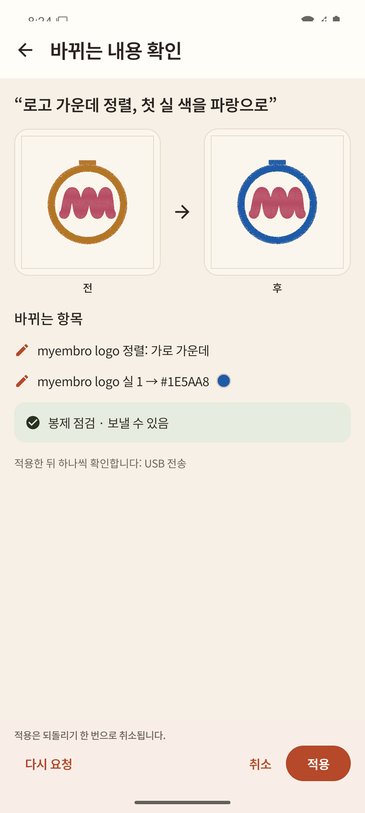

6. **적용**하면 전체 변경이 되돌리기 한 단계가 됩니다. **되돌리기**를 한 번 누르면 원래 도안으로 돌아갑니다.

   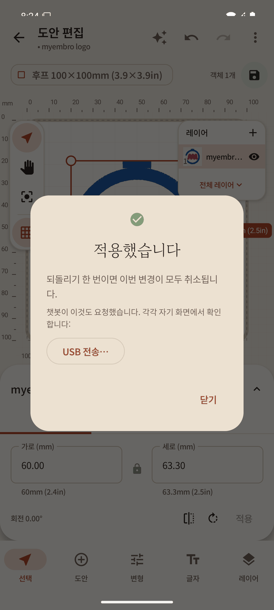
   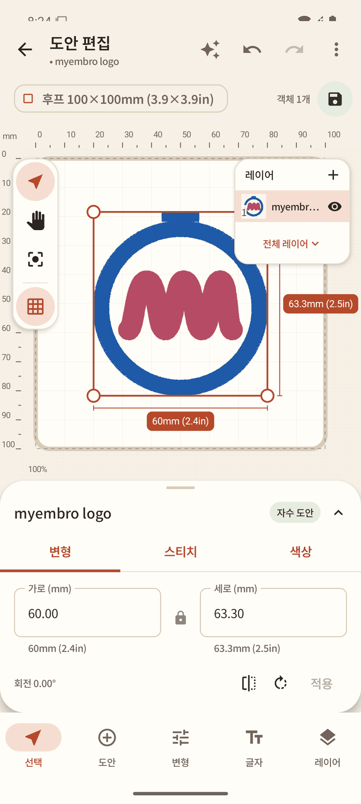
   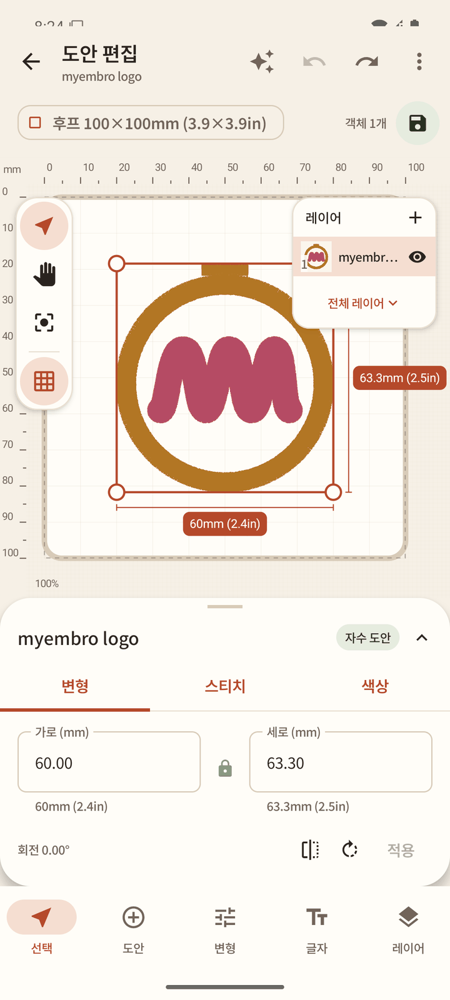

**챗봇이 받는 내용** (보내기 전에 **챗봇에게 보낼 내용**을 눌러 확인할 수 있습니다):
- 앱 안내문과, myembro가 받는 명령 목록
- 후프 이름과 크기
- 객체마다: 짧은 이름표(o1, o2, …), 글자/도안 구분, 이름, 글자 내용과 높이, 글꼴(f1, f2, … 이름표), 중심 위치, 크기, 회전, 배율, 실 색, 봉제 순서, 숨김 여부
- 글자를 쓸 수 있는 휴대폰 글꼴(이름표·이름·한글/영문·높이 범위)과 내장 도안(이름표·이름·크기)
- 내가 적은 요청

myembro는 **땀·그림·파일을 보내지 않고**, 챗봇이 휴대폰에 접근할 수도 없습니다. 챗봇의 답은 myembro가 읽고 검사하는 글일 뿐입니다.

**항상 앱에서 직접 확인하는 동작:** 객체 삭제, 저장, 공유, USB 전송. 답에 이런 동작이 들어 있으면, 적용한 뒤 앱이 하나씩 보여 주고 확인을 받습니다(예: **USB 전송…**).

**답을 쓸 수 없을 때**는 앱이 이유를 알려 주고 아무것도 바꾸지 않습니다. 답에 myembro 명령이 없거나, 명령이 깨졌거나, 이전 요청에 대한 답이거나, 그사이 도안이 바뀐 경우입니다. **고쳐 달라는 요청 복사**를 누르면 챗봇에게 보낼 짧은 고침 요청이 만들어집니다.

**AI에게 맡기기로 할 수 없는 것:**
- 그림을 보거나 만들 수 없습니다. 사진은 **사진/그림**으로 하세요.
- 글꼴을 내려받을 수 없습니다.
- 휴대폰에 이미 있는 글꼴로만 글자를 추가할 수 있습니다(프롬프트에 높이 범위와 함께 나열됩니다).
- 크기와 땀 종류는 여전히 앱의 자동 규칙과 봉제 점검을 따릅니다.

## 13. AI 연결(실험)

AI 연결을 쓰면 복사·붙여넣기 없이 챗봇이 도안을 바로 고칩니다. 내 중계 서버(Cloudflare Worker, [relay/README.md](../../relay/README.md) 참고)와 MCP 커넥터를 쓰는 챗봇(예: Claude)이 필요합니다. 이때도 myembro 안에는 AI가 없고 API 키를 저장하지 않습니다.

1. **설정**에서 **AI 연결(실험)**을 켭니다.
2. 중계 서버의 **중계 주소**(wss://…)와 **APP_KEY**를 넣습니다. 키는 이 휴대폰에만 있고 백업에 들어가지 않습니다.
3. 챗봇에 중계 서버를 커넥터로 추가합니다. 연결이 켜져 있는 동안 알림이 보입니다.

챗봇이 할 수 있는 것:
- 편집기에 열린 도안을 읽고 고칩니다. 고칠 때마다 되돌리기 한 단계입니다. 봉제 점검에 걸리는 변경은 하지 않습니다.
- 챗봇이 그린 그림(SVG, PNG, JPEG)을 넣습니다. 먼저 사진 창에서 열리므로 확인한 뒤에 도안에 들어갑니다.
- 내가 고른 사진을 봅니다. 편집기 메뉴에서 **AI에게 사진 보내기**를 누르고 확인합니다. 챗봇은 축소본만 봅니다.

내가 직접 하는 것: 객체를 지울 때는 휴대폰에서 먼저 묻습니다(90초 안에 답). 저장, 공유, USB 전송은 항상 앱에서 내가 합니다.
