# myembro 사용 설명서

[English](user-guide.md) | **한국어**

앱을 쓰는 순서대로 홈부터 설명합니다. 각 장은 **화면 구성**(번호 사진과 표), **사용법**, **알아 두기** 순서입니다. 사진의 번호와 표의 번호는 같습니다.

1. [설치와 홈](#1-설치와-홈)
2. [새 프로젝트 시작](#2-새-프로젝트-시작)
3. [편집기](#3-편집기)
4. [블럭 편집](#4-블럭-편집)
5. [레터링](#5-레터링)
6. [사진→자수](#6-사진자수)
7. [이모지](#7-이모지)
8. [도안 목록과 뷰어](#8-도안-목록과-뷰어)
9. [봉제 점검](#9-봉제-점검)
10. [자수기로 보내기](#10-자수기로-보내기)
11. [무료 도안 찾기](#11-무료-도안-찾기)
12. [설정](#12-설정)
13. [AI에게 맡기기](#13-ai에게-맡기기)
14. [AI 연결(실험)](#14-ai-연결실험)
15. [알려진 한계](#15-알려진-한계)
- [부록. 땀은 이렇게 만듭니다](#부록-땀은-이렇게-만듭니다)

## 1. 설치와 홈

### 설치

1. 안드로이드 폰에서 [앱 다운로드](https://github.com/linker2k/myembro/releases/latest/download/myembro.apk)를 누릅니다.
2. 받은 `myembro.apk`를 엽니다.
3. 폰이 물으면 이 출처의 설치를 허용합니다.

앱을 열면 홈이 나옵니다.

### 화면 구성

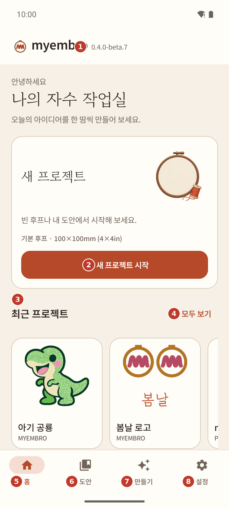

| 번호 | 이름 | 하는 일 |
|---|---|---|
| 1 | 버전 정보 | 앱 버전입니다. 누르면 버전 정보가 열립니다. |
| 2 | 새 프로젝트 시작 | 시작 방법을 고르는 시트를 엽니다(2장). 위 카드에 기본 후프 크기가 나옵니다. |
| 3 | 최근 프로젝트 | 최근에 저장한 프로젝트와 도안입니다. 누르면 뷰어로 엽니다. |
| 4 | 모두 보기 | 도안 목록 전체를 엽니다(8장). |
| 5 | 홈 | 이 화면입니다. |
| 6 | 도안 | 도안 목록입니다(8장). |
| 7 | 만들기 | 새 프로젝트 시트를 엽니다. |
| 8 | 설정 | 설정입니다(12장). |

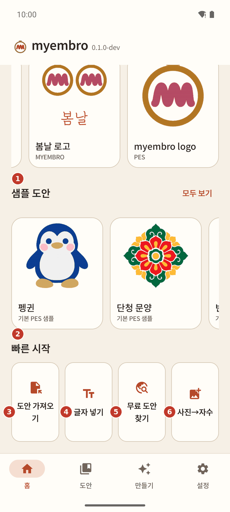

| 번호 | 이름 | 하는 일 |
|---|---|---|
| 1 | 샘플 도안 | 내장 도안 136개 중 일부입니다. 누르면 내 프로젝트로 복사되어 편집기가 열립니다. |
| 2 | 빠른 시작 | 자주 쓰는 일 네 가지입니다. |
| 3 | 도안 가져오기 | 휴대폰의 PES·PEC·DST 파일을 도안 목록에 넣습니다. |
| 4 | 글자 넣기 | 레터링 화면을 엽니다(5장). |
| 5 | 무료 도안 찾기 | 무료 도안 사이트 목록을 엽니다(11장). |
| 6 | 사진→자수 | 사진·그림을 자수로 만듭니다(6장). |

### 사용법

1. 처음이면 **새 프로젝트 시작**을 누릅니다.
2. 이어서 하려면 **최근 프로젝트**에서 도안을 누릅니다.

## 2. 새 프로젝트 시작

### 화면 구성

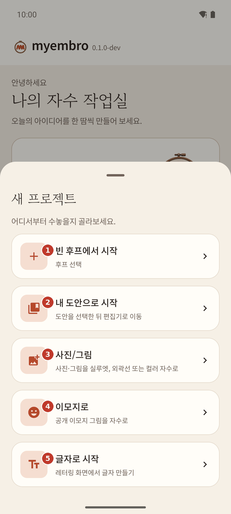

| 번호 | 이름 | 하는 일 |
|---|---|---|
| 1 | 빈 후프에서 시작 | 후프를 고르면 빈 편집기가 열립니다. |
| 2 | 내 도안으로 시작 | 도안을 고르면 그 도안으로 편집기가 열립니다. |
| 3 | 사진/그림 | 사진·그림을 실루엣, 외곽선, 컬러 자수로 만듭니다(6장). |
| 4 | 이모지로 | 이모지 그림을 자수로 만듭니다(7장). |
| 5 | 글자로 시작 | 레터링 화면을 엽니다(5장). |

### 사용법

1. 홈에서 **새 프로젝트 시작**을 누릅니다.
2. 시작 방법을 누릅니다.
3. **내 도안으로 시작**이면 도안 선택 화면이 열립니다. 이름으로 찾거나 **내 도안**·**샘플** 탭에서 고릅니다.

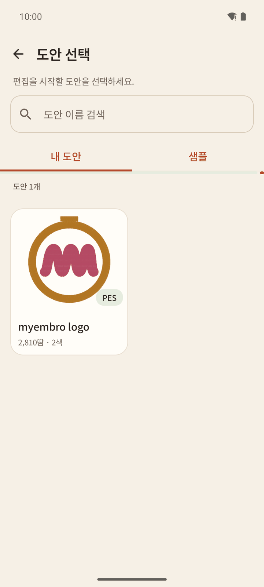

## 3. 편집기

도안과 글자를 후프 위에 놓고 고치는 화면입니다. 위에서 아래로 상단 막대, 둘째 줄, 캔버스, 아래 패널, 아래 탭이 있습니다.

### 3.1 화면 구성

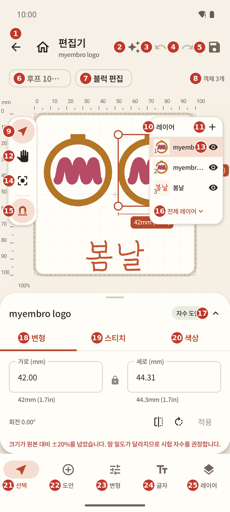

| 번호 | 이름 | 하는 일 |
|---|---|---|
| 1 | 뒤로 | 도안 목록으로 갑니다. 뷰어에서 열었으면 옆에 홈 아이콘도 있습니다. |
| 2 | AI에게 맡기기 | 챗봇에게 고칠 내용을 부탁합니다(13장). |
| 3 | 실행취소 | 마지막 변경을 되돌립니다. 할 일이 없으면 흐립니다. |
| 4 | 다시실행 | 되돌린 변경을 다시 합니다. |
| 5 | 저장 | 저장 시트를 엽니다(3.8). |
| 6 | 후프 칩 | 지금 후프입니다. 누르면 후프 메뉴가 열립니다(3.8). |
| 7 | 블럭 편집 | 색 영역마다 수놓는 방법을 바꿉니다(4장). |
| 8 | 객체 수 | 후프 위 객체 개수입니다. |
| 9 | 선택 도구 | 객체를 눌러 고르고 끌어 옮깁니다. |
| 10 | 레이어 패널 | 객체 목록입니다(3.3). |
| 11 | 도안 추가(+) | 도안 추가 시트를 엽니다(3.3). |
| 12 | 화면 이동 | 캔버스를 끌어 화면만 옮깁니다. |
| 13 | 레이어 숨기기(눈) | 그 객체를 숨기거나 보입니다. |
| 14 | 후프를 화면에 맞추기 | 후프 전체가 보이게 맞춥니다. |
| 15 | 자석 스냅 | 켜면 옮기는 객체가 후프 가운데나 다른 객체 가장자리·가운데에 붙습니다. |
| 16 | 전체 레이어 | 레이어 시트를 엽니다(3.3). |
| 17 | 속성 펼치기/접기 | 아래 패널을 펼치거나 접습니다. 패널 머리에 객체 이름과 종류(자수 도안·레터링)가 나옵니다. |
| 18 | 변형 탭 | 크기·위치·회전(3.4). |
| 19 | 스티치 탭 | 땀 정보와 미리보기(3.6). |
| 20 | 색상 탭 | 배경천과 실 색(3.7). |
| 21 | 아래 탭: 선택 | 여러 객체 선택 모드를 켜고 끕니다(3.5). |
| 22 | 아래 탭: 도안 | 도안 추가 시트를 엽니다(3.3). |
| 23 | 아래 탭: 변형 | 아래 패널을 펼쳐 변형 탭을 엽니다. |
| 24 | 아래 탭: 글자 | 레터링 화면을 엽니다(5장). 글자 객체를 고른 채 누르면 **글자 편집**이 됩니다. |
| 25 | 아래 탭: 레이어 | 레이어 시트를 엽니다(3.3). |

### 3.2 캔버스와 떠 있는 도구

**사용법**

1. 객체를 눌러 고릅니다. 선택 상자와 모서리 핸들이 나옵니다.
2. 객체를 끌어 옮깁니다.
3. 모서리 핸들을 끌어 크기를 바꿉니다. 크기는 mm와 인치로 함께 보입니다.
4. 두 손가락으로 크기와 회전을 바꿉니다. 빈 천에서는 화면을 확대하거나 옮깁니다.
5. 왼쪽 떠 있는 도구에서 **선택**, **화면 이동**, **후프를 화면에 맞추기**, **자석 스냅**을 고릅니다.

**알아 두기**

- 위와 왼쪽에는 mm 눈금자가 있고, 왼쪽 아래에 확대 비율이 나옵니다.
- 객체가 후프를 벗어나면 **봉제 가능 영역을 벗어났습니다**가 나옵니다.

### 3.3 레이어와 도안 추가

객체 하나가 레이어 하나입니다. 번호가 바느질 순서입니다.

**사용법**

1. 레이어 패널에서 줄을 누르면 그 객체가 골라집니다. 줄에는 번호, 작은 그림, 이름이 있습니다.
2. 눈 아이콘으로 숨기거나 보입니다.
3. **전체 레이어**를 누르면 레이어 시트가 열립니다.
4. 시트에서 손잡이를 길게 누른 채 끌어 바느질 순서를 바꿉니다. 위에서 아래로 바느질합니다.

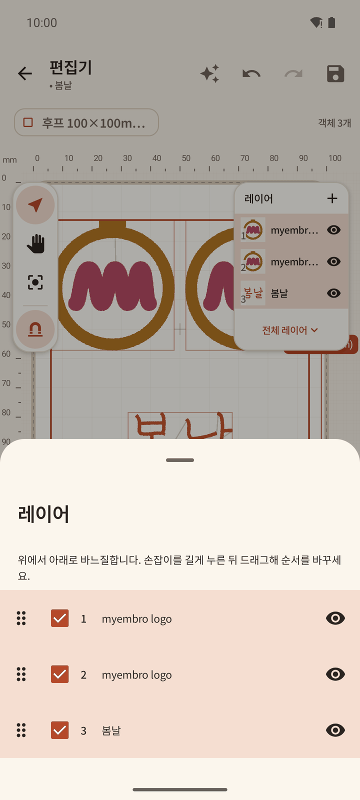

5. **+** 또는 아래 탭 **도안**을 누르면 도안 추가 시트가 열립니다.
6. **도안 가져오기**로 휴대폰 파일을 넣거나, 아래 목록에서 내 도안을 바로 누릅니다.

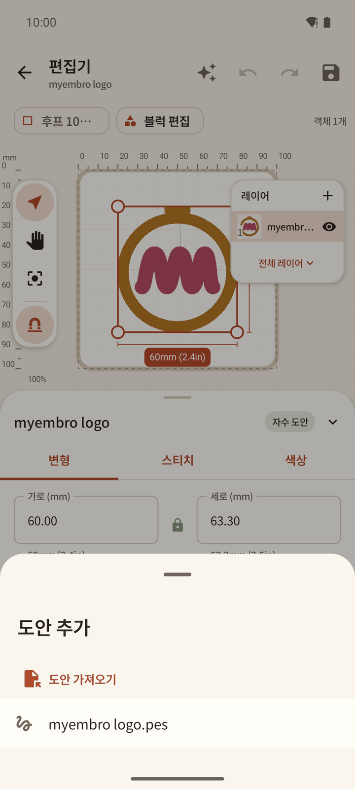

### 3.4 변형 탭과 객체 속성

#### 화면 구성

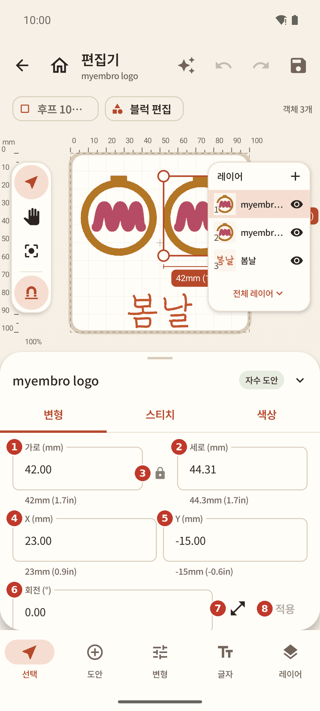

| 번호 | 이름 | 하는 일 |
|---|---|---|
| 1 | 가로 | 가로 크기(mm)입니다. 아래에 인치가 함께 나옵니다. |
| 2 | 세로 | 세로 크기(mm)입니다. |
| 3 | 비율 고정 | 자물쇠를 잠그면 가로·세로 비율이 그대로입니다. |
| 4 | X 위치 | 후프 중앙에서 가로로 떨어진 거리(mm)입니다. |
| 5 | Y 위치 | 후프 중앙에서 세로로 떨어진 거리(mm)입니다. 양수는 아래쪽입니다. |
| 6 | 회전 | 각도(°)입니다. |
| 7 | 객체 속성 | 객체 속성 창을 엽니다. |
| 8 | 적용 | 입력한 값을 반영합니다. |

#### 사용법

1. 객체를 고르고 **변형** 탭을 엽니다.
2. 값을 입력하고 **적용**을 누릅니다.
3. 아래로 내리면 **복제**, **좌우 반전**, **90° 회전**, **중앙 정렬**(후프 가운데로), **삭제**가 있습니다. 삭제도 되돌릴 수 있습니다.
4. 패널을 접으면 가로·세로·회전과 **좌우 반전**, **90° 회전**, **적용**만 보입니다.
5. **객체 속성**을 누르면 X·Y·회전·**가로 크기(%)**·**세로 크기(%)**를 한 번에 정합니다. 크기는 5~2000%입니다.

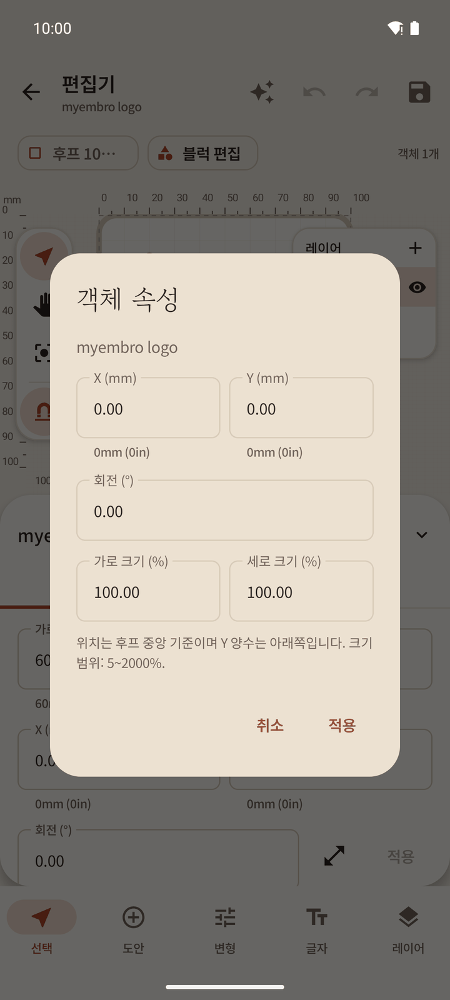

#### 알아 두기

- 크기를 원본보다 20% 넘게 바꾸면 **땀 밀도가 달라지므로 시험 자수를 권장합니다**가 나옵니다.
- 상하 반전은 없습니다. 좌우 반전과 90° 회전을 함께 쓰세요.

### 3.5 여러 객체 선택과 정렬

#### 화면 구성

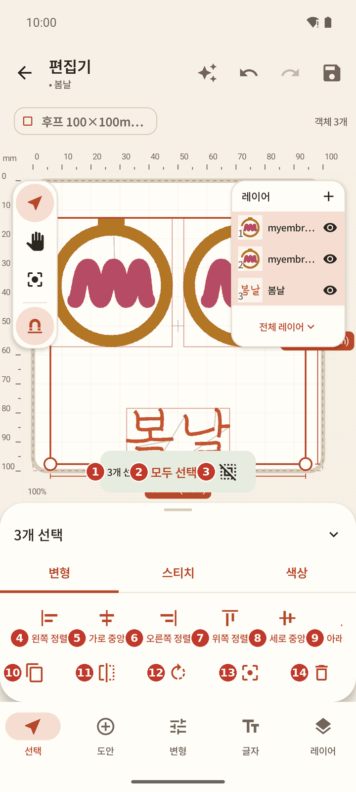

| 번호 | 이름 | 하는 일 |
|---|---|---|
| 1 | 선택한 개수 | 고른 객체 수입니다. |
| 2 | 모두 선택 | 모든 객체를 고릅니다. |
| 3 | 선택 해제 | 고른 것을 모두 풉니다. |
| 4 | 왼쪽 정렬 | 왼쪽 끝을 맞춥니다. |
| 5 | 가로 중앙 | 가로 가운데를 맞춥니다. |
| 6 | 오른쪽 정렬 | 오른쪽 끝을 맞춥니다. |
| 7 | 위쪽 정렬 | 위쪽 끝을 맞춥니다. |
| 8 | 세로 중앙 | 세로 가운데를 맞춥니다. |
| 9 | 아래쪽 정렬 | 아래쪽 끝을 맞춥니다. |
| 10 | 복제 | 고른 객체를 복사합니다. |
| 11 | 좌우 반전 | 좌우로 뒤집습니다. |
| 12 | 90° 회전 | 90° 돌립니다. |
| 13 | 후프 중앙으로 | 묶음을 후프 가운데로 옮깁니다. |
| 14 | 삭제 | 고른 객체를 지웁니다. |

#### 사용법

1. 아래 탭 **선택**을 누릅니다. 캔버스 아래에 선택 막대가 나옵니다.
2. 객체를 하나씩 누르거나 **모두 선택**을 누릅니다.
3. **변형** 탭에서 정렬 버튼을 누릅니다. 셋 이상 고르면 **가로 분배**·**세로 분배**도 쓸 수 있습니다.
4. 끝나면 **선택 해제**를 누르고 아래 탭 **선택**을 다시 눌러 모드를 끕니다.

### 3.6 스티치 탭

#### 화면 구성

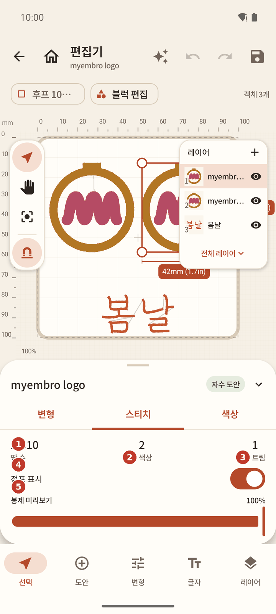

| 번호 | 이름 | 하는 일 |
|---|---|---|
| 1 | 땀 수 | 고른 객체의 바늘 수입니다. |
| 2 | 색 수 | 쓰는 실 색 수입니다. |
| 3 | 트림 수 | 실 자르기 횟수입니다. |
| 4 | 점프 표시 | 켜면 캔버스에 건너가는 실이 선으로 보입니다. |
| 5 | 봉제 미리보기 | 끌면 바느질 순서대로 어디까지 수놓는지 보여 줍니다. |

#### 사용법

1. 객체를 고르고 **스티치** 탭을 엽니다.
2. **점프 표시**를 켜서 건너가는 실이 많은지 봅니다.
3. **봉제 미리보기**를 끌어 순서를 확인합니다.

### 3.7 색상 탭, 색 시트, 실 고르기

#### 화면 구성

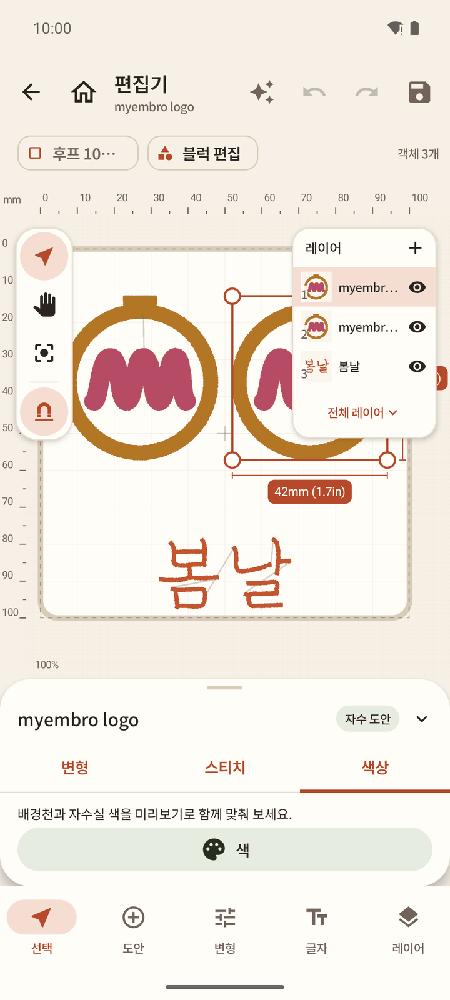

색상 탭에는 안내와 **색** 버튼만 있습니다. **색**을 누르면 색 시트가 열립니다.

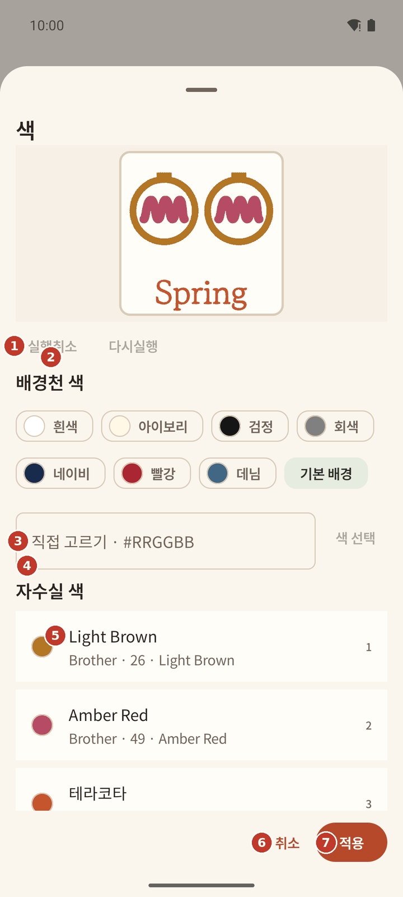

| 번호 | 이름 | 하는 일 |
|---|---|---|
| 1 | 실행취소 | 시트 안에서 바꾼 색을 되돌립니다. 옆에 다시실행이 있습니다. |
| 2 | 배경천 색 | 흰색·아이보리·검정·회색·네이비·빨강·데님·기본 배경 중에서 천 색을 고릅니다. |
| 3 | 직접 고르기 | #RRGGBB로 천 색을 넣거나 **색 선택**으로 고릅니다. |
| 4 | 자수실 색 | 도안의 실 목록입니다. 순번, 이름, 브랜드·번호가 나옵니다. |
| 5 | 실 한 줄 | 누르면 Brother 실 고르기 목록이 열립니다. |
| 6 | 취소 | 바꾼 것을 버립니다. |
| 7 | 적용 | 바꾼 색을 도안에 반영합니다. |

#### 사용법

1. **색상** 탭에서 **색**을 누릅니다.
2. 위 미리보기를 보며 배경천 색을 고릅니다. 천 색은 미리보기용입니다.
3. 바꿀 실 줄을 누릅니다. **Brother 실 고르기** 목록에서 새 실을 고릅니다. 내 실(12장)이 먼저 나옵니다.
4. **적용**을 누릅니다.

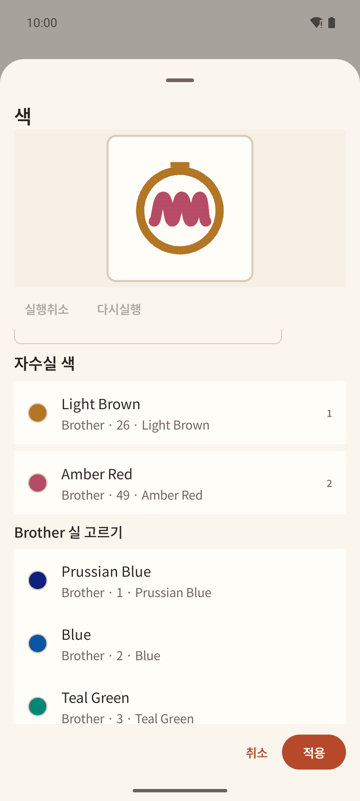

#### 알아 두기

- 시트를 연 사이 도안이 바뀌면 시트를 다시 열어 달라고 나옵니다.

### 3.8 후프와 저장

#### 후프 메뉴

후프 칩을 누르면 후프를 고릅니다.

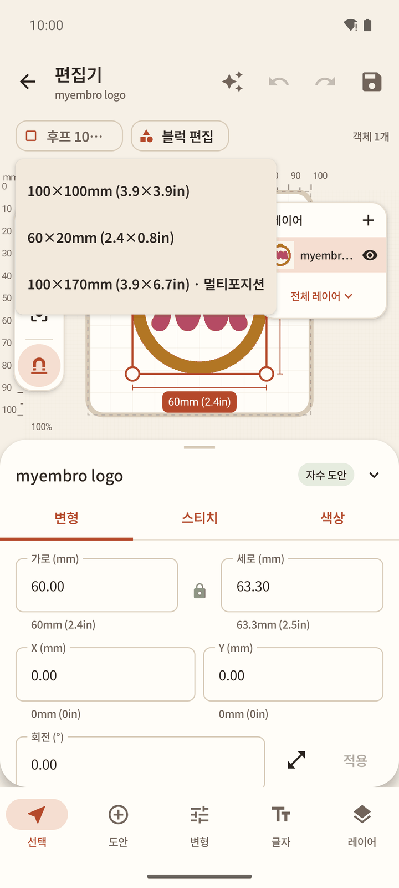

1. 기종 후프(예: 100×100mm)를 고릅니다.
2. 설정에서 만든 **사용자 정의 프레임**(예: 60×20mm)도 여기 나옵니다(12장).
3. **멀티포지션** 후프(예: 100×170mm)를 고르면 **위치별 분할 내보내기**로 위치마다 파일을 따로 만듭니다.

#### 저장 시트

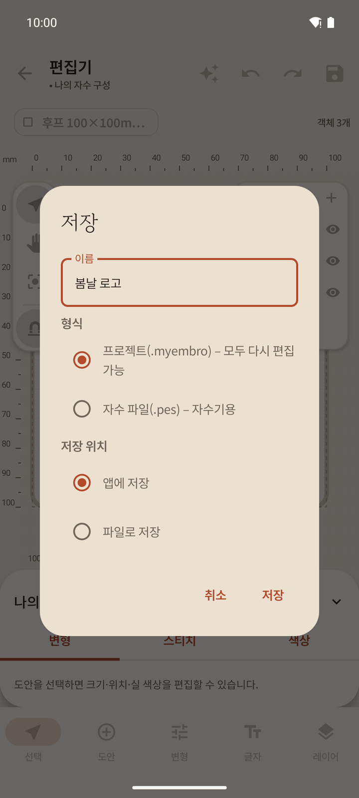

1. 상단 막대 오른쪽 **저장** 아이콘을 누릅니다.
2. 파일에서 연 도안이면 먼저 **저장(덮어쓰기)** 또는 **다른 이름으로 저장**을 고릅니다.
3. **이름**을 적습니다.
4. **형식**을 고릅니다. **프로젝트(.myembro)**는 모두 다시 편집할 수 있고, **자수 파일(.pes)**은 자수기용입니다.
5. **저장 위치**를 고릅니다. **앱에 저장**은 도안 목록에, **파일로 저장**은 휴대폰 폴더에 저장합니다.
6. **저장**을 누릅니다. 같은 이름이 있으면 덮어쓸지 묻습니다.

#### 알아 두기

- 저장하지 않고 나가면 **작업을 저장할까요?**가 나옵니다. **저장**, **버리기**, **취소** 중에서 고릅니다.
- 앱이 꺼져도 작업은 임시로 저장됩니다. 다음에 열 때 **이전 작업을 복원할까요?**가 나옵니다.
- 봉제 점검에서 차단되는 도안은 PES로 저장할 수 없습니다(9장).

## 4. 블럭 편집

사진, 이모지, 그림으로 만든 도안은 색 영역을 블럭으로 가지고 있습니다. 블럭마다 수놓는 방법을 바꿉니다.

### 화면 구성

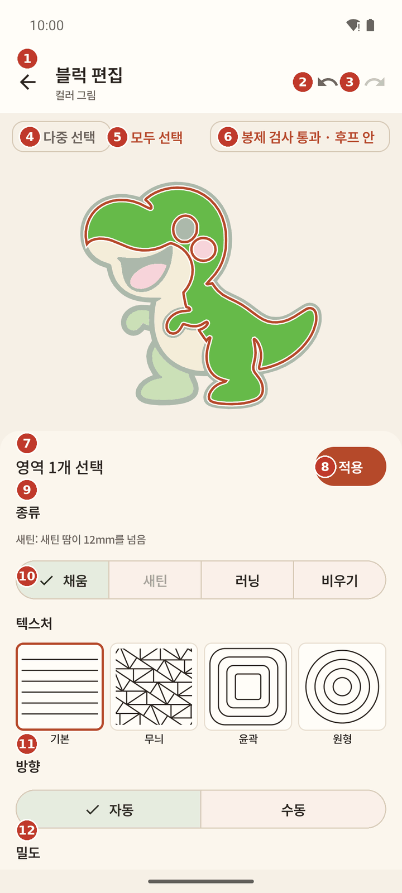

| 번호 | 이름 | 하는 일 |
|---|---|---|
| 1 | 완료 | 편집기로 돌아갑니다. |
| 2 | 실행취소 | 마지막 변경을 되돌립니다. |
| 3 | 다시실행 | 되돌린 변경을 다시 합니다. |
| 4 | 다중 선택 | 켜면 영역을 여러 개 고릅니다. |
| 5 | 모두 선택 | 모든 영역을 고릅니다. |
| 6 | 점검 상태 | 검사 중, 생성 중…, **봉제 검사 통과 · 후프 안**, **봉제 검사 차단** 중 하나입니다. |
| 7 | 선택한 영역 | 고른 영역 수입니다. |
| 8 | 적용 | 고른 설정으로 땀을 다시 만듭니다. |
| 9 | 종류 | 채움·새틴·러닝·비우기입니다. |
| 10 | 텍스처 | 채움의 무늬입니다. 기본·무늬·윤곽·원형입니다. |
| 11 | 방향 | 자동 또는 수동 바느질 각도입니다. |
| 12 | 밀도 | 지금은 보통만 됩니다. |

### 사용법

1. 편집기에서 **블럭 편집**을 누릅니다.
2. 캔버스에서 영역을 누릅니다. 여러 개면 **다중 선택**을 켜고 누르거나 **모두 선택**을 누릅니다.
3. **종류**를 고릅니다. 쓸 수 없는 종류는 흐리고, 이유가 나옵니다(예: *새틴: 이 모양은 새틴 불가*).
4. 채움이면 **텍스처**를 고릅니다. **무늬**를 고르면 **미앤더 타일** 목록에서 무늬를 고릅니다.

   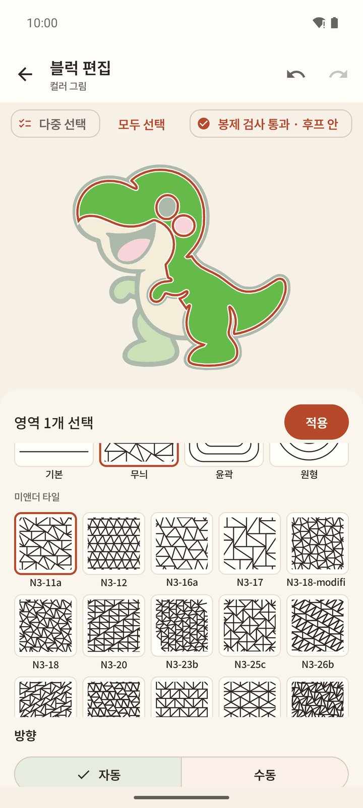

5. **방향**에서 **자동** 또는 **수동**을 고릅니다. 수동이면 각도를 정합니다(아래 [수동 각도](#수동-각도)).
6. 아래로 내려 **순서**를 봅니다. "10개 중 1번째로 바느질 (앞 = 먼저)"처럼 나옵니다. **맨 앞**, **앞으로**, **뒤로**, **맨 뒤**로 옮깁니다.

   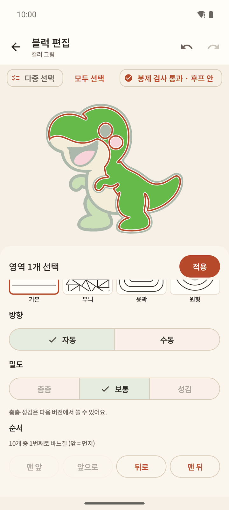

7. **적용**을 누릅니다. 걸린 초와 **취소** 버튼이 나옵니다.
8. 끝나면 **완료**를 누릅니다.

### 수동 각도

채움 영역의 바느질 줄 방향을 직접 정합니다.

#### 화면 구성

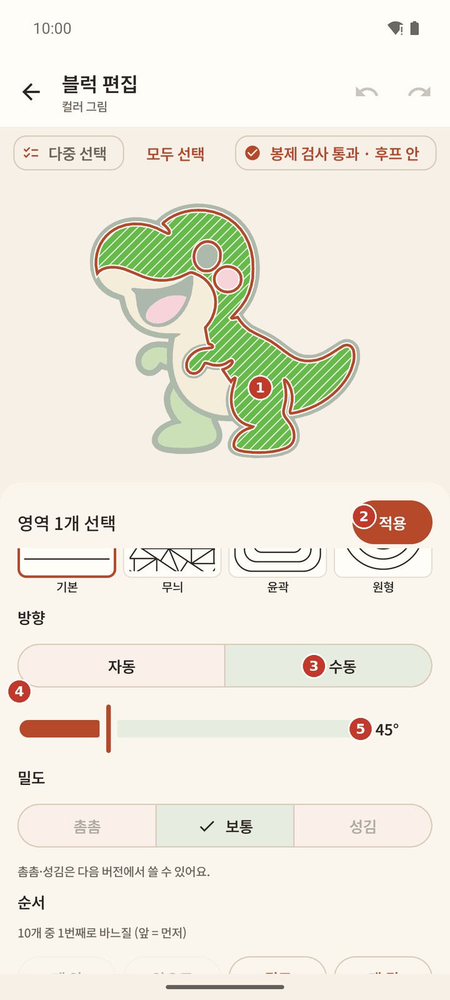

| 번호 | 이름 | 하는 일 |
|---|---|---|
| 1 | 빗금 미리보기 | 고른 영역 위에 그 각도의 빗금이 보입니다. 화면 표시일 뿐이고 땀은 아직 그대로입니다. 어두운 실에는 흰 선, 밝은 실에는 검은 선으로 나옵니다. |
| 2 | 적용 | 눌러야 땀이 그 각도로 바뀝니다. |
| 3 | 방향(자동/수동) | **자동**은 앱 기본값 0°(가로 줄)입니다. **수동**을 고르면 슬라이더가 나옵니다. |
| 4 | 각도 슬라이더 | 0–179°를 1° 단위로 정합니다. |
| 5 | 각도 값 | 지금 각도입니다. |

#### 사용법

1. 블럭 편집에서 채움 영역을 고릅니다.
2. **텍스처**에서 **기본**을 고릅니다.
3. **방향**에서 **수동**을 누릅니다.
4. 슬라이더를 끌어 각도를 정합니다. 빗금으로 방향을 확인합니다.
5. **적용**을 누릅니다.
6. 나중에 그 영역을 다시 고르면 지금 각도가 슬라이더에 나옵니다.

#### 줄 방향

| 각도 | 바느질 줄 |
|---|---|
| 0° | 가로 줄 (─) |
| 45° | 오른쪽 위로 올라가는 줄 (/) |
| 90° | 세로 줄 (│) |
| 135° | 왼쪽 위로 올라가는 줄 (\\) |

값이 커질수록 줄이 시계 반대 방향으로 돕니다.

#### 알아 두기

- 각도가 겉 바느질 줄을 바꾸는 것은 채움의 **기본** 텍스처뿐입니다. **무늬**·**윤곽**·**원형**은 겉 땀 모양이 그대로이고, 아래에 까는 밑박음 방향만 바뀝니다.
- 새틴·러닝·비우기에서는 방향이 나오지 않습니다.
- 여러 영역을 고르면 "선택한 영역 N개에 같은 각도가 들어갑니다"가 나오고 모두 같은 각도가 됩니다.

### 알아 두기

- **비우기**는 그 블럭을 수놓지 않아 천이 보입니다. 모든 블럭을 비울 수는 없습니다.
- 촘촘·성김은 다음 버전에서 씁니다.
- 새 땀이 봉제 점검에 걸리면 **적용 안 됨**이 나오고 이전 설정이 남습니다. **자세히**를 누르면 이유가 보입니다(예: 새틴 땀이 12mm를 넘음).
- 바늘이 너무 몰리는 곳에는 외곽 러닝을 넣지 않습니다. 그러면 **외곽 N곳 생략**이 나옵니다.
- 순서를 바꿀 때마다 되돌리기 한 단계입니다.
- 땀만 있는 도안(예: 가져온 PES)은 블럭이 없어 **스티치만 있는 도안이라 블럭 설정을 할 수 없어요**가 나옵니다.

## 5. 레터링

### 화면 구성

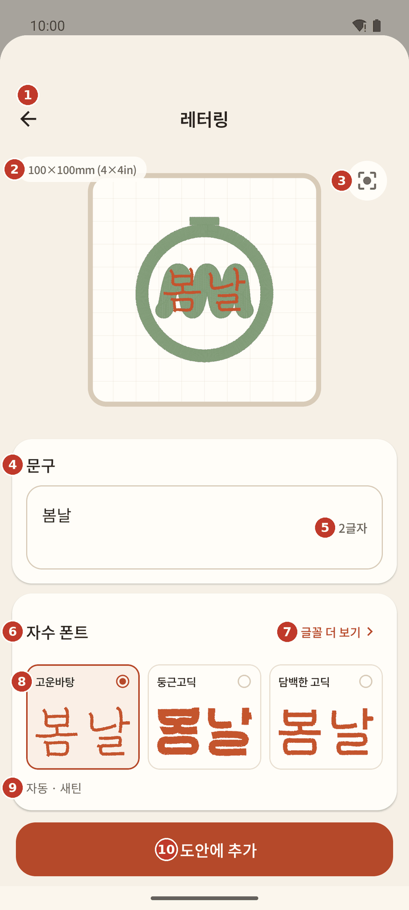

| 번호 | 이름 | 하는 일 |
|---|---|---|
| 1 | 뒤로 | 편집기로 갑니다. 바꾼 내용이 있으면 버릴지 묻습니다. |
| 2 | 후프 크기 | 지금 후프입니다. |
| 3 | 후프/글자 맞춤 전환 | 미리보기를 후프 전체 또는 글자에 맞춥니다. |
| 4 | 문구 | 수놓을 글자를 적습니다. |
| 5 | 글자 수 | 적은 글자 수입니다. |
| 6 | 자수 폰트 | 빠른 글꼴 3개입니다. |
| 7 | 글꼴 더 보기 | 글꼴 목록을 엽니다. |
| 8 | 글꼴 카드 | 누르면 그 글꼴로 바꿉니다. |
| 9 | 땀 종류 | 앱이 고른 땀 종류입니다(예: 자동 · 새틴). |
| 10 | 도안에 추가 | 글자를 편집기에 넣습니다. |

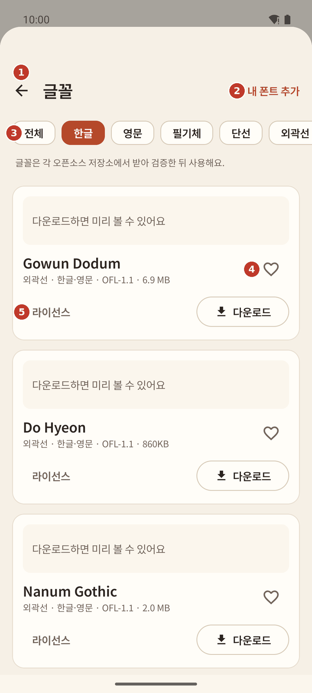

| 번호 | 이름 | 하는 일 |
|---|---|---|
| 1 | 뒤로 | 레터링 화면으로 갑니다. |
| 2 | 내 폰트 추가 | 내 TTF 글꼴을 넣습니다. |
| 3 | 글꼴 종류 필터 | 전체·한글·영문·필기체·단선·외곽선입니다. |
| 4 | 즐겨찾기 | 하트를 눌러 즐겨찾기합니다. |
| 5 | 라이선스 | 글꼴 라이선스를 봅니다. |

### 사용법

1. 편집기 아래 탭 **글자**나 홈의 **글자 넣기**를 누릅니다.
2. **문구**에 글자를 적습니다.
3. 빠른 글꼴을 누르거나 **글꼴 더 보기**에서 고릅니다. 받지 않은 글꼴은 **다운로드**를 누릅니다.
4. 미리보기를 확인합니다.
5. **도안에 추가**를 누릅니다.
6. 이미 넣은 글자를 고치려면 편집기에서 글자를 고르고 아래 탭 **글자**를 누릅니다.

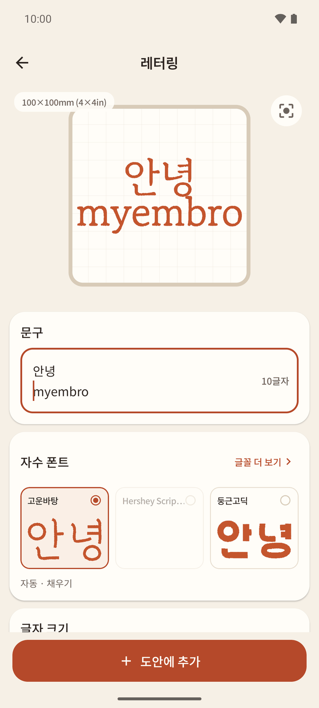
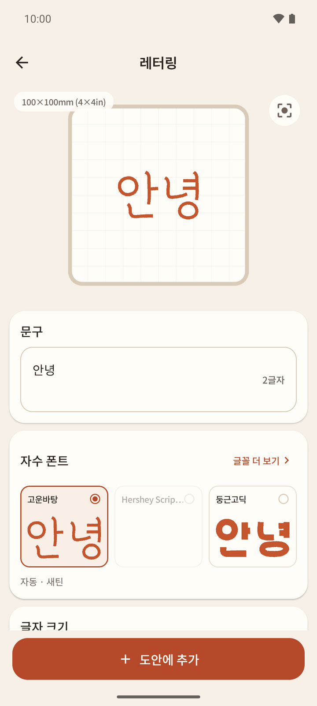

### 알아 두기

- 땀 종류는 앱이 정합니다. 위 그림처럼 한글과 영문이 섞인 '안녕 myembro'는 채우기, 한글만 있는 '안녕'은 새틴이 됩니다.
- 안전하게 수놓이는 크기만 허용합니다.
- 글꼴은 각 오픈소스 저장소에서 받아 검증한 뒤 씁니다. 쓸 수 없는 글꼴은 카드에 이유가 나옵니다(예: 입력한 한글을 지원하지 않아요).
- 일본어 가나도 됩니다. 탁점(゛)과 반탁점(゜)은 글자를 수놓은 뒤 따로 수놓습니다.
- 중국어(한자)는 아직 개발 중입니다.

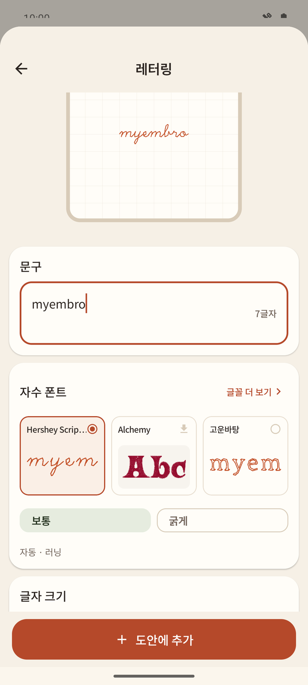
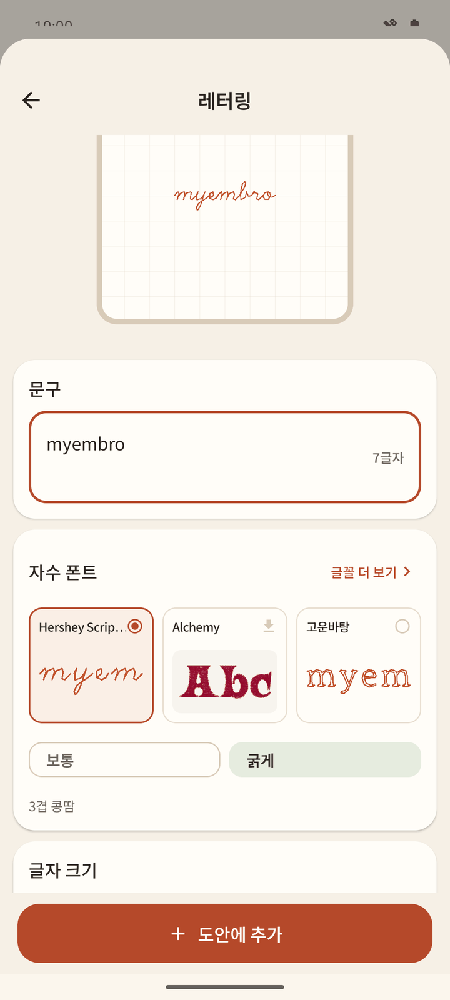

- 단선 글꼴은 **보통**(한 번)과 **굵게**(세 번 겹친 땀)가 있습니다. 같은 구간을 두 번 지나는 곳은 굵게에서 여섯 번이 될 수 있습니다.

## 6. 사진→자수

자르기, 모드, 결과의 3단계입니다. 다른 앱에서 그림을 myembro로 공유해도 이 화면이 열립니다.

### 1단계: 자르기

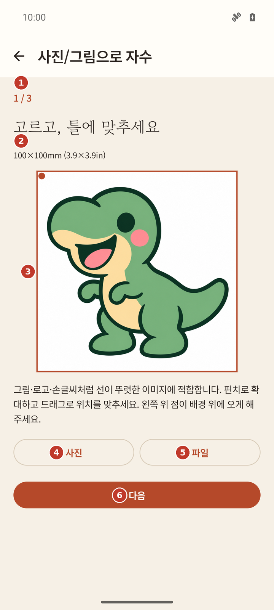

| 번호 | 이름 | 하는 일 |
|---|---|---|
| 1 | 단계 | 지금 단계입니다(1/3). |
| 2 | 후프 크기 | 맞출 후프입니다. |
| 3 | 자르기 틀 | 두 손가락으로 확대하고 끌어 맞춥니다. |
| 4 | 사진 | 사진 목록에서 그림을 고릅니다. |
| 5 | 파일 | SVG를 포함한 그림 파일을 고릅니다. |
| 6 | 다음 | 2단계로 갑니다. |

1. **사진**이나 **파일**로 그림을 고릅니다.
2. 틀 안에 원하는 부분을 맞춥니다. 그림을 줄여 전체가 보이게 해도 됩니다.
3. **다음**을 누릅니다.

### 2단계: 모드

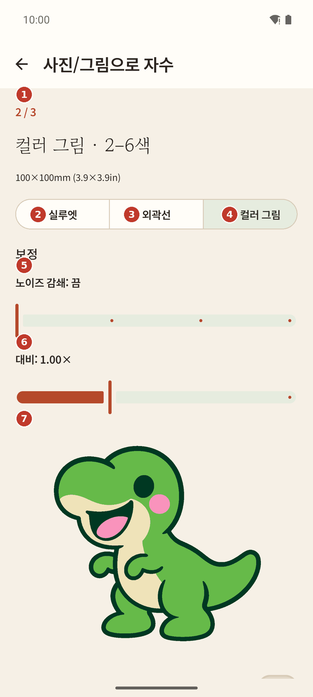

| 번호 | 이름 | 하는 일 |
|---|---|---|
| 1 | 단계 | 지금 단계입니다(2/3). |
| 2 | 실루엣 | 한 색으로 채웁니다. |
| 3 | 외곽선 | 한 색 윤곽선으로 만듭니다. |
| 4 | 컬러 그림 | 2–6색으로 채웁니다. 처음에는 4색입니다. |
| 5 | 노이즈 감쇄 | 끔·약·중·강입니다. 작은 점을 없앱니다. |
| 6 | 대비 | 0.5×–2.0×입니다. 1.00×는 그대로입니다. |
| 7 | 미리보기 | 실제 실 색으로 보여 줍니다. |

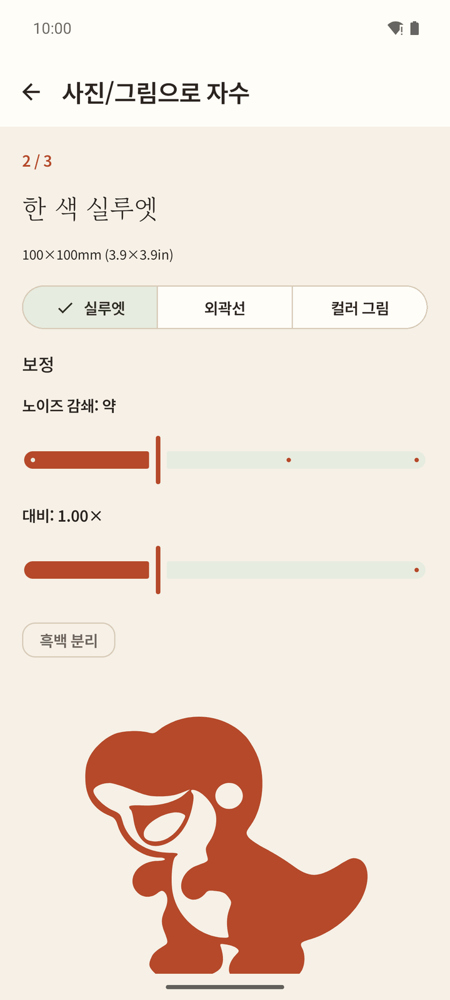
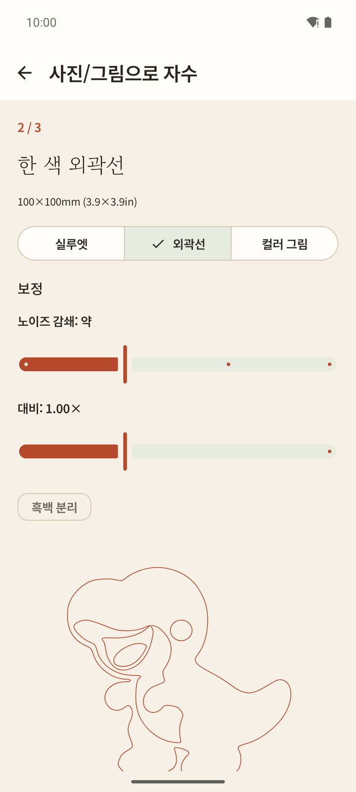

1. 모드를 누릅니다.
2. 아래로 내리며 설정합니다.
   - **흑백 분리**(실루엣·외곽선): 어두운 곳과 밝은 곳으로 자동으로 나눕니다.
   - **색 수**(컬러 그림): 2–6색을 고르거나 **흑백**을 켭니다.
   - **해상도**: 128–1024px입니다. 높을수록 윤곽이 매끈합니다.
   - **작은 조각 지우기**: 이 크기보다 작은 조각을 지웁니다.
   - **자수 크기**: 가로 × 세로가 나오고 비율은 그대로입니다. 가장 큰 크기는 99.9mm입니다.
3. **다음**을 누릅니다.

#### 텍스처 표현(실험)

컬러 그림에서 **텍스처 표현**을 켜면 스케치처럼 실 선을 겹쳐 수놓습니다.

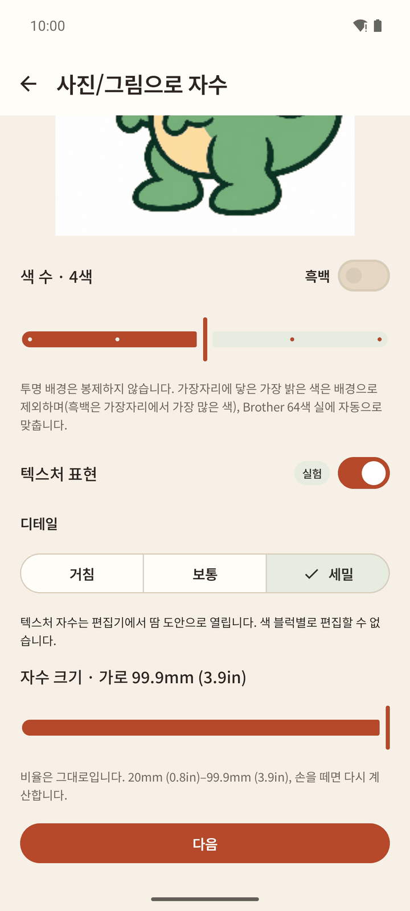

1. **텍스처 표현**을 켭니다.
2. **디테일**에서 **거침**, **보통**, **세밀**을 고릅니다. 세밀할수록 땀이 많습니다.
3. **다음**을 누릅니다.

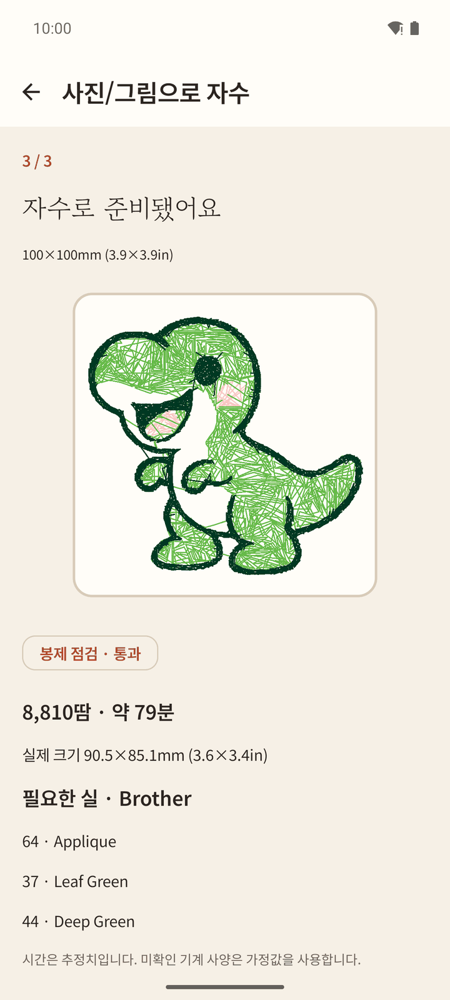

### 3단계: 결과

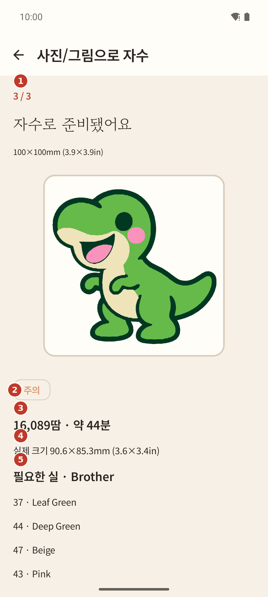

| 번호 | 이름 | 하는 일 |
|---|---|---|
| 1 | 단계 | 지금 단계입니다(3/3). |
| 2 | 봉제 점검 배지 | 통과, 주의, 차단 중 하나입니다. 누르면 이유가 나옵니다. |
| 3 | 땀 수·시간 | 땀 수와 예상 시간입니다. |
| 4 | 실제 크기 | 수놓을 크기입니다. |
| 5 | 필요한 실 | Brother 번호와 이름입니다. 없는 실에는 **내 실에 없음**이 붙습니다. |

1. 땀을 만드는 동안 진행 상황이 나옵니다. 1분이 지나면 **1분 더 기다리기** 또는 **그만두기**를 고릅니다.

   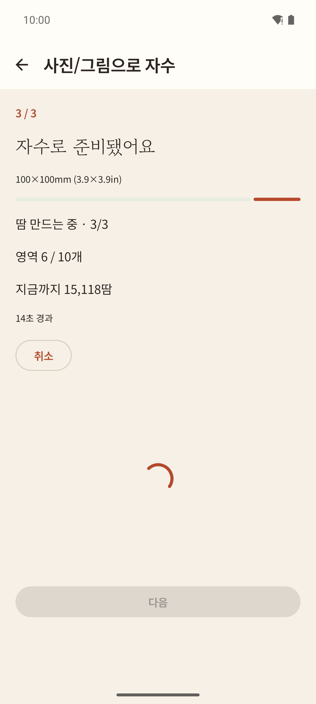

2. 결과를 확인합니다.
3. 아래 **다음**을 누르면 편집기에서 열립니다. 저장한 뒤 자수기로 보냅니다(10장).

### 알아 두기

- 투명 배경은 수놓지 않습니다. 가장자리에 닿은 가장 밝은 색은 배경으로 뺍니다.
- 투명 배경 컬러 그림에는 노이즈 감쇄와 대비를 쓸 수 없습니다.
- 실은 Brother 실에 자동으로 맞춥니다. **내 실**(12장)을 정하면 내 실만 씁니다.
- 서로 다른 색을 같은 실로 합치지 않습니다.
- 맞닿은 색은 0.2mm 겹쳐 틈이 보이지 않습니다.
- 컬러 그림과 실루엣은 채운 영역마다 같은 색 외곽 러닝을 두 번 둘러 테두리를 또렷하게 합니다. 두 번째는 반 땀 엇갈려 지납니다.
- 바늘이 너무 몰리는 곳에는 외곽을 넣지 않고 **외곽 N곳 생략**으로 알려 줍니다.
- 결과의 **주의**는 저장할 수 있는 경고입니다. 위 그림의 주의는 바늘이 조금 몰린 곳입니다(9장).
- 텍스처 자수는 편집기에서 땀 도안으로 열립니다. 블럭 편집은 할 수 없습니다.
- 그림 파일(SVG)은 그대로 쓰고 크기만 정합니다.

## 7. 이모지

### 화면 구성

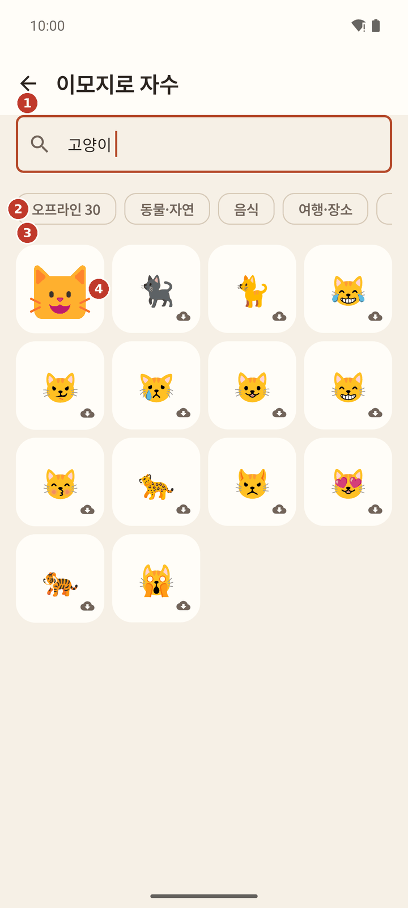

| 번호 | 이름 | 하는 일 |
|---|---|---|
| 1 | 검색 | 한글이나 영어로 찾습니다. |
| 2 | 분류 | 오프라인 30·동물·자연·음식·여행·장소 등입니다. |
| 3 | 바로 쓸 수 있는 이모지 | 앱 안에 있는 이모지입니다. |
| 4 | 내려받기가 필요한 이모지 | 구름 표시가 있으면 먼저 내려받습니다. |

### 사용법

1. 새 프로젝트 시트에서 **이모지로**를 누릅니다.
2. 검색하거나 분류를 누릅니다.
3. 이모지를 누릅니다.
4. 사진 화면과 같은 **자수 크기** 슬라이더로 크기를 정합니다.

## 8. 도안 목록과 뷰어

### 8.1 도안 목록

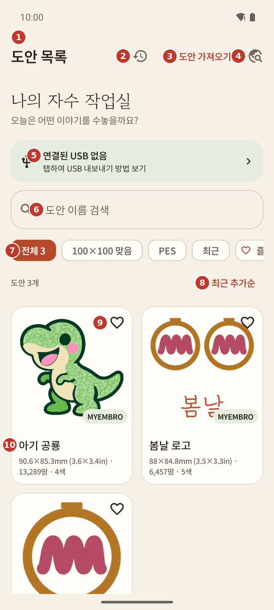

| 번호 | 이름 | 하는 일 |
|---|---|---|
| 1 | 도안 목록 | 저장한 도안과 프로젝트입니다. |
| 2 | 전송 기록 | 최근 USB 전송 결과를 봅니다. |
| 3 | 도안 가져오기 | 휴대폰의 PES·PEC·DST 파일을 넣습니다. |
| 4 | 무료 도안 찾기 | 무료 도안 사이트 목록입니다(11장). |
| 5 | USB 상태 | 연결된 USB를 보여 줍니다. 누르면 USB 내보내기 방법이 나옵니다. |
| 6 | 검색 | 도안 이름으로 찾습니다. |
| 7 | 필터 | 전체·100×100 맞음·PES·최근·즐겨찾기입니다. |
| 8 | 정렬 | 최근 추가순·이름순·땀 수 적은순입니다. |
| 9 | 즐겨찾기 | 하트를 눌러 즐겨찾기합니다. |
| 10 | 도안 카드 | 크기, 땀 수, 색 수가 나옵니다. 누르면 뷰어가 열립니다. |

**사용법**

1. 아래 탭 **도안**을 누릅니다.
2. 도안을 누르면 뷰어가 열립니다.
3. 도안을 길게 누르면 선택 모드가 됩니다. 다른 도안을 눌러 더 고릅니다.

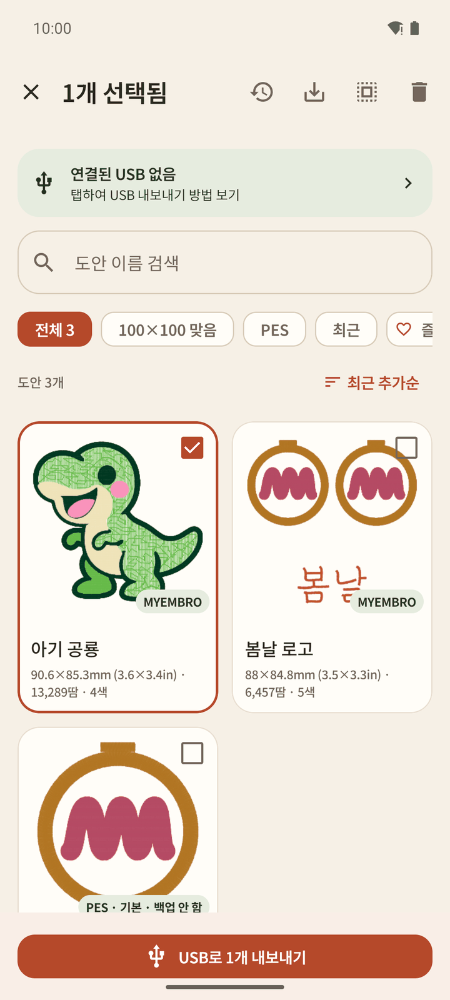

4. 선택 모드 위쪽에서 **파일로 내보내기**, **모두 선택**, **삭제**를 씁니다. 아래 **USB로 N개 내보내기**로 보냅니다(10장).
5. 전송 기록 아이콘을 누르면 최근 20건이 나옵니다.

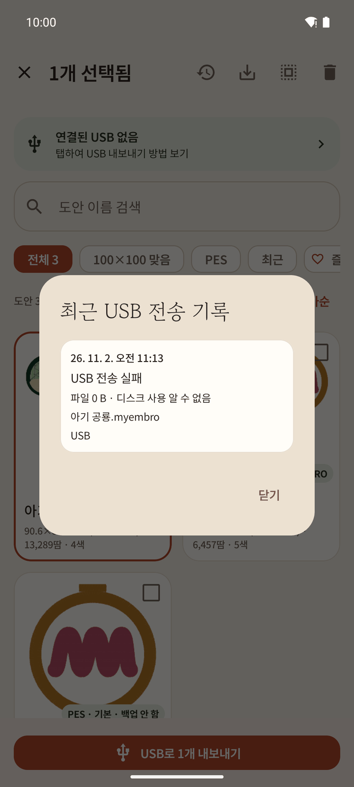

**알아 두기**

- **기본 · 백업 안 함**은 앱에 들어 있는 기본 도안이라 백업 ZIP에 넣지 않는다는 뜻입니다.
- 샘플에서 연 도안에는 **샘플** 표시가 붙습니다.
- **파일로 내보내기**는 고른 파일을 원본 그대로 폴더에 복사합니다. 검사나 변환은 하지 않습니다.

### 8.2 뷰어

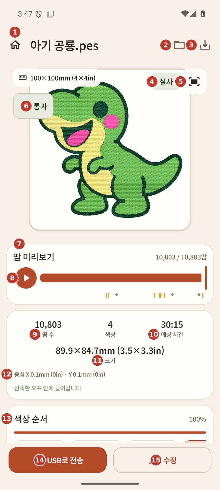

| 번호 | 이름 | 하는 일 |
|---|---|---|
| 1 | 홈 | 홈으로 갑니다. |
| 2 | 파일 열기 | 다른 파일을 엽니다. |
| 3 | 도안 내보내기 | 내보내기 시트를 엽니다. |
| 4 | 화면에 맞추기 | 도안 전체가 보이게 맞춥니다. |
| 5 | 봉제 점검 배지 | 통과 또는 차단입니다. 누르면 봉제 점검이 열립니다(9장). |
| 6 | 땀 미리보기 | 끌면 그 땀까지 보여 줍니다. |
| 7 | 재생 | 바느질 순서대로 재생합니다. |
| 8 | 땀 수 | 전체 땀 수입니다. 옆에 색 수가 있습니다. |
| 9 | 예상 시간 | 대략 걸리는 시간입니다. |
| 10 | 크기 | 도안 크기입니다. |
| 11 | 중심 위치 | 후프 중심에서의 위치와 후프 안에 들어가는지입니다. |
| 12 | 색상 순서 | 실을 바꾸는 순서입니다. |
| 13 | USB로 전송 | 자수기로 보냅니다(10장). |
| 14 | 수정 | 편집기에서 엽니다. |

**사용법**

1. 도안 목록에서 도안을 누릅니다.
2. **재생**을 누르거나 땀 미리보기를 끌어 바느질 순서를 봅니다.
3. 고치려면 **수정**, 보내려면 **USB로 전송**을 누릅니다.
4. **도안 내보내기**를 누르면 내보내기 방법을 고릅니다.
   - **PES로 저장**: 휴대폰이나 연결한 저장장치 폴더에 저장합니다.
   - **PES 파일 공유**: 다른 앱으로 사본을 보냅니다.
   - **USB로 내보내기**: USB로 보냅니다(10장).

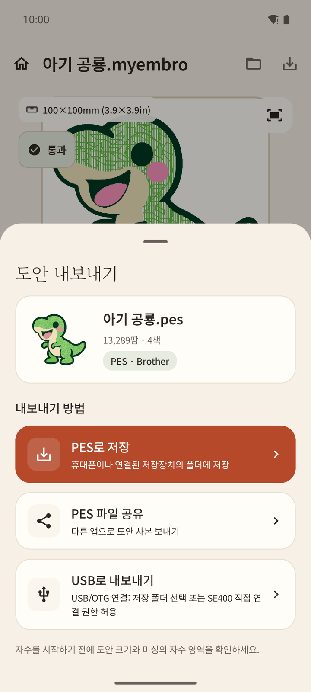

**알아 두기**

- PES(v1–v10), PEC, DST 파일을 열 수 있습니다.

## 9. 봉제 점검

앱은 저장·전송 전에 실제 봉제를 망치는 조건을 검사합니다.

### 화면 구성

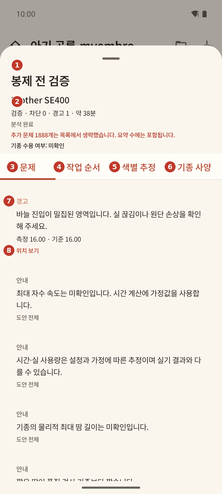

| 번호 | 이름 | 하는 일 |
|---|---|---|
| 1 | 봉제 전 검증 | 선택한 기종 기준 검사입니다. |
| 2 | 요약 | 차단 수, 경고 수, 예상 시간입니다. |
| 3 | 문제 탭 | 차단·경고·안내 목록입니다. |
| 4 | 작업 순서 탭 | 색과 실 자르기 순서입니다. |
| 5 | 색별 추정 | 색마다 땀 수와 시간입니다. |
| 6 | 기종 사양 | 기종의 영역과 기능입니다. |
| 7 | 경고 항목 | 무엇이 걸렸는지와 측정값입니다. |
| 8 | 위치 보기 | 그 땀으로 이동해 보여 줍니다. |

### 사용법

1. 뷰어나 사진 결과에서 점검 배지를 누릅니다.
2. **문제** 탭에서 항목을 읽습니다.
3. **위치 보기**로 걸린 곳을 확인합니다. 재생 화면에는 차단 위치가 빨간 원으로 나옵니다.

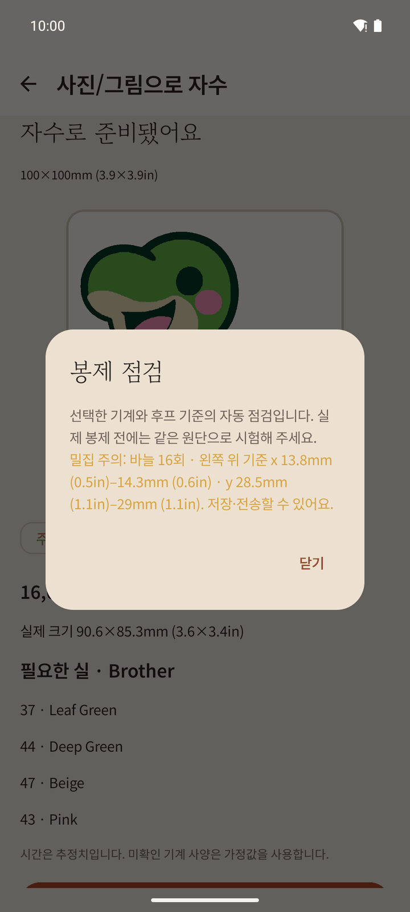

### 검사 항목

- 0.5mm 칸 하나에 바늘이 너무 많음
- 같은 점에 연속으로 바늘이 들어감
- 시작·끝 잠금 땀 누락
- 12.0mm보다 긴 땀
- 파일 오류, 또는 후프 밖 땀

### 알아 두기

- 0.5mm 칸에 바늘이 16–30번이면 **경고**입니다. 위치를 보여 주고 저장·전송은 됩니다.
- 30번을 넘거나 다른 항목에 걸리면 **차단**입니다. 저장·전송을 막습니다.
- 가져온 PES 파일은 고치지 않고 그대로 둡니다. 바늘이 30번 넘게 몰린 경우만 막습니다.
- **안내**는 확인되지 않은 기종 사양(예: 최대 자수 속도)을 알려 줍니다.

## 10. 자수기로 보내기

자수기를 USB 케이블로 컴퓨터에 연결하는 기종(SE400 등)은 **10.1**, 그 밖의 기종은 **10.2**를 보세요.

### 10.1 USB 케이블로 직접 보내기(SE400 등)

컴퓨터가 필요 없습니다. Brother SE400 실제 기계와 갤럭시 폴드7로 확인했습니다. SE425와 이노비스 900 / 900D도 설명서상 같은 방식이지만, 실제 기계에서는 아직 확인하지 않았습니다.

**먼저 영상으로 보기:** [1분 단계별 영상](../images/usb-direct-ko.mp4) (SE400에서 촬영했고, 휴대폰은 영어 화면입니다).

**준비물:** 휴대폰 단자(대부분 USB-C)와 자수기의 네모난 **USB-B** 단자를 잇는 케이블. 프린터용 USB-A ↔ USB-B 케이블이라면 휴대폰 쪽에 USB-C OTG 어댑터를 끼웁니다. USB-C ↔ USB-B 케이블 하나여도 됩니다.

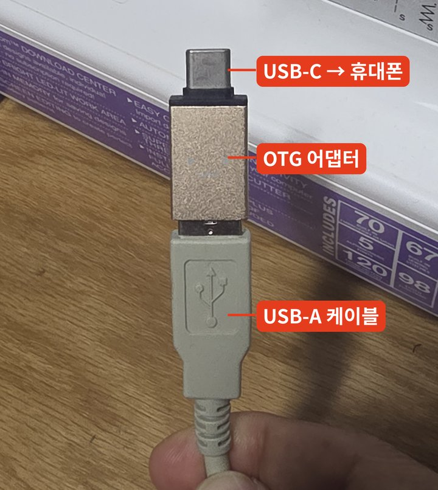

1. **자수기를 켜고, 네모난 USB-B 쪽을 자수기 오른쪽 옆면 단자에 꽂습니다. 반대쪽은 휴대폰에 꽂습니다.**
   성공: 자수기 화면이 켜져 있고, 케이블이 양쪽에 꽂혀 있습니다.

   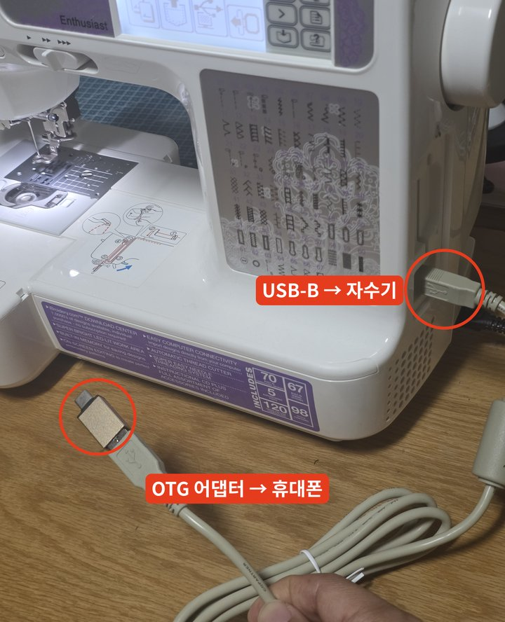

2. **휴대폰이 USB 장치에 쓸 앱을 물으면 myembro를 누르고 한 번만을 누릅니다.** 묻지 않는 휴대폰도 있습니다. 그때는 myembro를 직접 엽니다.
   성공: myembro가 열립니다. 여기서 myembro를 고르면 자수기 접근도 함께 허용되어 4단계는 건너뜁니다.

   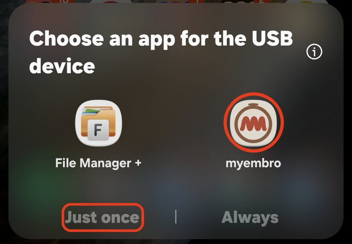

3. **보낼 도안을 열고 USB로 전송을 누릅니다.** 여러 개를 보내려면 **도안**에서 도안 하나를 길게 누르고 나머지를 누른 뒤, 아래 **USB로 2개 내보내기**를 누릅니다(숫자는 고른 개수).
   성공: 위쪽 안내에 **USB: SE400 직접 연결 · Sewing machine**이 보입니다. Sewing machine은 SE400이 알려 주는 이름이고, 길면 "…"로 잘립니다. 2단계에서 myembro를 골랐다면 바로 5단계로 갑니다.

   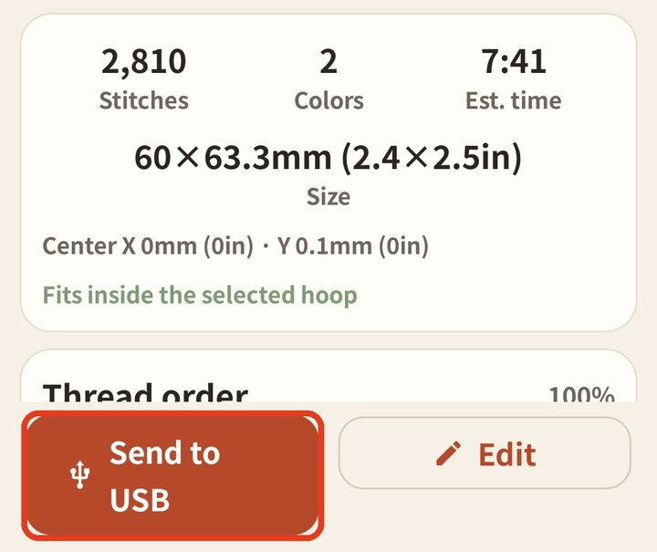

4. **2단계의 앱 선택을 놓쳤을 때만:** myembro가 Sewing machine에 접근해도 되는지 묻습니다. **확인**을 누릅니다.
   성공: 앱이 보내기 시작합니다.

   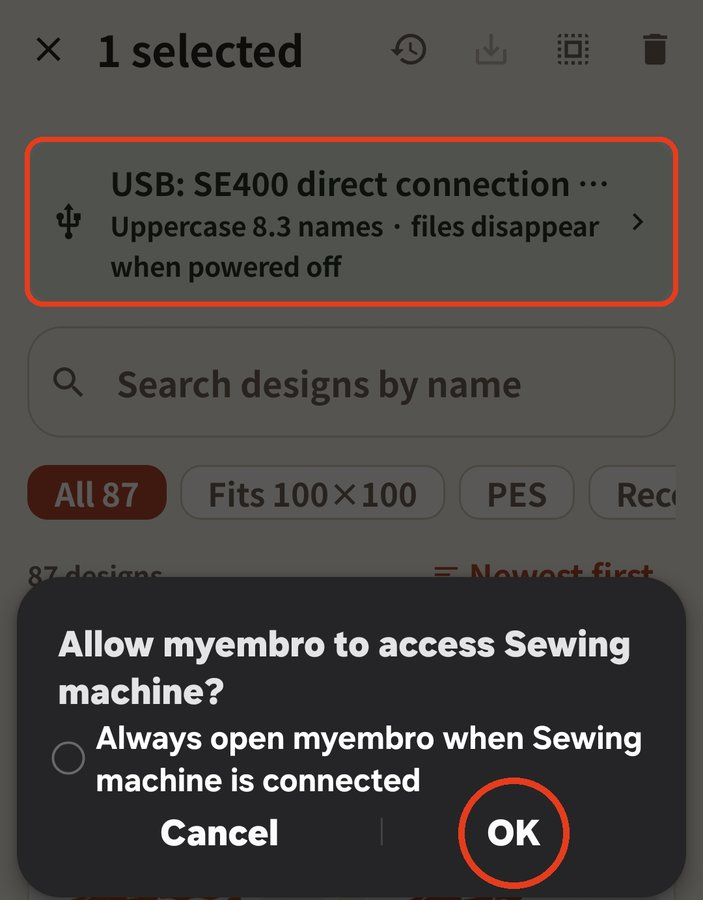

5. **결과를 기다립니다.**
   성공: **✔ myembro 로고.pes 전송 완료**와 파일 크기, 남은 공간이 나옵니다. 앱이 보낸 파일을 자수기에서 다시 읽어 확인한 결과입니다. 파일 이름은 한글까지 그대로입니다.

   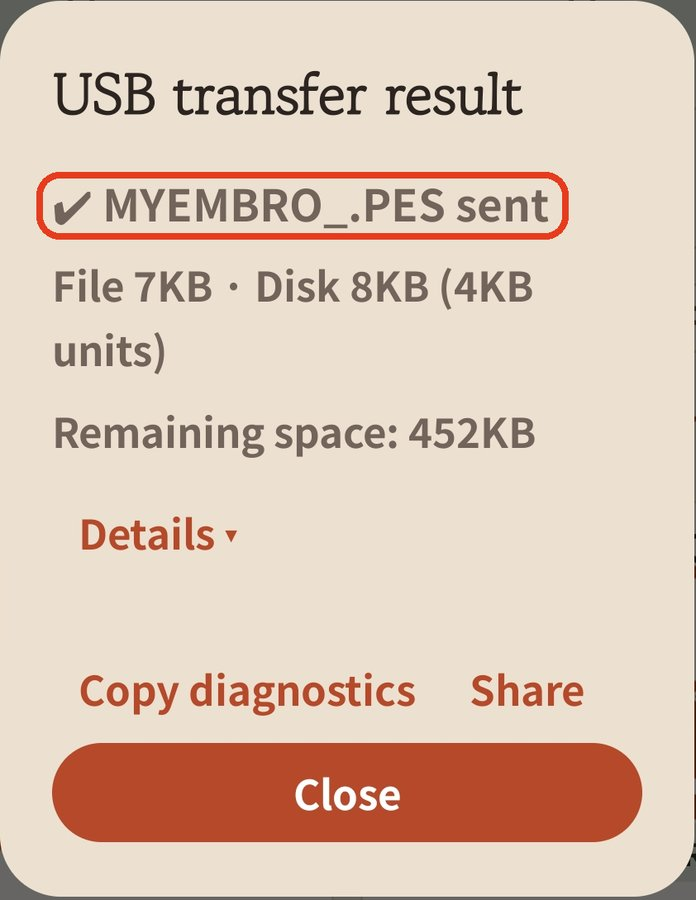

6. **자수기에서 USB(컴퓨터) 키를 누릅니다.** 첫 화면 아랫줄, USB 표시와 모니터 그림이 있는 키입니다.

   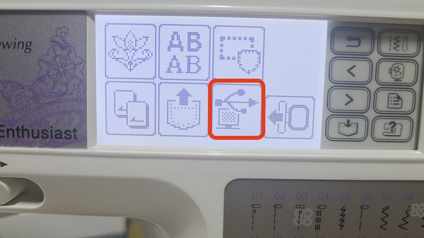

7. **도안(1)을 누르고 위쪽 화살표 키(2)를 누릅니다.** 왼쪽 위에는 사용 중인 메모리가 나옵니다. 예: 8/476KB

   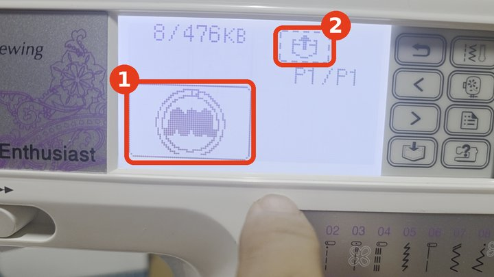

8. **첫 번째 실 색과 함께 도안이 열립니다.** 평소처럼 수놓으면 됩니다.
   성공: 자수기 화면에 도안이 나옵니다.

   

**자수기가 꽉 찼을 때:** 자수기의 USB 메모리에는 도안을 12개까지 넣을 수 있습니다(Brother SE400 USB 설명서). 공간이나 칸이 모자라면 아무것도 쓰지 않고 **공간 부족 — 삭제할 PES 선택** 창에 자수기의 PES 목록을 보여 줍니다. 처음에는 아무것도 체크되어 있지 않습니다. 필요 없는 파일만 체크하고 **선택 파일 삭제 후 내보내기**를 누르세요. 앱이 스스로 지우는 일은 없습니다.

**자수기 전원을 끄면 파일이 지워집니다.** 계속 두려면 자수기 내부 메모리에 저장하세요.

**막혔을 때**

- **앱 선택을 놓쳤거나 접근 허용 창에서 취소를 눌렀을 때:** **USB로 전송**(또는 **USB로 내보내기**)을 다시 누르고, 접근을 물으면 **확인**을 누릅니다.
- **안내가 계속 연결된 USB 없음일 때:** 충전만 되는 케이블이 많습니다. 파일을 옮겨 본 적이 있는 케이블로 바꿔 보세요. 자수기가 켜져 있는지도 확인하세요.
- **꽂았는데 드라이브가 안 보일 때:** 안내를 누르고 **USB 상태 새로고침**을 누릅니다. 그래도 안 보이면 양쪽을 뽑고 몇 초 뒤, 자수기를 켠 채 다시 꽂으세요.

### 10.2 USB 메모리로 보내기(다른 기종)

1. 휴대폰에 USB 메모리를 연결합니다(OTG).
2. **도안**에서 도안을 길게 눌러 보낼 도안을 고릅니다(8.1).
3. **USB로 N개 내보내기**를 누르고 USB 메모리 폴더 접근을 허용합니다.
4. 꺼내기를 한 뒤 USB 메모리를 자수기에 꽂습니다.

실패하면 결과 창에 이유와 **자세히**, **진단 정보 복사**, **공유**가 나옵니다. 결과는 전송 기록(8.1)에도 남습니다.

**다른 자수기:** 기종 목록에는 미국·한국에서 판매되는 Brother 자수기 58개가 있습니다(12장). 실제 기계에서 확인한 기종은 SE400뿐이고, 나머지는 Brother 설명서와 제품 페이지를 따릅니다.

## 11. 무료 도안 찾기

### 화면 구성

| 번호 | 이름 | 하는 일 |
|---|---|---|
| 1 | 가져오는 방법 | 받은 PES를 공유 → myembro로 보내면 도안 목록에 들어갑니다. |
| 2 | 사이트 이름 | 무료 도안을 주는 곳입니다. |
| 3 | 사이트 열기 | 브라우저로 사이트를 엽니다. |
| 4 | 조건 표시 | PES 제공, 개인용만, 회원가입 필요 여부 등입니다. |
| 5 | 이용 조건 보기 | 사이트의 이용 조건 페이지를 엽니다. |

### 사용법

1. 홈 **빠른 시작**이나 도안 목록 위쪽에서 **무료 도안 찾기**를 누릅니다.
2. 조건을 보고 사이트를 엽니다.
3. 사이트에서 도안을 받습니다.
4. 받은 파일을 공유하고 myembro를 고릅니다. 도안 목록에 들어갑니다.

### 알아 두기

- 도안은 제작자 사이트에서 직접 받습니다. 앱이 대신 받지 않습니다.
- PES·PEC·DST·ZIP을 지원합니다.
- 각 사이트의 이용 조건을 따르세요. 대부분 도안 파일 재배포와 판매는 안 됩니다.

## 12. 설정

### 화면 구성

| 번호 | 이름 | 하는 일 |
|---|---|---|
| 1 | 백업 | 도안·프로젝트·받은 글꼴·설정을 ZIP 하나에 보관합니다. |
| 2 | 백업 저장 | ZIP을 만듭니다. 앱 밖에 보관하세요. |
| 3 | ZIP 복원 | ZIP을 다시 읽어 옵니다. |
| 4 | AI 연결(실험) | 14장을 보세요. |
| 5 | 미싱과 자수 | 기종과 후프 설정입니다. |
| 6 | 미싱 기종 | 내 자수기를 고릅니다. |

| 번호 | 이름 | 하는 일 |
|---|---|---|
| 1 | 사용자 정의 프레임 추가 | 내 프레임 크기를 만듭니다. |
| 2 | 실 브랜드 | Brother·Madeira·Isacord 중 고릅니다. |
| 3 | PES 출력 버전 | v1 최소(기본) 또는 v6 호환(실 이름·색 정보 포함)입니다. |
| 4 | 내 실 고르기 | 가지고 있는 실을 체크합니다. |
| 5 | 화면 테마 | 밝게(기본)·어둡게·시스템 설정 따르기입니다. |
| 6 | 앱 정보 | 앱 설명, 라이선스, 버전입니다. |

### 사용법

**백업과 복원**

1. **백업 저장**을 누르고 ZIP을 저장할 곳을 고릅니다.
2. 재설치나 폰 교체 뒤 **ZIP 복원**으로 그 ZIP을 고릅니다.

**미싱과 자수**

1. **미싱 기종**을 누르고 내 자수기를 고릅니다. 최대 자수 영역과 연결 안내가 나옵니다.

   

2. **기본 후프**에서 새 프로젝트에 쓸 후프를 고릅니다.
3. **사용자 정의 프레임 추가**를 누르고 이름, 단위(mm·in), 가로, 세로를 넣고 **저장**을 누릅니다. 편집기 후프 메뉴에 나옵니다.

   

**실과 색상**

1. **실 브랜드**를 고릅니다.
2. **PES 출력 버전**을 고릅니다. 잘 모르면 기본(v1)을 둡니다.
3. **내 실**을 켜고 **실 선택**을 누릅니다.
4. 가진 실을 체크합니다. 이름이나 번호로 찾습니다. **확인**을 누릅니다.

   

**화면 테마와 앱 정보**

1. **화면 테마**를 눌러 밝게, 어둡게, 시스템 설정 따르기 중에서 고릅니다.

   

2. 맨 아래 **앱 정보**에 앱 라이선스(GPL-3.0-or-later), 오픈소스 라이선스, 버전이 나옵니다.

   

### 알아 두기

- 기종 목록에는 Brother 자수기 58개가 있습니다. 미국 판매 30개(SE, PE, NS, NQ, XE, XJ, XP, EV, PR)와 한국 판매 28개(M, LB, 이노비스, F, PR)입니다. 출처가 있는 목록은 [machines.md](../machines.md)에 있습니다.
- 100×100mm보다 큰 기종에는 **실제 기계 미확인**이 붙습니다.
- 도안은 후프 안에 있어야 합니다. 100mm 후프에서 가장 큰 도안은 99.9mm이고, 앱이 자동으로 지킵니다.
- 내 실 목록이 비어 있으면 모든 색을 씁니다. 내 실은 컬러 그림과 색 시트에 쓰이고, 백업에 들어갑니다.
- AI 연결의 중계 주소와 APP_KEY는 백업에 들어가지 않습니다.

## 13. AI에게 맡기기

휴대폰에 있는 챗봇 앱(Gemini, ChatGPT, Claude 등)으로 도안을 고칩니다. myembro 안에는 AI가 없고, 계정이나 키를 저장하지 않습니다.

### 화면 구성

| 번호 | 이름 | 하는 일 |
|---|---|---|
| 1 | 요청 입력 | 바꿀 내용을 적습니다. |
| 2 | 말로 입력 | 마이크로 말해서 적습니다. |
| 3 | 사진 첨부 | 도안에 넣을 사진을 붙입니다. 사진은 휴대폰에만 있고, 챗봇에는 번호와 크기만 갑니다. |
| 4 | 보낼 내용 보기 | 챗봇에게 가는 글을 미리 봅니다. |
| 5 | 복사 | 보낼 글을 복사합니다. |
| 6 | 챗봇에 공유 | 챗봇 앱으로 바로 보냅니다. |

### 사용법

1. 편집기 상단 막대의 **AI에게 맡기기**를 누릅니다.
2. 바꿀 내용을 적습니다. 예: *로고 아래에 빨간색으로 "Mina"*
3. **챗봇에 공유**를 누르고 챗봇 앱을 고릅니다. 또는 **복사**한 뒤 직접 붙여넣습니다.
4. **챗봇의 답을 기다리는 중 (p-…)** 막대가 나옵니다. 이 코드가 답을 요청과 연결합니다.
5. 챗봇의 답 전체를 복사합니다. myembro로 공유하거나, 막대의 **답 붙여넣기**를 누르고 **확인**을 누릅니다.
6. **바뀌는 내용 확인**에 전·후 그림, 바뀌는 항목, 봉제 점검 결과가 나옵니다. 아직 바뀐 것은 없습니다.
7. **적용**, **취소**, **다시 요청** 중 하나를 누릅니다.
8. 적용한 변경은 되돌리기 한 번으로 모두 돌아갑니다.

### 알아 두기

- 챗봇이 받는 내용: 앱 안내문과 명령 목록, 후프 이름과 크기, 객체마다 이름표·종류·글자·글꼴·위치·크기·회전·실 색·순서·숨김, 쓸 수 있는 글꼴과 내장 도안 목록, 내 요청.
- 땀, 그림, 파일은 보내지 않습니다. 챗봇은 휴대폰에 접근할 수 없습니다.
- 객체 삭제, 저장, 공유, USB 전송은 적용한 뒤 앱이 하나씩 확인을 받습니다.
- 답을 쓸 수 없으면 이유를 알려 주고 아무것도 바꾸지 않습니다. **고쳐 달라는 요청 복사**로 챗봇에게 다시 부탁합니다.
- 챗봇은 첨부한 사진을 볼 수 없고, 글꼴을 받을 수 없습니다. 크기와 땀 종류는 앱 규칙과 봉제 점검을 따릅니다.

## 14. AI 연결(실험)

복사·붙여넣기 없이 챗봇이 열린 도안을 바로 고칩니다. 내 중계 서버([relay/README.md](../../relay/README.md))와 커넥터를 지원하는 챗봇(예: Claude)이 필요합니다.

### 사용법

1. **설정**에서 **AI 연결(실험)**을 켭니다.
2. **중계 주소**(wss://…)와 **APP_KEY**를 넣습니다.
3. 챗봇에 중계 서버를 커넥터로 추가합니다. 연결 중에는 알림이 보입니다.

### 알아 두기

- 주소와 키는 이 휴대폰에만 있고 백업에 들어가지 않습니다. 재설치하거나 폰을 바꾸면 다시 넣습니다.
- 챗봇은 편집기에 열린 도안을 읽고 고칩니다. 고칠 때마다 되돌리기 한 단계입니다. 봉제 점검에 걸리는 변경은 하지 않습니다.
- 챗봇이 그린 그림(SVG, PNG, JPEG)은 사진 화면에서 먼저 확인한 뒤 들어갑니다.
- 객체를 지울 때는 휴대폰에서 먼저 묻습니다(90초 안에 답). 저장, 공유, USB 전송은 항상 내가 합니다.

## 15. 알려진 한계

- 실제 기계에서 확인한 기종은 SE400뿐입니다. 다른 기종은 Brother 공개 사양을 따릅니다.
- 컬러 그림에서 작은 조각은 주변 색으로 정리됩니다.
- 아주 복잡한 그림은 '너무 복잡함'으로 멈출 수 있습니다. 해상도를 낮추거나, 조각 기준을 올리거나, 더 작게 자르세요.
- 블럭 편집의 밀도는 지금 보통만 됩니다.
- 중국어(한자) 레터링은 개발 중입니다.

## 부록. 땀은 이렇게 만듭니다

### 밑박음 자동

채움은 위를 덮기 전에 밑박음을 먼저 박아 천을 잡아 줍니다. 새틴 글자는 글꼴에 정해진 밑박음과 밀림 보정을 그대로 씁니다. 한글 새틴 글자에는 밑박음과 밀림 보정이 들어가지 않습니다.

### 끊지 않고 이어 박기

한 영역이 여러 구간으로 나뉘어도 실을 자르지 않고 이어 박습니다. 다음 구간으로 옮겨 갈 때는 아직 채우지 않은 자리 밑으로 지나가므로, 옮겨 간 실이 나중에 박는 땀에 덮여 겉에 남지 않습니다.

### 외곽은 두 번

컬러 그림과 실루엣의 채운 영역은 같은 색 러닝으로 테두리를 두 번 두릅니다. 두 번째는 반 땀 엇갈려 지나 테두리가 또렷합니다.

### 한글 새틴은 좌상→우하

한글 새틴 글자는 글자 획의 가운데 선을 따라 새틴으로 박습니다. 서로 붙어 있는 획 덩어리 안에서는 실을 자르지 않습니다. 덩어리는 기본 필순대로 왼쪽 위에서 오른쪽 아래로 박으며, 실제 필순과 다른 글자도 있습니다. 실은 덩어리와 덩어리 사이에서만 자릅니다.

### 떨어진 곳만 실 자르기

실 자르기 명령은 떨어진 곳으로 건너갈 때만 넣습니다. 글자와 글자 사이가 3mm보다 가까우면 자르지 않고 이어 박습니다. 실이 실제로 잘리는지는 자수기에 실 자르기 기능이 있는지에 따라 다릅니다. 사진 자수에서 떨어진 조각은 가까운 것부터 차례로 박아서, 시험한 그림에서 건너가는 실의 길이가 실루엣은 약 16%, 컬러 그림은 약 19% 줄었습니다.

### 잠금 땀 자동

실을 시작하고 끝내는 곳과 실을 자르기 앞뒤에 잠금 땀을 자동으로 넣어 실이 풀리지 않게 합니다. 앱이 만든 도안에 잠금 땀이 빠져 있으면 저장과 전송을 막습니다. 잠금 땀 위치는 앱이 정하며 직접 바꿀 수 없습니다.

### 블럭마다 바로 바꾸기

**블럭 편집**에서 영역마다 종류(채움·새틴·러닝·비우기), 채움의 텍스처(기본·무늬·윤곽·원형), 방향(자동·수동), 순서를 바꿀 수 있습니다. 자세한 사용법은 [4장](#4-블럭-편집)을 보세요.
