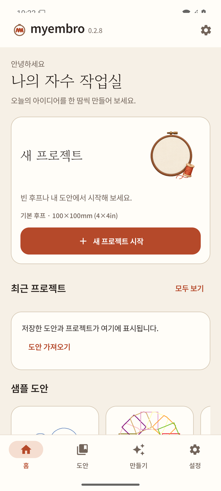
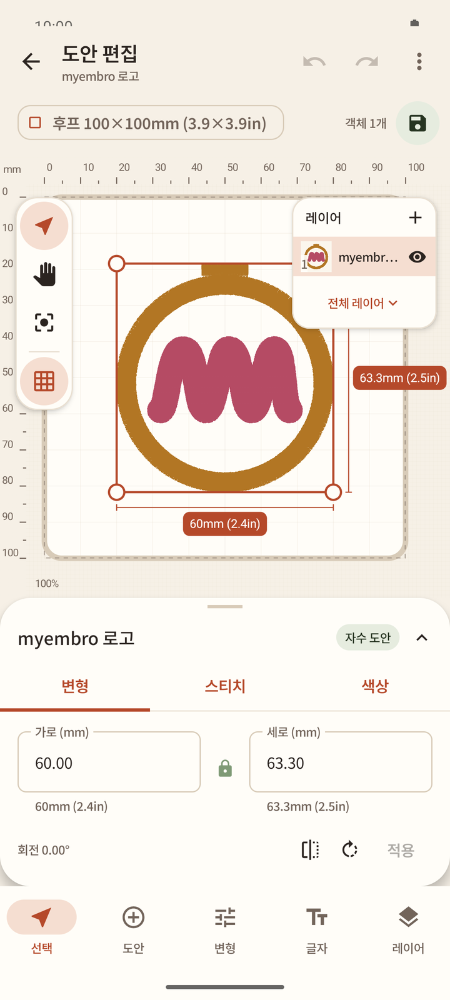

# myembro User Guide

**English** | [한국어](user-guide.ko.md)

This guide covers myembro v0.2.8. Screenshots show the Korean UI; English labels are given in the text.

1. [Getting started](#1-getting-started)
2. [Starting a new project](#2-starting-a-new-project)
3. [Editor](#3-editor)
4. [Lettering](#4-lettering)
5. [Photo to embroidery](#5-photo-to-embroidery)
6. [Emoji](#6-emoji)
7. [Viewer: playback and statistics](#7-viewer-playback-and-statistics)
8. [Sew-out check](#8-sew-out-check)
9. [Sending to the machine](#9-sending-to-the-machine)
10. [Backup and restore](#10-backup-and-restore)
11. [About and known limitations](#11-about-and-known-limitations)

## 1. Getting started

Install the APK from the latest GitHub pre-release. The home screen opens first.

- **New project** card: shows the default hoop (100×100mm, 4×4in). Tap **Start new project**.
- **Recent projects**: saved designs and projects appear here. **See all** opens the full list; **Import design** opens a PES/PEC/DST file from the phone.
- **Sample designs**: built-in designs you can open right away.
- Bottom bar: **Home**, **Designs**, **Create**, **Settings**. The gear at the top right also opens Settings.

## 2. Starting a new project

**Start new project** opens a sheet with five starting points:

| Option | What happens |
|---|---|
| Start from an empty hoop | Choose a hoop, then the editor opens empty |
| Start from my design | Pick a saved design, then the editor opens with it |
| Photo/drawing | Turn a photo or drawing into silhouette, outline or color embroidery (chapter 5) |
| From emoji | Turn an open-source emoji image into embroidery (chapter 6) |
| Start with lettering | Open the lettering screen (chapter 4) |

## 3. Editor

- Top: back, undo/redo, menu. Below it the hoop chip (for example **Hoop 100×100mm**), the object count and the **Save** button.
- Left tools: select, pan (hand), fit to view, grid.
- **Layers** panel: each design or lettering object is a layer; the eye icon shows or hides it, **+** adds one.
- Tap an object to select it. Drag the corner handles to resize; the size labels show mm and inches.
- Bottom sheet tabs **Transform**, **Stitch**, **Color**. In Transform, type **Width (mm)** / **Height (mm)** (the lock keeps the aspect ratio), set rotation, flip, then tap **Apply**.
- Bottom bar: **Select**, **Design** (add a design), **Transform**, **Lettering**, **Layers**.

The hoop is 100×100mm by default. Designs must stay inside it: coordinates run 0–999 in 0.1mm units, so the maximum design size is 99.9mm. The app enforces this automatically.

## 4. Lettering

1. Tap **Lettering** in the editor (or **Start with lettering**).
2. Type your text and open the font list. Filters: **All**, **Korean**, **Latin**, **Script**, **Single-line**, **Outline**. **+ Add my font** adds your own TTF font.
3. Fonts are downloaded from their open-source repositories and verified before use. Tap the download button on a font card; **License** shows its license; the heart marks a favorite. A card says when the font does not support the Korean letters you typed.
4. Set the letter height and place the text on the hoop.

What the app decides for you:
- **Stitch type.** For TTF fonts (including Korean) the app chooses satin, fill or running stitch from the letter size, and only offers sizes that sew safely.
- **Ink/Stitch fonts** (72 verified fonts) are stitched as satin.
- **Single-line fonts** have **Normal** (one pass) and **Bold** (Ink/Stitch bean stitch, three passes). Where the original font draws the same segment twice, Bold can pass there 6 times.

<!-- shot: 05 Korean satin -->
<!-- shot: 06 single-line normal/bold -->

## 5. Photo to embroidery

Choose **Photo/drawing**, pick an image, crop it, then choose a mode:

- **Silhouette**: one color, filled.
- **Outline**: one color, traced outline.
- **Color drawing**: traces a drawing into several thread colors; a grayscale option is available.

Set the embroidery size with the slider, check the preview, then continue to the editor. Very small areas are merged away, and stitch types (fill, satin, running) are chosen per region automatically. If a region cannot be stitched safely it is excluded and the app tells you how many.

<!-- shot: 07 silhouette + size -->
<!-- shot: 08 outline -->
<!-- shot: 09 color drawing + grayscale -->

## 6. Emoji

Choose **From emoji**, search (Korean search terms work, based on Unicode CLDR), pick an emoji and set its size with the slider (shared with the photo screen). Some emoji lose small color areas at large sizes; the size range offered keeps all colors.

<!-- shot: 10 emoji -->

## 7. Viewer: playback and statistics

Open any design to view it: thread colors, zoom and pan, the hoop outline, stitch-by-stitch playback, and statistics (stitch count, size, colors, trims, estimated time). PES (v1–v10), PEC and DST can be opened.

<!-- shot: 11 viewer playback/statistics -->

## 8. Sew-out check

Before saving or sending, every design the app generates is checked for the conditions that cause real sew-out failures:

- too many needle penetrations in one 0.5mm cell
- repeated penetrations at the same point
- missing start/end lock stitches
- stitches longer than 12.0mm
- file errors, or stitches outside the hoop (0–999 in 0.1mm units)

If any check fails, saving and sending are blocked and the reason is shown. Imported PES files are kept byte-for-byte.

<!-- shot: 12 sew-out check -->

## 9. Sending to the machine

**Brother SE400 (USB cable):** connect the phone to the SE400 with a USB cable and send the design directly (confirmed on a real machine). Past transfers appear in the transfer history.

**Important for the SE400:** it has no automatic thread cutter. Travel threads between colors and positions are not cut, so trim them by hand after sewing. The app shows guidance for this.

**SE600/SE700:** machine profiles (100×100mm, USB memory) based on the manuals; transfer has not been tested on real machines yet.

<!-- shot: 13 SE400 USB transfer -->
<!-- shot: 14 transfer history -->

## 10. Backup and restore

In **Settings**, a full backup saves designs, projects, downloaded fonts and settings into one ZIP; restore reads it back.

**Take a backup now.** The current APK is signed with a development key. When releases switch to the official signing key, the new version cannot be installed over the old one: you must uninstall once and reinstall, which deletes app data. Restore your ZIP afterwards.

<!-- shot: 15 backup/restore -->

## 11. About and known limitations

**Settings → About** shows the app version and information. myembro is GPL-3.0-or-later.

- SE400: no automatic thread cutting; trim travel threads by hand.
- Signing key change: uninstall/reinstall will be needed once; back up first.
- SE600/SE700: transfer not yet tested on real machines.

The app also has a dark theme.

<!-- shot: 16 about -->
<!-- shot: 17 dark home -->
