# myembro User Guide

**English** | [한국어](user-guide.ko.md)

This guide covers myembro v0.4.0-beta.2 (some screenshots show older versions).

1. [Getting started](#1-getting-started)
2. [Starting a new project](#2-starting-a-new-project)
3. [Editor](#3-editor)
4. [Lettering](#4-lettering)
5. [Photo to embroidery](#5-photo-to-embroidery)
6. [Emoji](#6-emoji)
7. [Viewer: playback and statistics](#7-viewer-playback-and-statistics)
8. [Sew-out check](#8-sew-out-check)
9. [Sending to the machine](#9-sending-to-the-machine)
10. [Backup, restore and my threads](#10-backup-restore-and-my-threads)
11. [About and known limitations](#11-about-and-known-limitations)
12. [Ask AI](#12-ask-ai)
13. [AI connection (experimental)](#13-ai-connection-experimental)

## 1. Getting started

Install the APK from the latest GitHub pre-release. The home screen opens first.

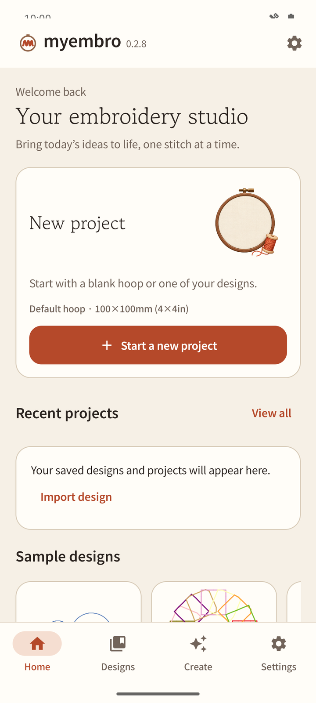

- **New project** card: shows the default hoop (100×100mm, 4×4in). Tap **Start a new project**.
- **Recent projects**: saved designs and projects appear here. **View all** opens the full list; **Import design** opens a PES/PEC/DST file from the phone.
- **Sample designs**: built-in designs you can open right away.
- Bottom bar: **Home**, **Designs**, **Create**, **Settings**. The gear at the top right also opens Settings.

## 2. Starting a new project

**Start new project** opens a sheet with five starting points:

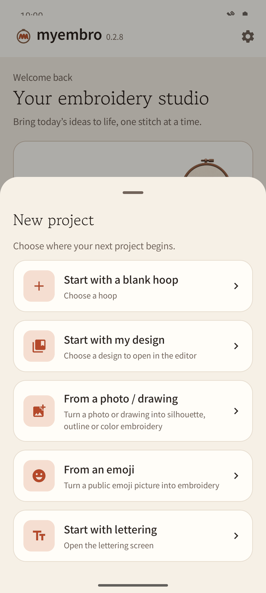

| Option | What happens |
|---|---|
| Start with a blank hoop | Choose a hoop, then the editor opens empty |
| Start with my design | Pick a saved design, then the editor opens with it |
| From a photo / drawing | Turn a photo or drawing into silhouette, outline or color embroidery (chapter 5) |
| From an emoji | Turn an open-source emoji image into embroidery (chapter 6) |
| Start with lettering | Open the lettering screen (chapter 4) |

## 3. Editor

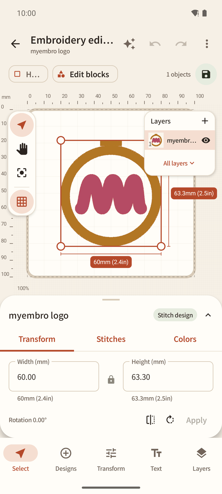

- Top: back, home, **Ask AI** (sparkle, chapter 12), undo/redo, menu. Below it the hoop chip (for example **Hoop 100×100mm**), **Edit blocks**, the object count and the **Save** button.
- Left tools: select, pan (hand), fit to view, grid.
- **Layers** panel: each design or lettering object is a layer; the eye icon shows or hides it, **+** adds one.
- Tap an object to select it. Drag the corner handles to resize; the size labels show mm and inches.
- Bottom sheet tabs **Transform**, **Stitches**, **Colors**. In Transform, type **Width (mm)** / **Height (mm)** (the lock keeps the aspect ratio), set rotation, flip, then tap **Apply**.
- Bottom bar: **Select**, **Designs** (add a design), **Transform**, **Text**, **Layers**.
- **Colors** sheet (palette icon): pick a **Fabric color** to preview the design on your fabric, and change each **Embroidery threads** color to another Brother thread (your threads are listed first). Tap **Apply** to keep the changes.

### Block editing

Designs made from a photo, an emoji or an SVG keep their color areas as blocks. Tap **Edit blocks** to change how each block is sewn.

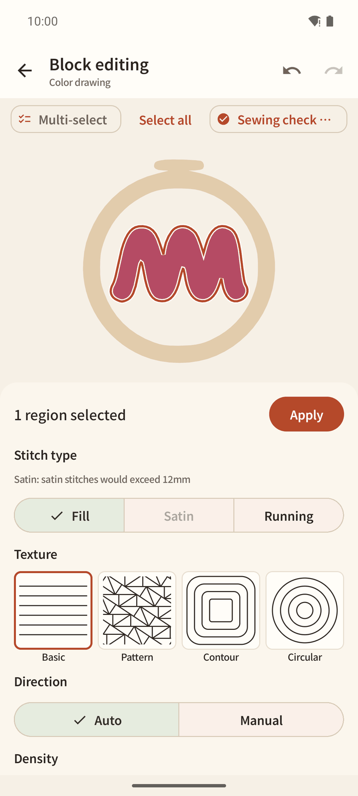

1. Tap a region on the canvas. Turn on **Multi-select** to pick several, or tap **Select all**.
2. Choose the **Stitch type**: **Fill**, **Satin** or **Running**. A type the region cannot use is greyed out, with the reason above it (for example *Satin: this shape cannot be satin*).
3. For Fill, choose the **Texture**: **Basic**, **Pattern** (an Ink/Stitch meander tile), **Contour** or **Circular**.
4. **Direction**: **Auto**, or **Manual** with a stitch angle.
5. **Density**: only **Normal** for now. Dense and sparse come in a later version.
6. Tap **Apply**. The stitches are made in the background and checked with the real sewing check. A **Cancel** button and the elapsed time show while it works. If the check fails, nothing changes and the previous settings stay.

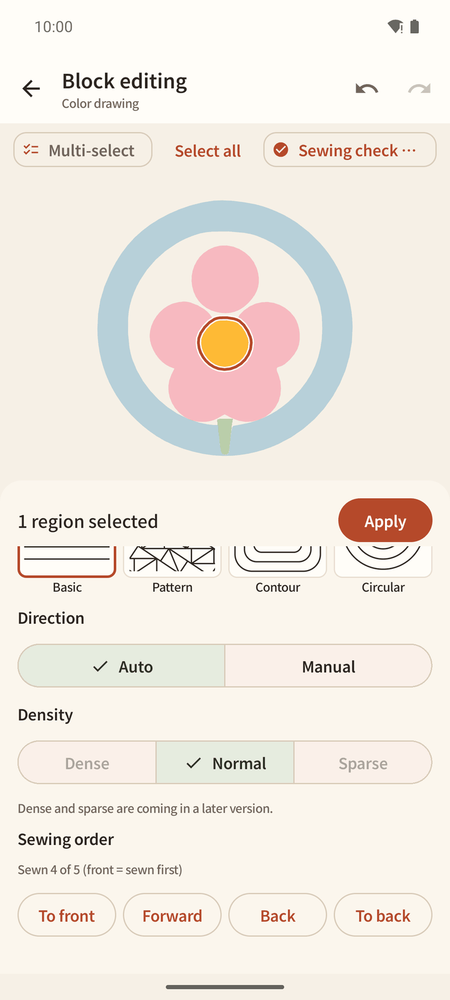

**Sewing order** shows where the selected region is sewn (front = sewn first). Use **To front**, **Forward**, **Back** and **To back** to move it. Every change is one undo step. The badge at the top shows **Sewing check passed · in hoop** for the whole design.

Designs that are only stitches (such as an opened PES file) have no blocks, so block editing is not available for them.

### Hoop size

The hoop is 100×100mm by default. Designs must stay inside it: coordinates run 0–999 in 0.1mm units, so the maximum design size is 99.9mm. The app enforces this automatically.

## 4. Lettering

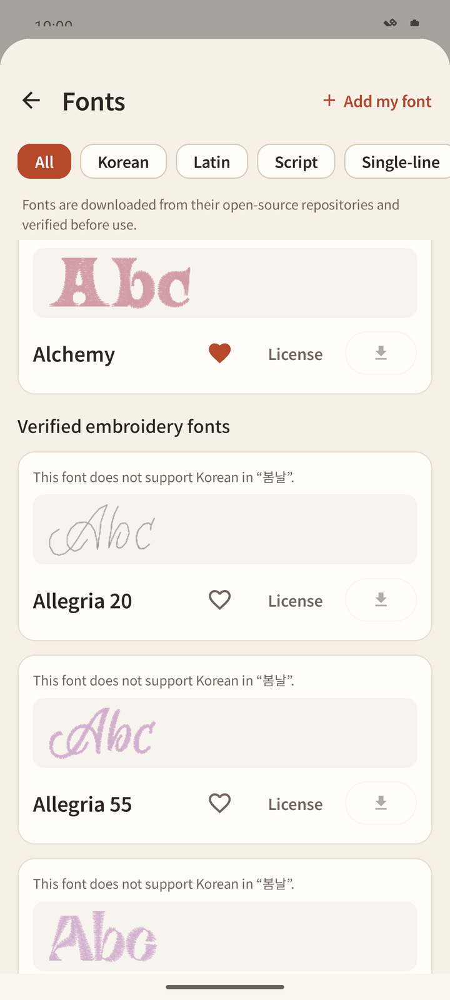

1. Tap **Text** in the editor's bottom bar (or **Start with lettering**). The lettering screen shows a preview on the hoop.
2. Type your text in **Phrase** (the character count is shown).
3. Pick a font under **Embroidery font**, or tap **More fonts** to open the font library. Filters: **All**, **Korean**, **Latin**, **Script**, **Single-line**, **Outline**. **+ Add my font** adds your own TTF font.
4. Fonts are downloaded from their open-source repositories and verified before use. On a font card, tap the download button; **License** shows its license; the heart marks a favorite. If a font cannot write the letters you typed, the card says so (for example, that it does not support the Korean in your text).
5. Set **Letter height**, then tap **+ Add to design**.

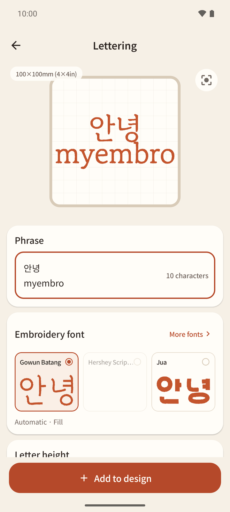
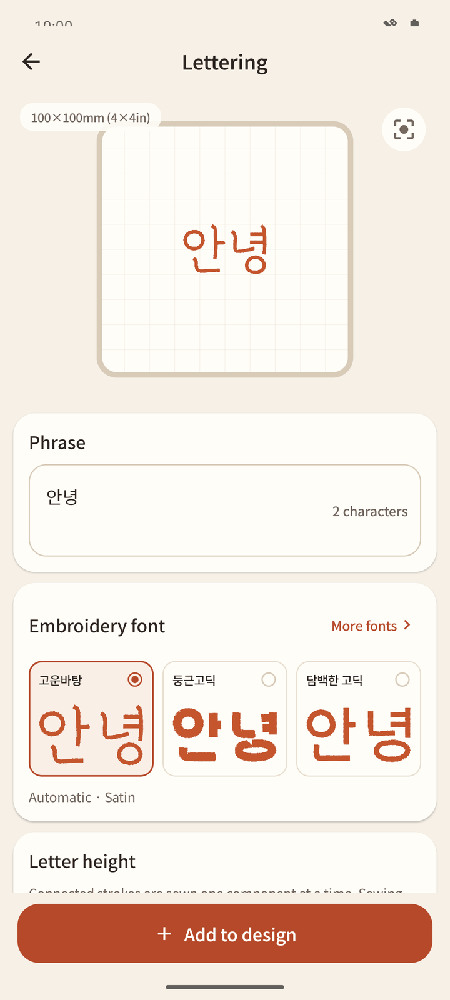

The app chooses the stitch type and shows it under the font list, for example **Automatic · Fill** or **Automatic · Satin**. In the screenshots, mixed text ("안녕 myembro") becomes fill and Korean-only text ("안녕") becomes satin. Only sizes that sew safely are offered. The 72 verified Ink/Stitch fonts are stitched as satin.

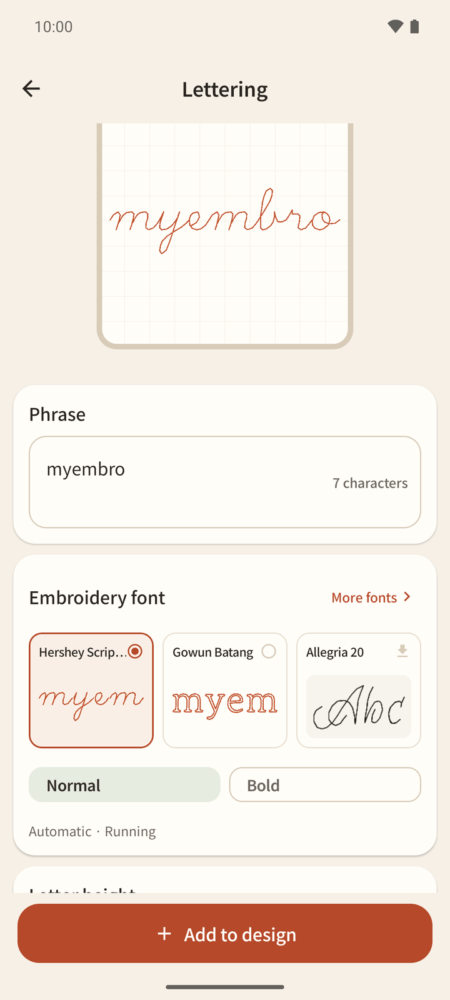
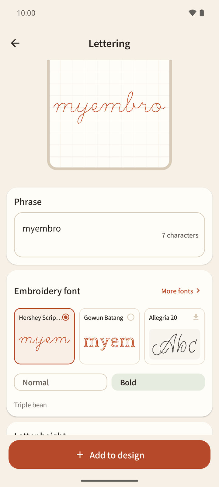

Single-line fonts (for example Hershey Script 1-stroke) offer **Normal** (running stitch, one pass) and **Bold** (triple bean stitch from Ink/Stitch). Where the original font draws the same segment twice, Bold can pass there 6 times.

## 5. Photo to embroidery

Choose **From a photo / drawing** on the new project sheet. The screen has three steps: crop, choose a mode, then the result.

You can also share a picture to myembro from another app (gallery, browser, files). It opens on this same screen. An SVG drawing is used as it is: only the size slider is shown.

**Step 2 — mode.** Choose **Silhouette**, **Outline** or **Color drawing**. Color drawing with 4 colors is selected first.

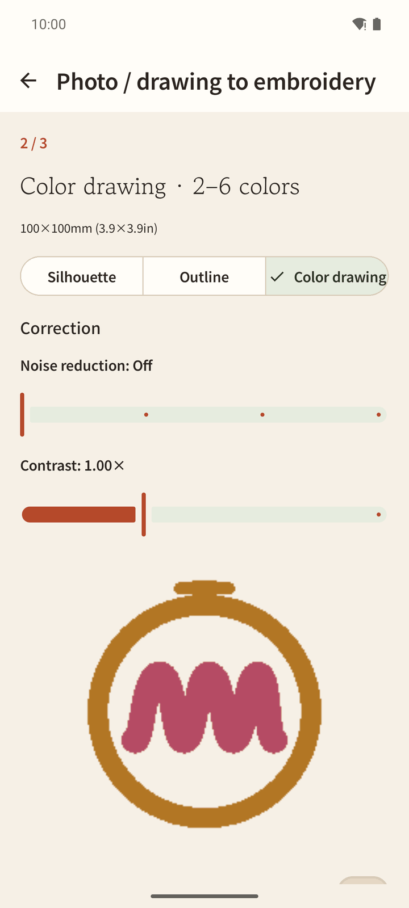

**Correction** (all modes):
- **Noise reduction**: Off, Weak, Medium or Strong. It removes small specks.
- **Contrast**: 0.5× to 2.0×. 1.00× keeps the picture as it is.
- **Black-and-white separation** (silhouette and outline only): splits the picture into dark and light automatically.
- For color pictures with a transparent background, noise reduction and contrast are turned off.

**Color drawing** (2–6 colors):
- Set **Colors** with the slider, or turn on **Black & white**.
- The preview shows the picture in the actual thread colors.
- Transparent background is not sewn. The most common color at the edge is treated as background.
- Colors are matched to Brother threads automatically. If you set **My threads** (chapter 10), only your threads are used.
- Each color area is filled. Next to each other, colors overlap by 0.2mm so no gaps show. The outer edge of the design does not grow.
- Each filled area gets a single-pass running outline in the same color. If an outline would fail the sewing check, that outline is left out.

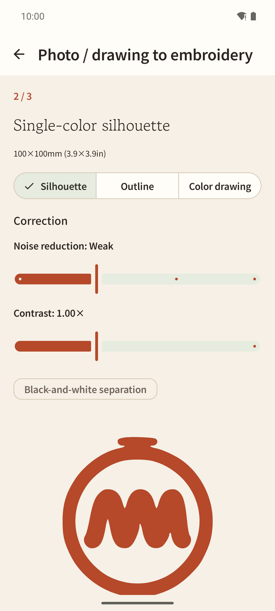

- **Silhouette**: one color, filled, with a same-color single-pass running outline around each filled area and its holes. Outlines that fail the sewing check are omitted. The **Detail** slider keeps smaller contours the higher it is.

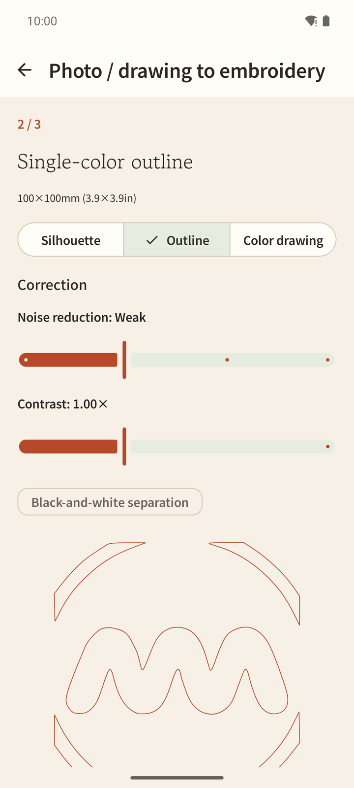

- **Outline**: one color, traced outline of the same picture.

**Embroidery size · width** slider (all modes): the aspect ratio is kept. The range is computed for the picture, and the design is recalculated when you release the slider. The largest size is 99.9mm.

**Thread texture (experimental).** In Color drawing, turn on **Thread texture** to sew the picture as layered thread lines, like a sketch.

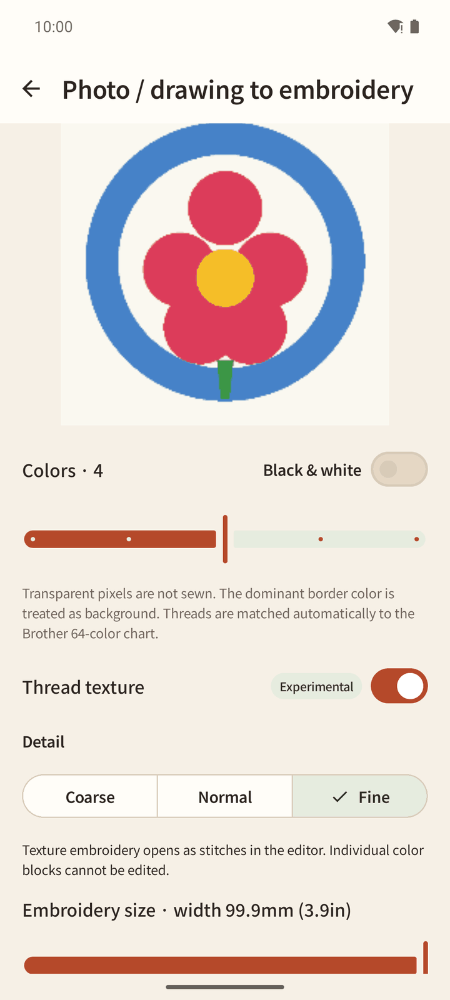

- **Detail**: **Coarse**, **Normal** or **Fine**. Fine makes more stitches.
- Texture embroidery opens in the editor as stitches. Its color blocks cannot be edited.
- If there are too many stitches, the app says so. Make the picture smaller or choose Coarse.

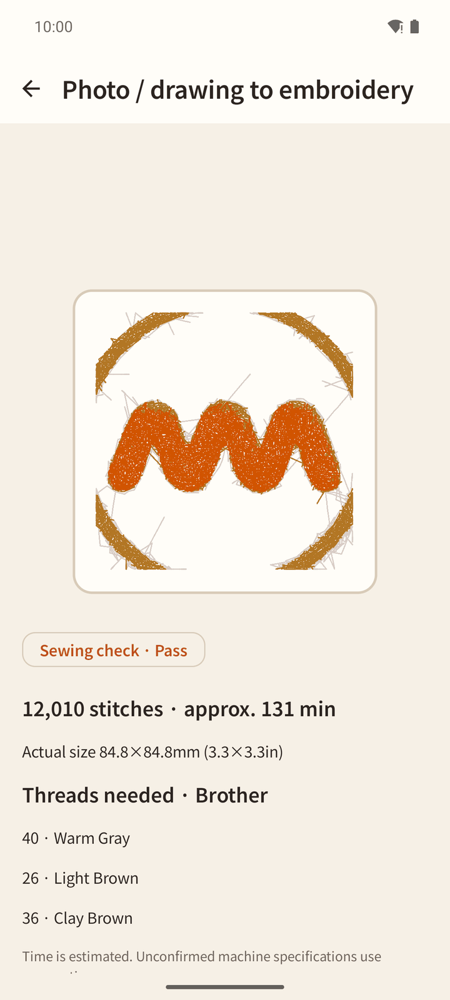

**Step 3 — result.**

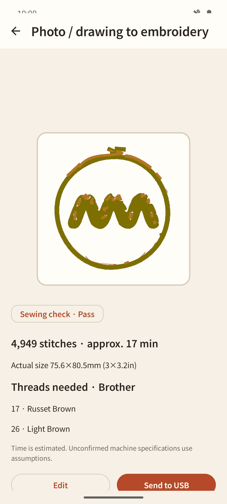

The result shows **Sewing check · Pass**, the stitch count and estimated time, the actual size and **Threads needed · Brother** (number and name). A thread you do not own is marked **Not in my threads**. The time is an estimate. Making the stitches stops after 1 minute; then try lower detail or a smaller crop. Tap **Edit** to keep editing (including block editing, chapter 3) or **Send to USB** to send it to the machine.

## 6. Emoji

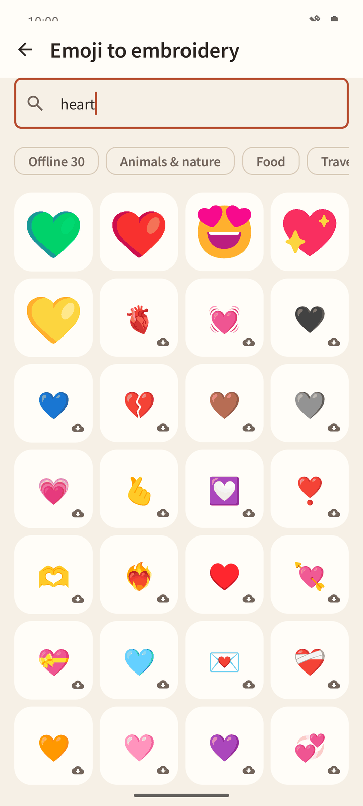

Choose **From an emoji** and search. Korean search terms work (based on Unicode CLDR); the screenshot shows results for "heart". Some emoji are marked as needing a download first. Set the size with the same embroidery size slider as the photo screen.

## 7. Viewer: playback and statistics

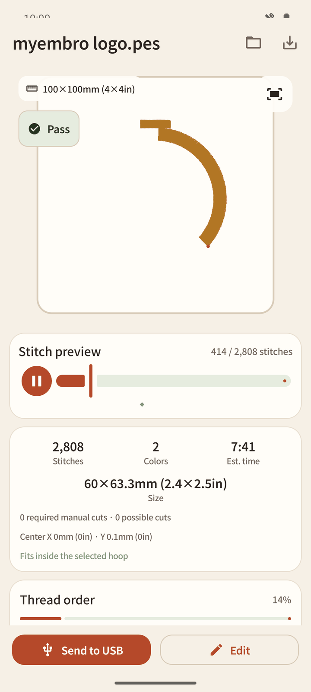

Open any design to view it with thread colors, zoom and pan and the hoop outline. Stitch playback shows progress (for example 414/2,808 stitches), and statistics show stitch count, colors, estimated time and size. PES (v1–v10), PEC and DST can be opened.

## 8. Sew-out check

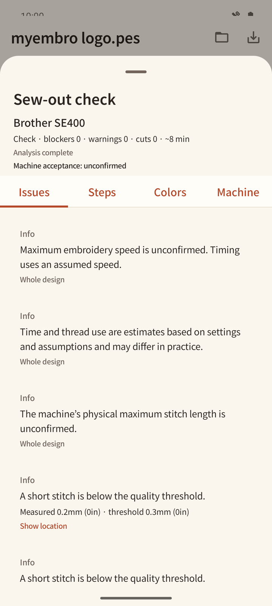

The **Sew-out check** sheet shows the selected machine (here Brother SE400), the number of blocks, warnings and thread trims, and the estimated time. Tabs: **Issues**, **Steps**, **Colors**, **Machine**. Info items explain what is unverified (for example the maximum sewing speed used for time estimates); **Show location** jumps to the stitch.

Every design the app generates is checked before saving or sending for the conditions that cause real sew-out failures:

- too many needle penetrations in one 0.5mm cell
- repeated penetrations at the same point
- missing start/end lock stitches
- stitches longer than 12.0mm
- file errors, or stitches outside the hoop (0–999 in 0.1mm units)

If any check fails, saving and sending are blocked. Imported PES files are kept byte-for-byte.

## 9. Sending to the machine

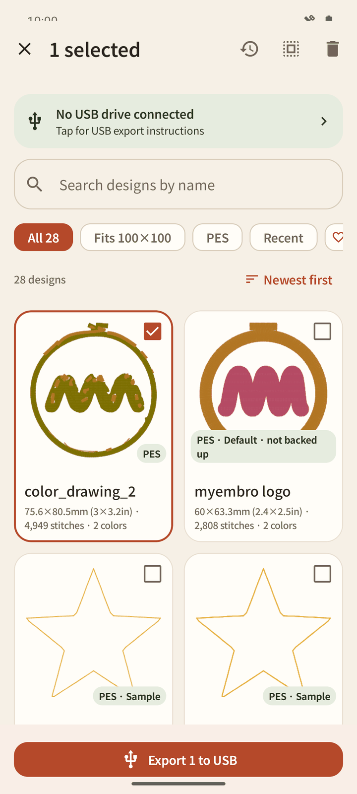

1. Connect the phone to the machine. For the Brother SE400, use a USB cable (USB-B on the machine side). For other models, connect a USB flash drive to the phone (OTG), export, then plug the drive into the machine.
2. In **Designs**, enter selection mode and check the designs to send. Filters: **All**, **Fits 100×100**, **PES**, **Recent**, favorites.
3. Tap **Export 1 to USB** (the count follows your selection). If no USB drive is connected, a banner says **No USB drive connected**; tap it for USB export instructions.

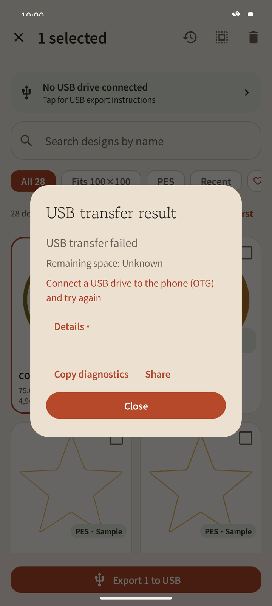

If the transfer fails, the result screen explains how to connect (OTG) and offers **Copy diagnostic info**.

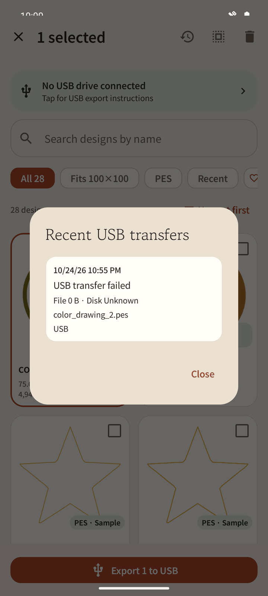

The clock icon in selection mode opens the recent USB transfer history (the screenshot was taken on an emulator, so only failed attempts are listed).

**Important:** a file sent to the machine over USB is erased when the machine is turned off, unless you save it to the machine's internal memory.

**Other machines:** the machine list has 58 Brother embroidery models sold in the United States and Korea (chapter 10). Only the SE400 is tested on a real machine; the others follow Brother's manuals and product pages.

## 10. Backup, restore and my threads

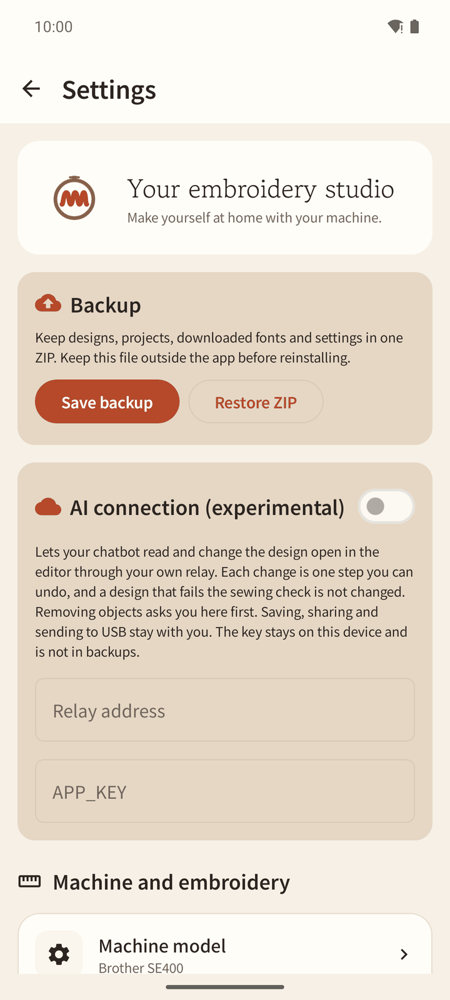

At the top of **Settings**, **Backup** stores designs, projects, downloaded fonts and settings in one ZIP. Tap **Save backup** and keep the ZIP outside the app; **Restore ZIP** reads it back. Below it are **AI connection (experimental)** (chapter 13) and **Machine model**, which shows the selected model (Brother SE400) with its maximum embroidery area (100×100mm) and notes. The list has 58 Brother embroidery models, grouped by region: 30 sold in the United States (SE, PE, NS, NQ, XE, XJ, XP, EV, PR) and 28 sold in Korea (M, LB, Innovis, F, PR). Each shows its maximum embroidery area. Models larger than 100×100mm are marked **Not verified on a physical machine**. The full list with sources is in [machines.md](../machines.md).

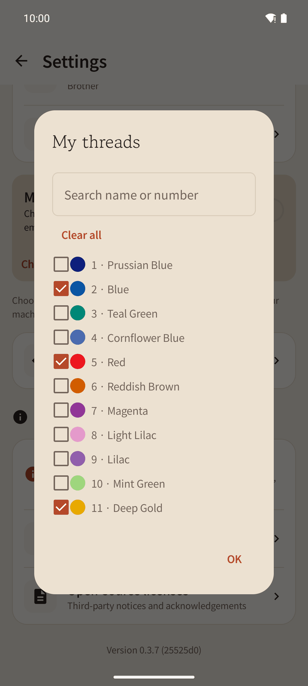

**My threads** (under **Threads**): turn it on and tap **Choose threads** to tick the Brother threads you own. Search by name or number. Color drawings then use only your threads. An empty list uses all colors. My threads is kept in the backup.

**Moving from an alpha to the beta:** the beta is signed with the official key, so it cannot be installed over an alpha. Save a backup in the alpha, uninstall it, install the beta and restore the ZIP. Updates from the beta onward install normally.

## 11. About and known limitations

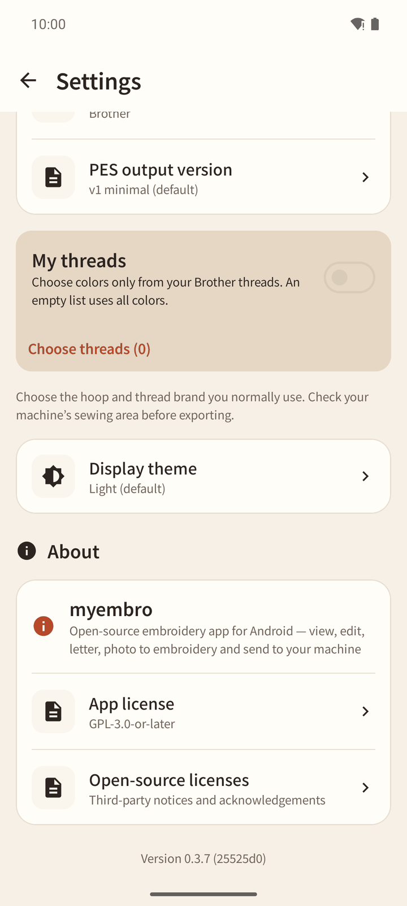

At the bottom of **Settings**: **Display theme**, **About** (**App license** GPL-3.0-or-later, **Open-source licenses**) and the version (0.3.7 with the build commit). myembro is GPL-3.0-or-later.

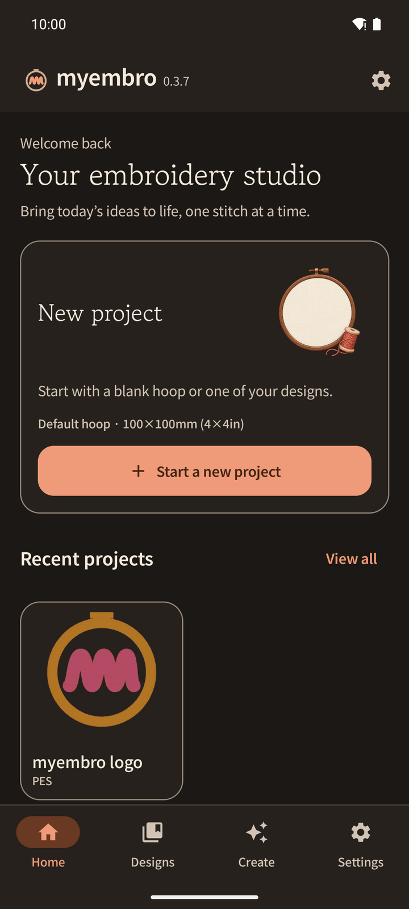

Known limitations:
- Moving from an alpha to the beta needs one uninstall/reinstall; back up first.
- Only the SE400 is tested on a real machine. Other models follow Brother's published specifications.

## 12. Ask AI

Ask AI lets any chatbot app edit your design: Gemini, ChatGPT, Claude or another chat app on your phone. myembro has no AI built in and stores no account or API key. You use the chatbot you already have.

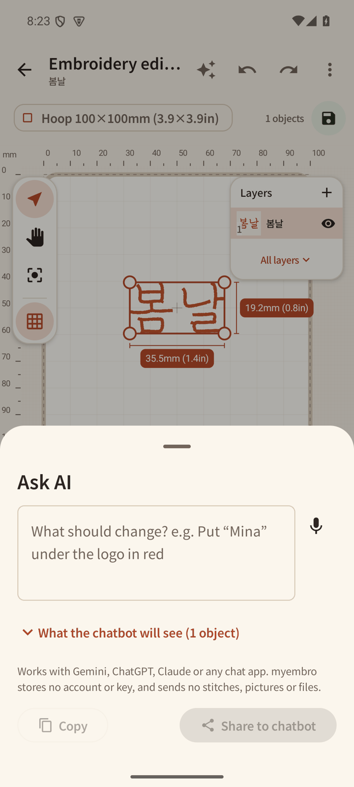

1. In the editor, tap the **Ask AI** button (sparkle icon, top bar).
2. Type what should change, for example *Put "Mina" under the logo in red*, or tap the microphone if your phone has speech input.
3. Tap **Share to chatbot** and pick your chat app, or tap **Copy** and paste it into the chat yourself. A bar shows **Waiting for the chatbot's reply (p-…)**. The code ties the reply to this request.
4. When the chatbot answers, copy its whole reply and either share it back to myembro or tap **Paste reply** in the bar, then **Check**.

   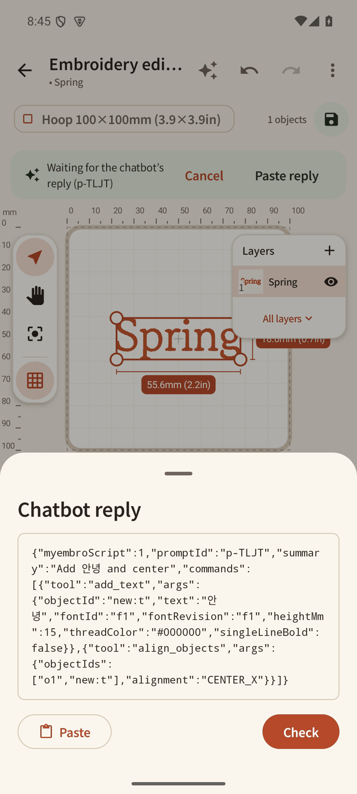

5. **Check the changes** shows **Before** and **After** pictures, a list of the changes, and the **Sewout check** result. Nothing has changed yet. Tap **Apply**, **Cancel**, or **Ask for changes** to send a follow-up to the chatbot.

   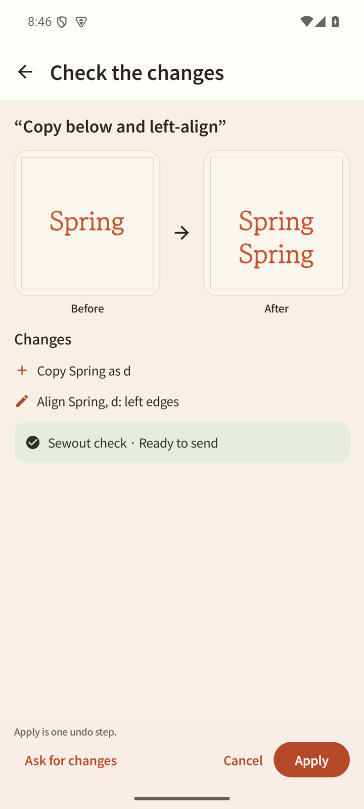

6. **Apply** makes the whole change one undo step. Tap **Undo** once to return to the design as it was.

   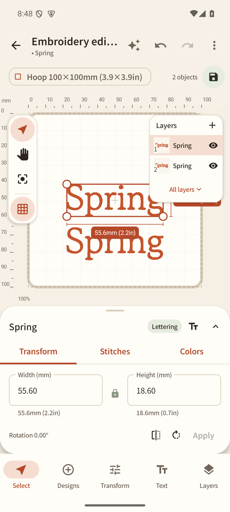

**What the chatbot receives** (tap **What the chatbot will see** to read it before sending):
- the instructions and the list of commands myembro accepts;
- the hoop name and size;
- for each object: a short handle (o1, o2, …), whether it is text or a design, its name, the text and text height, the font (as a handle f1, f2, …), centre position, size, rotation, scale, thread colours, sewing order and whether it is hidden;
- the fonts on your phone that cover the text (handle, name, Korean/Latin, height range) and the built-in designs (handle, name, size);
- your request.

myembro sends **no stitches, pictures or files**, and the chatbot cannot reach your phone. The reply is only text that myembro reads and checks.

**Always confirmed by you in the app:** deleting objects, saving, sharing and USB transfer. If the reply asks for these, the app shows them after Apply so you can confirm each one, for example **USB transfer…**.

**When a reply is refused,** the app says why and changes nothing. Reasons include no myembro commands in the reply, damaged commands, or a reply for an older request or a design that has changed since. **Copy a fix-up request** gives the chatbot a short correction to answer.

**What Ask AI cannot do:**
- It cannot see or create pictures. Use **Photo/drawing** for photos.
- It cannot download fonts.
- It can add text only in fonts already on your phone (the prompt lists them with their height ranges).
- Sizes and stitch types still follow the app's automatic rules and the sew-out check.

## 13. AI connection (experimental)

AI connection lets a chatbot work on your design directly, without copy and paste. It needs your own relay server (a Cloudflare Worker, see [relay/README.md](../../relay/README.md)) and a chatbot that supports MCP connectors, such as Claude. myembro still has no AI built in and stores no API key.

1. In **Settings**, turn on **AI connection (experimental)**.
2. Enter the **Relay address** (wss://…) and the **APP_KEY** of your relay. The key stays on this phone and is not in backups.
3. Add the relay as a connector in your chatbot. A notification shows while the connection is on.

What the chatbot can do:
- Read the design open in the editor and change it. Each change is one undo step. A change that fails the sewing check is not made.
- Add a picture it drew (SVG, PNG or JPEG). It opens in the photo window first, so you check it before it is added.
- Look at a photo you choose: in the editor menu tap **Send a photo to AI** and confirm. The chatbot sees a reduced copy only.

What stays with you: removing objects asks you on the phone first (you have 90 seconds), and saving, sharing and sending to USB are always done by you in the app.
