# myembro User Guide

**English** | [한국어](user-guide.ko.md)

This guide follows the app from the home screen onward, in the order you use it. Each chapter has a **screen layout** (numbered picture and table), **how to use it** and **good to know**. The numbers in the picture match the numbers in the table.

1. [Install and home](#1-install-and-home)
2. [Starting a new project](#2-starting-a-new-project)
3. [Editor](#3-editor)
4. [Block editing](#4-block-editing)
5. [Lettering](#5-lettering)
6. [Photo to embroidery](#6-photo-to-embroidery)
7. [Emoji](#7-emoji)
8. [Design list and viewer](#8-design-list-and-viewer)
9. [Sew-out check](#9-sew-out-check)
10. [Sending to the machine](#10-sending-to-the-machine)
11. [Find free designs](#11-find-free-designs)
12. [Settings](#12-settings)
13. [Ask AI](#13-ask-ai)
14. [AI connection (experimental)](#14-ai-connection-experimental)
15. [Known limitations](#15-known-limitations)
- [Appendix. How stitches are made](#appendix-how-stitches-are-made)

## 1. Install and home

### Install

1. On your Android phone, tap [Download the app](https://github.com/linker2k/myembro/releases/latest/download/myembro.apk).
2. Open the downloaded `myembro.apk`.
3. If the phone asks, allow installs from this source.

The app opens on the home screen.

### Screen layout

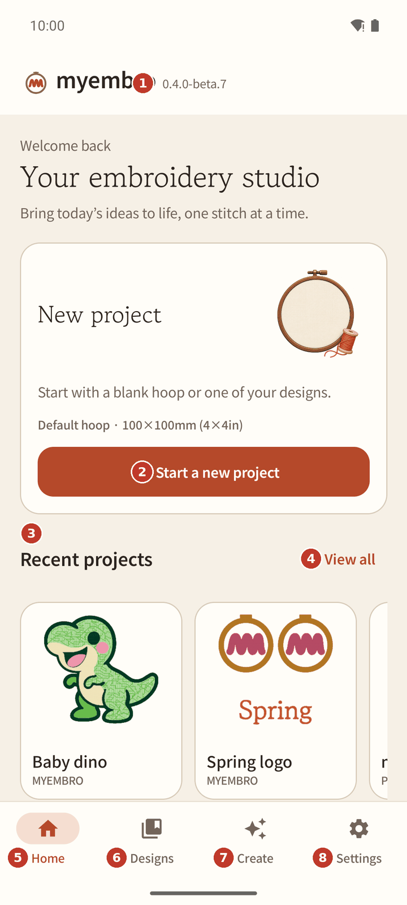

| No. | Name | What it does |
|---|---|---|
| 1 | Version info | The app version. Tap it to open version info. |
| 2 | Start a new project | Opens the sheet where you choose how to start (chapter 2). The card above shows the default hoop. |
| 3 | Recent projects | Projects and designs you saved recently. Tap one to open it in the viewer. |
| 4 | View all | Opens the whole design list (chapter 8). |
| 5 | Home | This screen. |
| 6 | Designs | The design list (chapter 8). |
| 7 | Create | Opens the new project sheet. |
| 8 | Settings | Settings (chapter 12). |

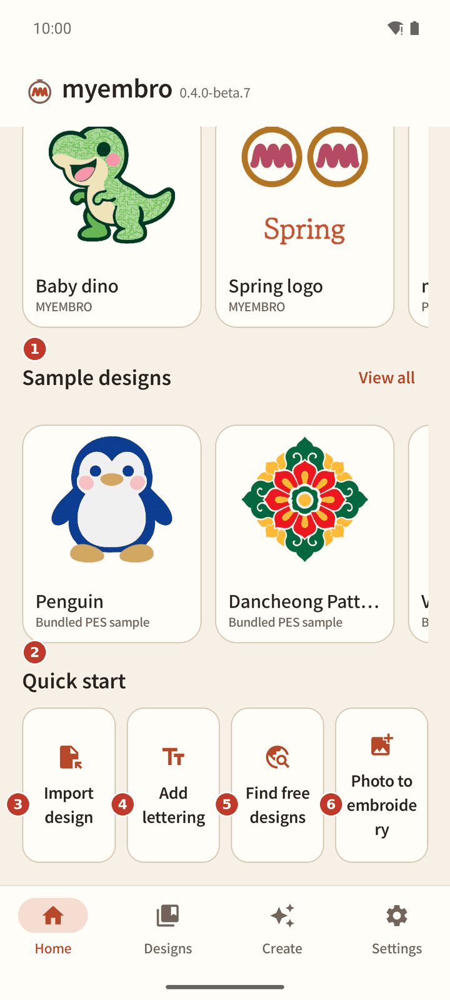

| No. | Name | What it does |
|---|---|---|
| 1 | Sample designs | Some of the 136 built-in designs. Tap one to copy it into your projects and open the editor. |
| 2 | Quick start | Four common tasks. |
| 3 | Import design | Adds PES, PEC or DST files from your phone to the design list. |
| 4 | Add lettering | Opens the lettering screen (chapter 5). |
| 5 | Find free designs | Opens a list of free design sites (chapter 11). |
| 6 | Photo to embroidery | Turns a photo or drawing into embroidery (chapter 6). |

### How to use it

1. The first time, tap **Start a new project**.
2. To continue earlier work, tap a design under **Recent projects**.

## 2. Starting a new project

### Screen layout

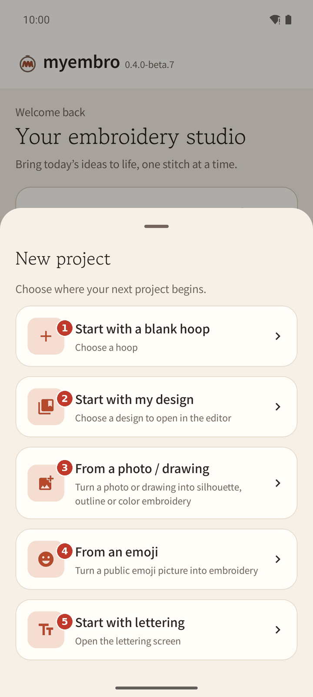

| No. | Name | What it does |
|---|---|---|
| 1 | Start with a blank hoop | Choose a hoop and an empty editor opens. |
| 2 | Start with my design | Choose a design and the editor opens with it. |
| 3 | From a photo / drawing | Turns a photo or drawing into silhouette, outline or color embroidery (chapter 6). |
| 4 | From an emoji | Turns an emoji picture into embroidery (chapter 7). |
| 5 | Start with lettering | Opens the lettering screen (chapter 5). |

### How to use it

1. On the home screen, tap **Start a new project**.
2. Tap a way to start.
3. **Start with my design** opens the design picker. Search by name, or pick from the **My designs** or **Samples** tab.

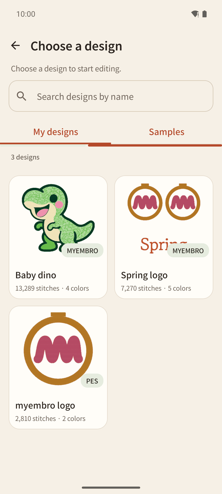

## 3. Editor

Here you place designs and lettering on the hoop and change them. From top to bottom: the top bar, the second row, the canvas, the bottom panel and the bottom tabs.

### 3.1 Screen layout

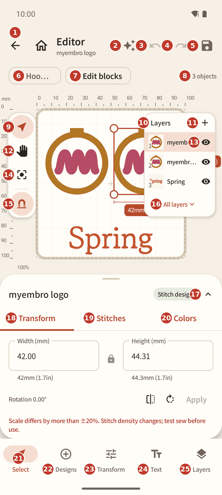

| No. | Name | What it does |
|---|---|---|
| 1 | Back | Goes to the design list. If you opened the design from the viewer, a home icon is next to it. |
| 2 | Ask AI | Asks a chatbot to make a change (chapter 13). |
| 3 | Undo | Undoes the last change. Dimmed when there is nothing to undo. |
| 4 | Redo | Redoes an undone change. |
| 5 | Save | Opens the save sheet (3.8). |
| 6 | Hoop chip | The current hoop. Tap it to open the hoop menu (3.8). |
| 7 | Edit blocks | Changes how each color region is sewn (chapter 4). |
| 8 | Object count | How many objects are on the hoop. |
| 9 | Select tool | Tap an object to select it and drag to move it. |
| 10 | Layers panel | The list of objects (3.3). |
| 11 | Add design (+) | Opens the add design sheet (3.3). |
| 12 | Pan canvas | Drag to move only the view. |
| 13 | Hide layer (eye) | Hides or shows that object. |
| 14 | Fit hoop to screen | Fits the whole hoop on the screen. |
| 15 | Snap | When on, a moving object snaps to the hoop center or to the edges and centers of other objects. |
| 16 | All layers | Opens the layers sheet (3.3). |
| 17 | Expand/collapse properties | Opens or closes the bottom panel. Its header shows the object name and type (Stitch design or Lettering). |
| 18 | Transform tab | Size, position and rotation (3.4). |
| 19 | Stitches tab | Stitch information and preview (3.6). |
| 20 | Colors tab | Fabric and thread colors (3.7). |
| 21 | Bottom tab: Select | Turns multi-select mode on and off (3.5). |
| 22 | Bottom tab: Designs | Opens the add design sheet (3.3). |
| 23 | Bottom tab: Transform | Opens the bottom panel on the Transform tab. |
| 24 | Bottom tab: Text | Opens the lettering screen (chapter 5). With lettering selected, it becomes **Edit lettering**. |
| 25 | Bottom tab: Layers | Opens the layers sheet (3.3). |

### 3.2 Canvas and floating tools

**How to use it**

1. Tap an object to select it. A selection box with corner handles appears.
2. Drag the object to move it.
3. Drag a corner handle to resize. The size shows in mm and inches.
4. Use two fingers to resize and rotate. On empty fabric, two fingers zoom or move the view.
5. In the floating tools on the left, choose **Select**, **Pan canvas**, **Fit hoop to screen** or **Snap**.

**Good to know**

- Rulers in mm run along the top and left. The zoom level is at the bottom left.
- If an object leaves the hoop, **Design extends outside the sewing area** appears.

### 3.3 Layers and adding designs

Each object is one layer. The number is the sewing order.

**How to use it**

1. Tap a row in the layers panel to select that object. Each row has a number, a small picture and a name.
2. Tap the eye to hide or show it.
3. Tap **All layers** to open the layers sheet.
4. In the sheet, press and hold a grip and drag to change the sewing order. Sewing goes from top to bottom.

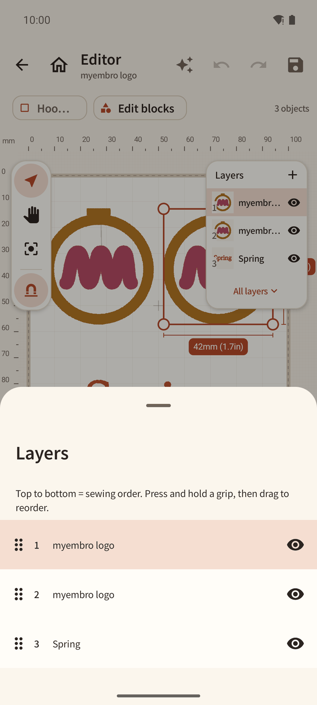

5. Tap **+** or the **Designs** bottom tab to open the add design sheet.
6. Tap **Import designs** to add a file from your phone, or tap one of your designs in the list below.

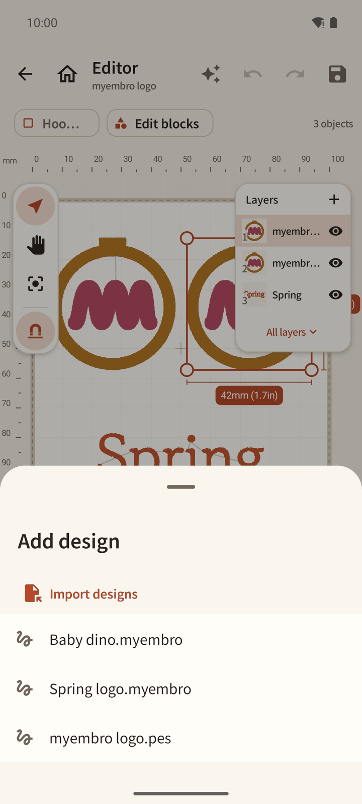

### 3.4 Transform tab and object properties

#### Screen layout

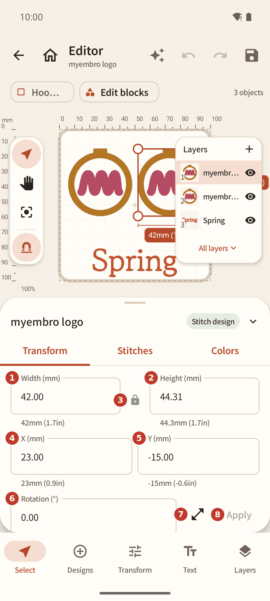

| No. | Name | What it does |
|---|---|---|
| 1 | Width | Width in mm. Inches show below. |
| 2 | Height | Height in mm. |
| 3 | Lock aspect ratio | When locked, width and height keep their ratio. |
| 4 | X position | Horizontal distance from the hoop center, in mm. |
| 5 | Y position | Vertical distance from the hoop center, in mm. Positive is down. |
| 6 | Rotation | Angle in degrees. |
| 7 | Object properties | Opens the object properties window. |
| 8 | Apply | Applies the values you entered. |

#### How to use it

1. Select an object and open the **Transform** tab.
2. Enter values and tap **Apply**.
3. Scroll down for **Duplicate**, **Mirror**, **Rotate 90°**, **Center** (to the hoop center) and **Delete**. Delete can be undone too.
4. With the panel collapsed, only width, height, rotation, **Mirror**, **Rotate 90°** and **Apply** show.
5. **Object properties** sets X, Y, rotation, **width (%)** and **height (%)** in one go. Size can be 5–2000%.

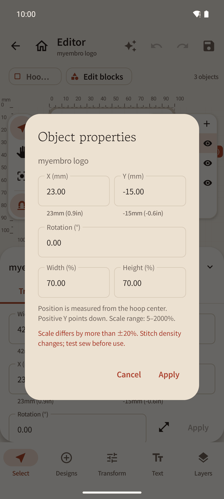

#### Good to know

- If you change the size by more than 20% from the original, **Scale differs by more than ±20%. Stitch density changes; test sew before use.** appears.
- There is no vertical flip. Use Mirror together with Rotate 90°.

### 3.5 Selecting several objects and aligning

#### Screen layout

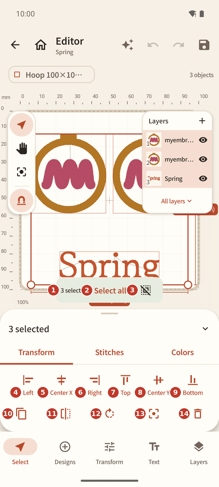

| No. | Name | What it does |
|---|---|---|
| 1 | Selected count | How many objects are selected. |
| 2 | Select all | Selects every object. |
| 3 | Clear | Clears the selection. |
| 4 | Align left | Lines up the left edges. |
| 5 | Center X | Lines up the horizontal centers. |
| 6 | Align right | Lines up the right edges. |
| 7 | Align top | Lines up the top edges. |
| 8 | Center Y | Lines up the vertical centers. |
| 9 | Align bottom | Lines up the bottom edges. |
| 10 | Duplicate | Copies the selected objects. |
| 11 | Mirror | Flips them left to right. |
| 12 | Rotate 90° | Turns them 90°. |
| 13 | Center in hoop | Moves the group to the hoop center. |
| 14 | Delete | Deletes the selected objects. |

#### How to use it

1. Tap the **Select** bottom tab. A selection bar appears below the canvas.
2. Tap objects one by one, or tap **Select all**.
3. Tap an align button on the **Transform** tab. With three or more selected, **Space horizontally** and **Space vertically** work too.
4. When done, tap **Clear**, then tap the **Select** bottom tab again to leave the mode.

### 3.6 Stitches tab

#### Screen layout

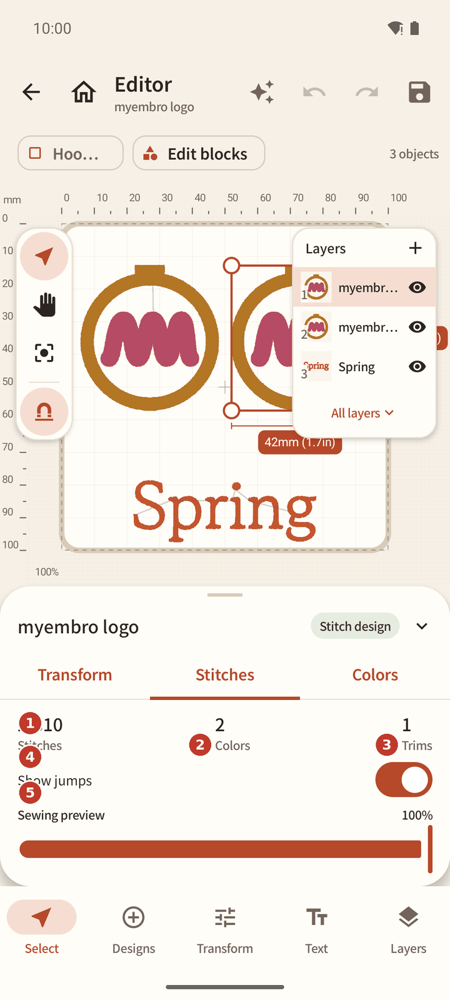

| No. | Name | What it does |
|---|---|---|
| 1 | Stitches | Needle drops in the selected object. |
| 2 | Colors | Number of thread colors. |
| 3 | Trims | Number of thread cuts. |
| 4 | Show jumps | When on, threads that jump across show as lines on the canvas. |
| 5 | Sewing preview | Drag it to see how far the sewing has got, in sewing order. |

#### How to use it

1. Select an object and open the **Stitches** tab.
2. Turn on **Show jumps** to see whether there are many jumps.
3. Drag **Sewing preview** to check the order.

### 3.7 Colors tab, color sheet and thread picker

#### Screen layout

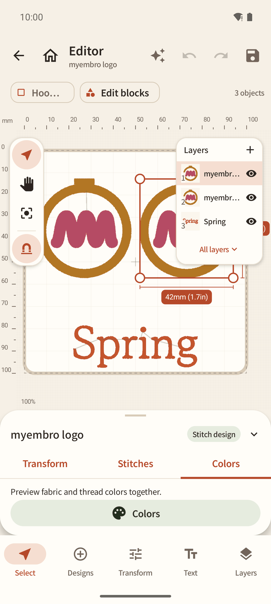

The Colors tab has a short note and a **Colors** button. Tap **Colors** to open the color sheet.

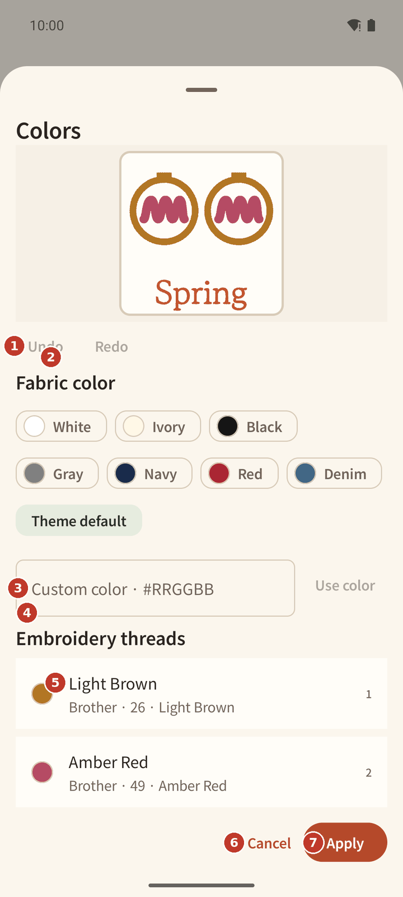

| No. | Name | What it does |
|---|---|---|
| 1 | Undo | Undoes color changes made in the sheet. Redo is next to it. |
| 2 | Fabric color | Choose White, Ivory, Black, Gray, Navy, Red, Denim or Theme default. |
| 3 | Custom color | Enter a fabric color as #RRGGBB, or tap **Use color** to pick one. |
| 4 | Embroidery threads | The design's threads, with order, name, brand and number. |
| 5 | Thread row | Tap it to open the Brother thread list. |
| 6 | Cancel | Drops the changes. |
| 7 | Apply | Applies the new colors to the design. |

#### How to use it

1. On the **Colors** tab, tap **Colors**.
2. Choose a fabric color while watching the preview at the top. The fabric color is for preview only.
3. Tap the thread row to change. Choose a new thread in the **Pick a Brother thread** list. My threads (chapter 12) come first.
4. Tap **Apply**.

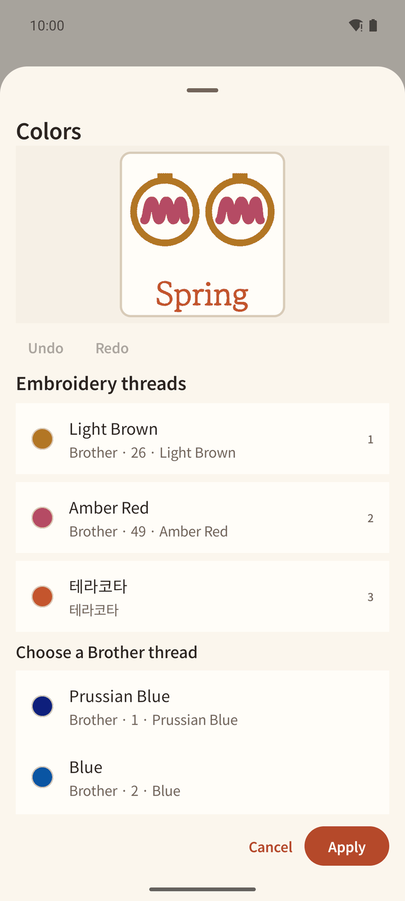

#### Good to know

- If the design changes while the sheet is open, the app asks you to open the sheet again.

### 3.8 Hoop and saving

#### Hoop menu

Tap the hoop chip to choose a hoop.

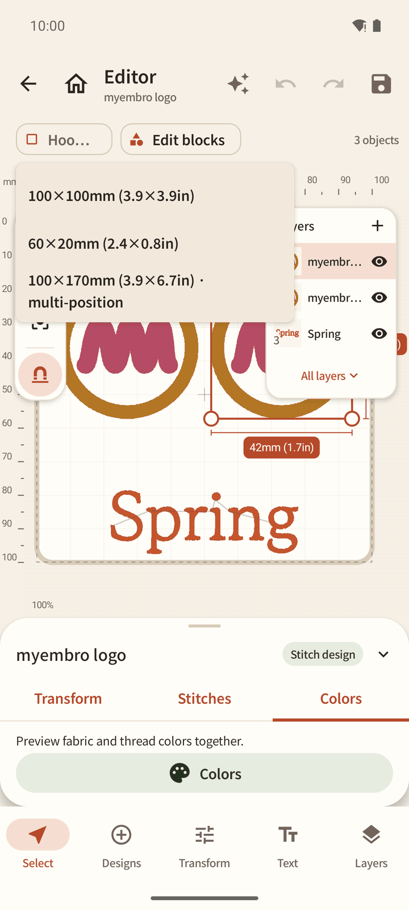

1. Choose a machine hoop (for example 100×100mm).
2. **Custom frames** you made in Settings (for example 60×20mm) also appear here (chapter 12).
3. Choose a **multi-position** hoop (for example 100×170mm) and use **Export by position** to make a separate file for each position.

#### Save sheet

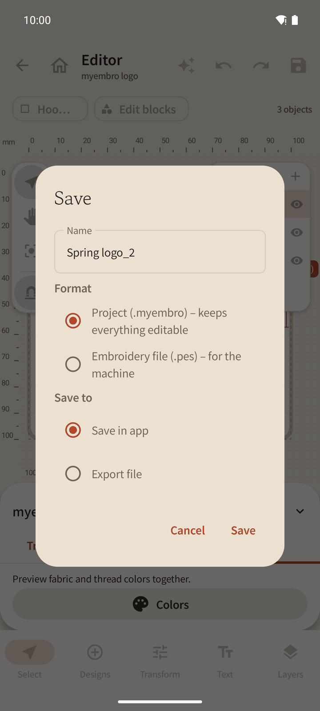

1. Tap the **Save** icon at the right of the top bar.
2. If the design was opened from a file, first choose **Save (replace)** or **Save as…**.
3. Enter a **Name**.
4. Choose a **Format**. **Project (.myembro)** keeps everything editable. **Embroidery file (.pes)** is for the machine.
5. Choose where to **Save to**. **Save in app** puts it in the design list. **Export file** saves it to a folder on the phone.
6. Tap **Save**. If the name already exists, the app asks whether to replace it.

#### Good to know

- If you leave without saving, **Save your work?** appears. Choose **Save**, **Discard** or **Cancel**.
- Your work is saved as a draft even if the app closes. Next time, **Restore unfinished work?** appears.
- A design blocked by the sew-out check cannot be saved in any format (chapter 9).

## 4. Block editing

Designs made from photos, emoji or drawings keep their color regions as blocks. You can change how each block is sewn.

### Screen layout

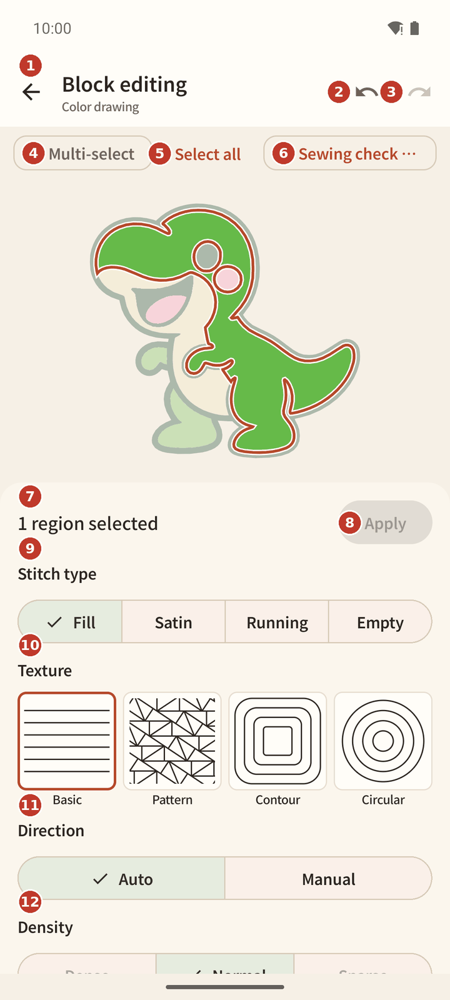

| No. | Name | What it does |
|---|---|---|
| 1 | Done | Returns to the editor. |
| 2 | Undo | Undoes the last change. |
| 3 | Redo | Redoes an undone change. |
| 4 | Multi-select | When on, you can pick several regions. |
| 5 | Select all | Picks every region. |
| 6 | Check status | Checking, Generating…, **Sewing check passed · in hoop** or **Sewing check blocked**. |
| 7 | Selected regions | How many regions are selected. |
| 8 | Apply | Makes new stitches with the chosen settings. |
| 9 | Stitch type | Fill, Satin, Running or Empty. |
| 10 | Texture | The fill pattern: Basic, Pattern, Contour or Circular. |
| 11 | Direction | Automatic or manual stitch angle. |
| 12 | Density | Only Normal works for now. |

### How to use it

1. In the editor, tap **Edit blocks**.
2. Tap a region on the canvas. For several, turn on **Multi-select** and tap them, or tap **Select all**.
3. Choose a **Stitch type**. Types that cannot be used are dimmed, with the reason (for example *Satin: this shape cannot be satin*).
4. For a fill, choose a **Texture**. With **Pattern**, pick a pattern from the **Meander tile** list.

   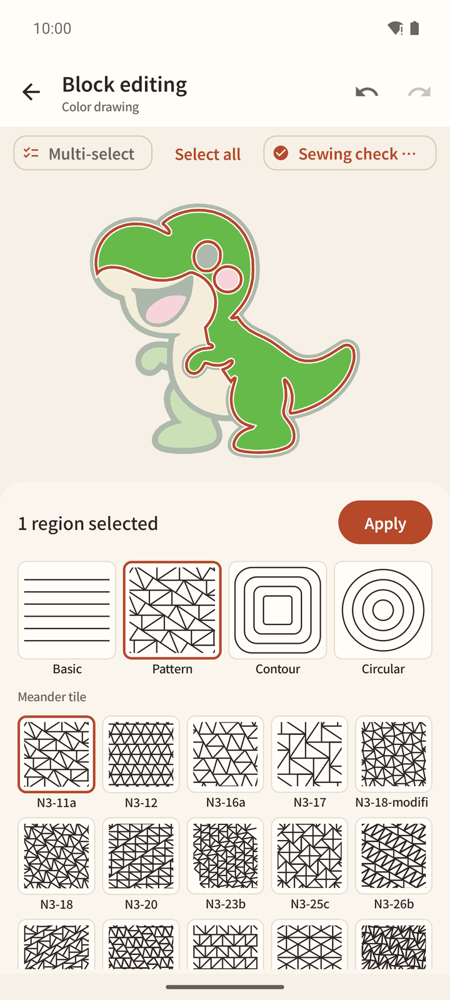

5. Under **Direction**, choose **Auto** or **Manual**. With Manual, set the angle (see [Manual angle](#manual-angle) below).
6. Scroll down to **Sewing order**. It reads like "Sewn 1 of 10 (front = sewn first)". Move it with **First**, **Forward**, **Back** or **Last**.

   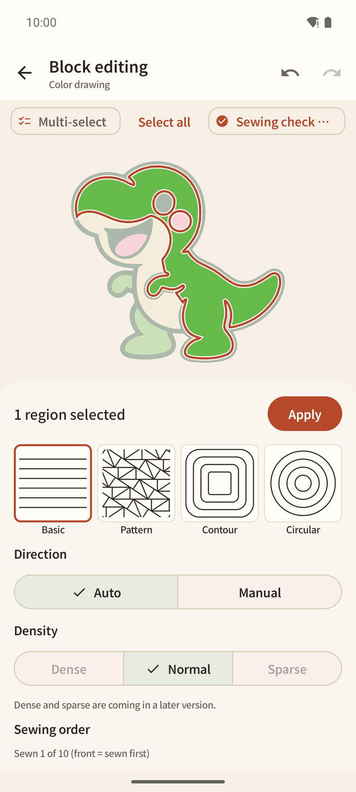

7. Tap **Apply**. The seconds taken and a **Cancel** button show.
8. When finished, tap **Done**.

### Manual angle

Set the direction of the stitch rows in a fill region yourself.

#### Screen layout

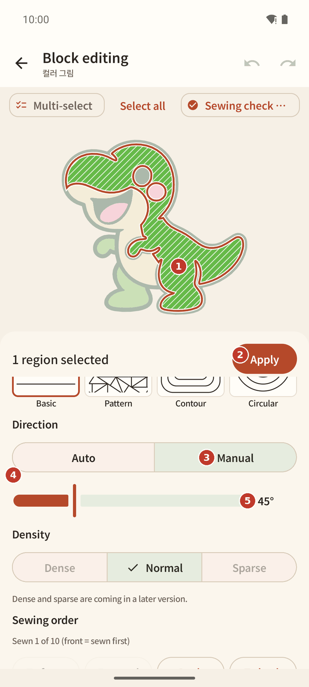

| No. | Name | What it does |
|---|---|---|
| 1 | Hatching preview | Hatching at the chosen angle shows over the selected regions. It is only a preview; the stitches do not change yet. It is drawn in white on dark threads and in black on light threads. |
| 2 | Apply | Tap it to change the stitches to that angle. |
| 3 | Direction (Auto/Manual) | **Auto** is the app default, 0° (horizontal rows). **Manual** shows the slider. |
| 4 | Angle slider | Sets 0–179° in 1° steps. |
| 5 | Angle value | The current angle. |

#### How to use it

1. In block editing, select a fill region.
2. Under **Texture**, choose **Basic**.
3. Under **Direction**, tap **Manual**.
4. Drag the slider to set the angle. Check the direction with the hatching.
5. Tap **Apply**.
6. When you select that region again later, the slider shows its current angle.

#### Row direction

| Angle | Stitch rows |
|---|---|
| 0° | Horizontal (─) |
| 45° | Rising to the right (/) |
| 90° | Vertical (│) |
| 135° | Rising to the left (\\) |

Higher values turn the rows counterclockwise.

#### Good to know

- The angle changes the visible stitch rows only with the **Basic** fill texture. With **Pattern**, **Contour** and **Circular**, the top stitches look the same; only the underlay beneath them changes direction.
- Direction does not show for Satin, Running and Empty.
- With several regions selected, "The same angle goes to all N regions" appears and they all get the same angle.

### Good to know

- **Empty** sews nothing in that block, so the fabric shows. You cannot empty every block.
- Dense and sparse are coming in a later version.
- If the new stitches fail the sew-out check, **Not applied** appears and the previous settings stay. Tap **Details** to see why (for example, satin stitches would exceed 12mm).
- Where needles would pile up too much, no outline running stitch is added. Then **Outline left out in N places** appears.
- Each order change is one undo step.
- A design with stitches only (for example an imported PES) has no blocks, so **This design has stitches only, so block settings are not available** appears.

## 5. Lettering

### Screen layout

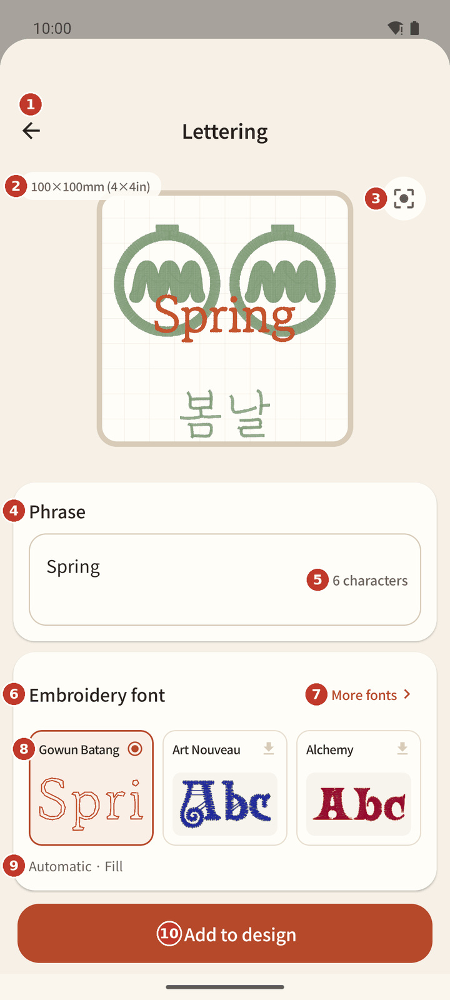

| No. | Name | What it does |
|---|---|---|
| 1 | Back | Returns to the editor. If you changed something, the app asks whether to discard it. |
| 2 | Hoop size | The current hoop. |
| 3 | Hoop/lettering fit | Fits the preview to the whole hoop or to the lettering. |
| 4 | Phrase | The text to embroider. |
| 5 | Character count | How many characters you typed. |
| 6 | Embroidery font | Three quick fonts. |
| 7 | More fonts | Opens the font list. |
| 8 | Font card | Tap to switch to that font. |
| 9 | Stitch type | The stitch type the app chose (for example Automatic · Fill). |
| 10 | Add to design | Puts the lettering in the editor. |

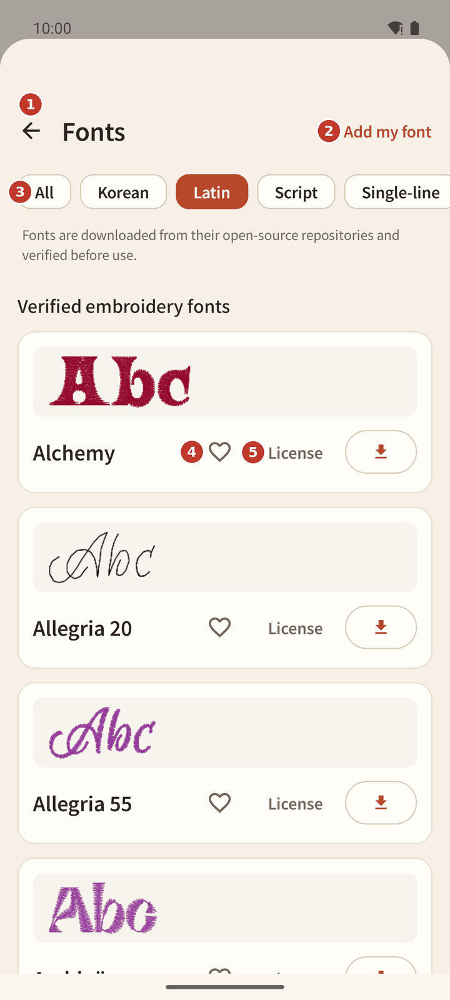

| No. | Name | What it does |
|---|---|---|
| 1 | Back | Returns to the lettering screen. |
| 2 | Add my font | Adds your own TTF font. |
| 3 | Font filters | All, Korean, Latin, Script, Single-line, Outline. |
| 4 | Favorite | Tap the heart to make it a favorite. |
| 5 | License | Shows the font license. |

### How to use it

1. Tap the **Text** bottom tab in the editor, or **Add lettering** on the home screen.
2. Type your text under **Phrase**.
3. Tap a quick font, or choose one in **More fonts**. For a font you do not have yet, tap **Download**.
4. Check the preview.
5. Tap **Add to design**.
6. To change lettering you already added, select it in the editor and tap the **Text** bottom tab.

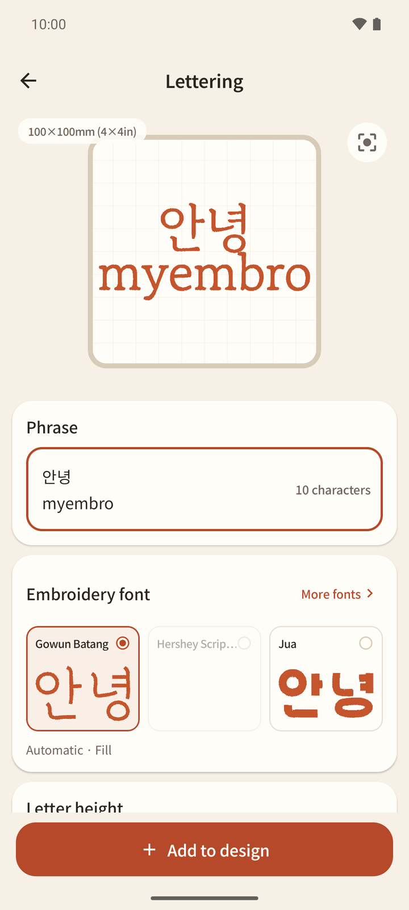
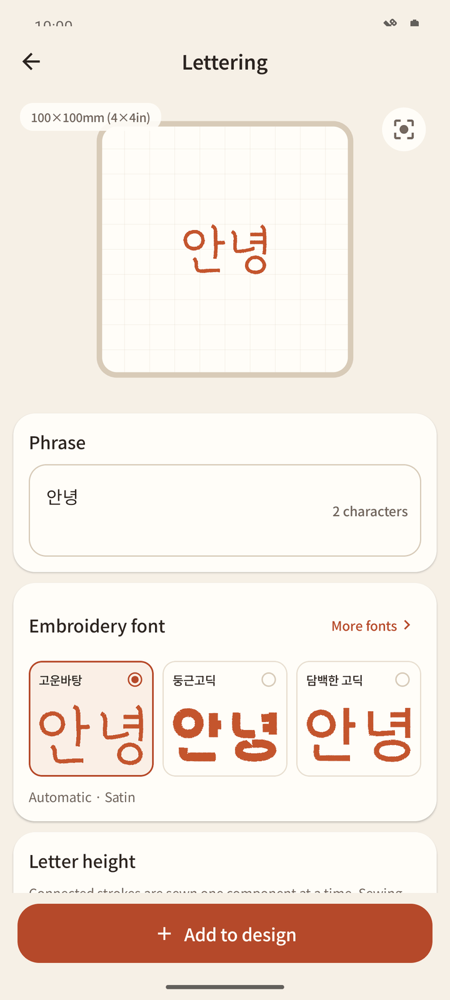

### Good to know

- The app chooses the stitch type. In the pictures above, '안녕 myembro' (Korean mixed with Latin) became fill, and '안녕' (Korean only) became satin.
- Only sizes that sew safely are allowed.
- Fonts are downloaded from their open-source repositories and verified before use. A font that cannot be used shows the reason on its card (for example, it does not support the Korean you typed).
- Japanese kana works too. Voiced marks (゛ and ゜) are sewn after the character.
- Chinese (Han character) lettering is still in development.

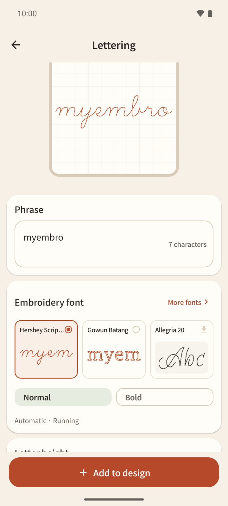
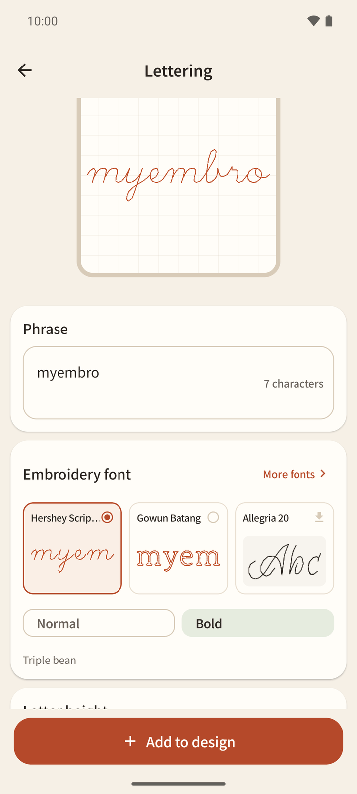

- Single-line fonts have **Normal** (one pass) and **Bold** (three passes). Where the font goes over the same part twice, Bold can give six passes.

## 6. Photo to embroidery

There are three steps: crop, mode and result. Sharing a picture to myembro from another app also opens this screen.

### Step 1: Crop

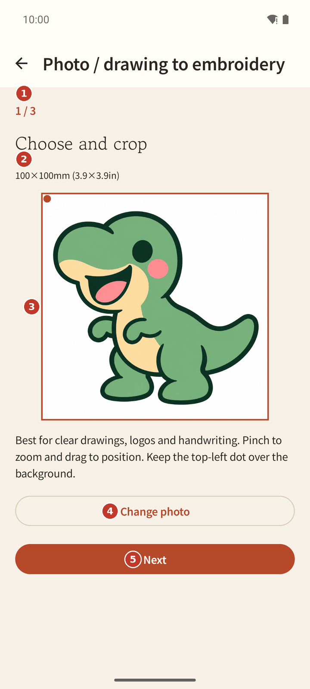

| No. | Name | What it does |
|---|---|---|
| 1 | Step | The current step (1/3). |
| 2 | Hoop size | The hoop to fit. |
| 3 | Crop frame | Pinch to zoom and drag to position. |
| 4 | Photos | Pick a picture from your photos. |
| 5 | Files | Pick a picture file, including SVG. |
| 6 | Next | Goes to step 2. |

1. Tap **Photos** or **Files** and pick a picture.
2. Fit the part you want inside the frame. You can zoom out so the whole picture shows.
3. Tap **Next**.

Any phone with Android 8.0 or later can pick pictures. On older phones **Photos** may open the file screen instead; you pick the same way.

### Step 2: Mode

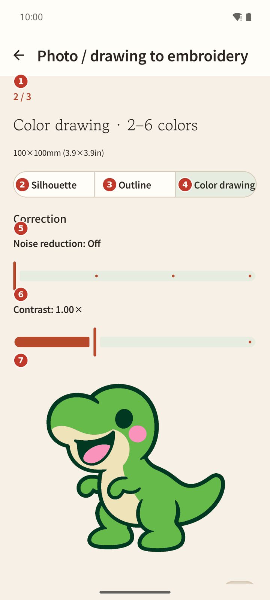

| No. | Name | What it does |
|---|---|---|
| 1 | Step | The current step (2/3). |
| 2 | Silhouette | Fills with one color. |
| 3 | Outline | Makes a one-color outline. |
| 4 | Color drawing | Fills with 2–6 colors. Starts at 4. |
| 5 | Noise reduction | Off, Weak, Medium or Strong. Removes small specks. |
| 6 | Contrast | 0.5×–2.0×. 1.00× keeps the picture as it is. |
| 7 | Preview | Shows the result in real thread colors. |

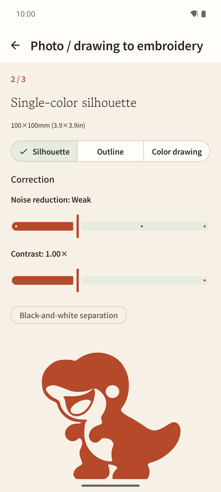
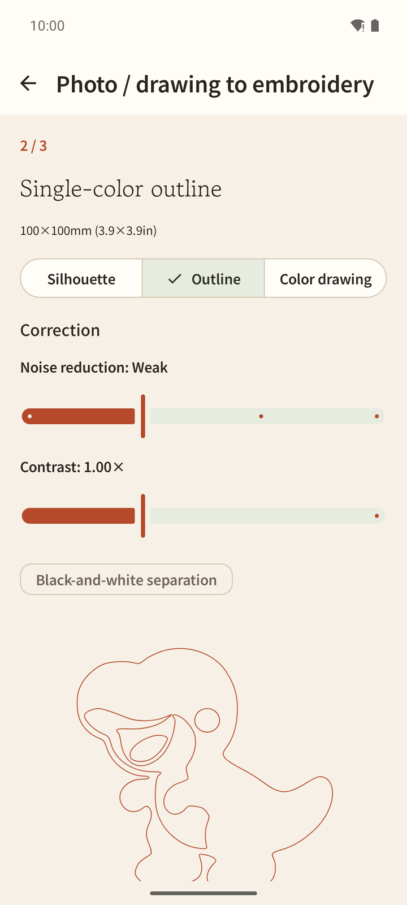

1. Tap a mode.
2. Scroll down and set the options.
   - **Black-and-white separation** (Silhouette and Outline): splits the picture into dark and light parts automatically.
   - **Colors** (Color drawing): choose 2–6 colors, or turn on **Black & white**.
   - **Resolution**: 128–1024px. Higher gives smoother edges.
   - **Remove pieces under …**: removes pieces smaller than this.
   - **Embroidery size**: shows width × height and keeps the ratio. The largest size is 99.9mm.
3. Tap **Next**.

#### Thread texture (experimental)

In Color drawing, turn on **Thread texture** to sew the picture as layered thread lines, like a sketch.

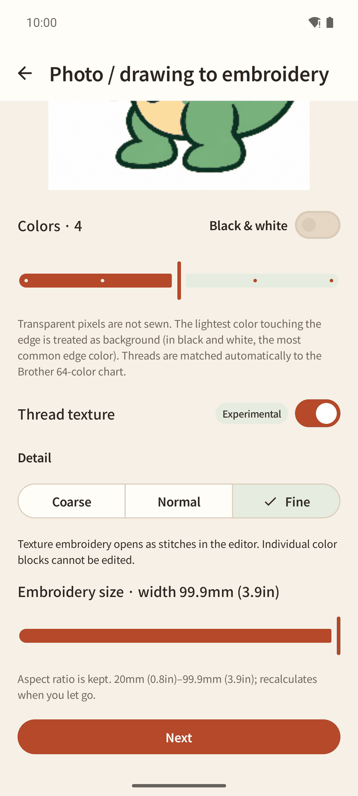

1. Turn on **Thread texture**.
2. Under **Detail**, choose **Coarse**, **Normal** or **Fine**. Finer means more stitches.
3. Tap **Next**.

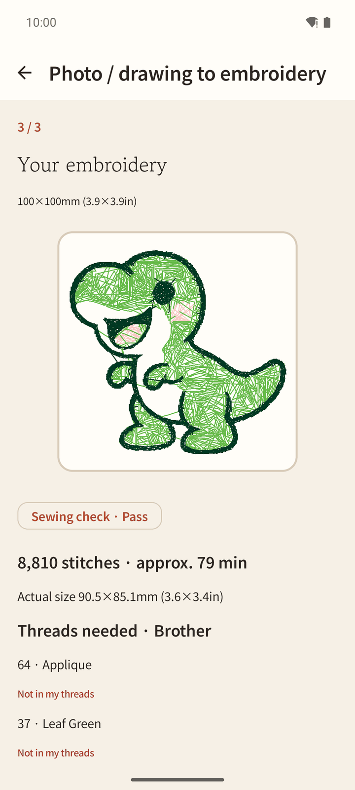

### Step 3: Result

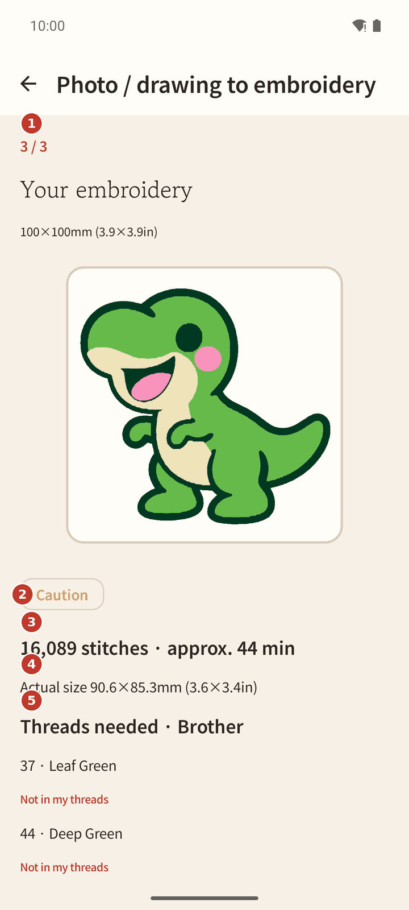

| No. | Name | What it does |
|---|---|---|
| 1 | Step | The current step (3/3). |
| 2 | Sewing check badge | Pass, Caution or Blocked. Tap it to see why. |
| 3 | Stitches and time | Stitch count and estimated time. |
| 4 | Actual size | The size that will be sewn. |
| 5 | Threads needed | Brother numbers and names. Threads you do not own are marked **Not in my threads**. |

1. While stitches are made, the progress shows. After a minute, choose **Wait 1 more minute** or **Stop**.
2. Check the result.
3. Tap **Next** at the bottom to open it in the editor. Save it, then send it to the machine (chapter 10).

### Good to know

- Transparent areas are not sewn. The lightest color touching the edge is treated as background.
- Noise reduction and contrast are not available for color drawings with a transparent background.
- Threads are matched to Brother threads automatically. If you set **My threads** (chapter 12), only your threads are used.
- Different colors are never merged into the same thread.
- Touching colors overlap by 0.2mm so no gaps show.
- In Color drawing and Silhouette, each filled region gets a same-color outline running stitch twice for a crisp edge. The second pass is offset by half a stitch.
- Where needles would pile up too much, the outline is left out and **Outline left out in N places** tells you.
- **Caution** on the result is a warning; you can still save. The Caution in the picture above is a spot where needles gather a little (chapter 9).
- Texture embroidery opens as stitches in the editor. Block editing is not available for it.
- Picture files (SVG) are used as they are; you only set the size.

## 7. Emoji

### Screen layout

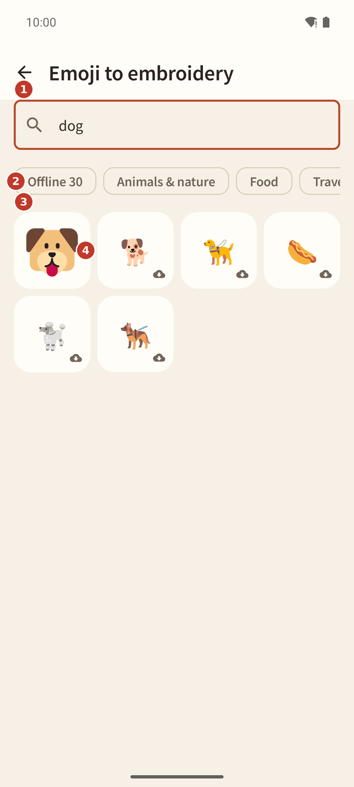

| No. | Name | What it does |
|---|---|---|
| 1 | Search | Search in English or Korean. |
| 2 | Categories | Offline 29, Animals & nature, Food, Travel and more. |
| 3 | Ready emoji | Emoji that come with the app. |
| 4 | Emoji to download | A cloud mark means it has to be downloaded first. |

### How to use it

1. In the new project sheet, tap **From an emoji**.
2. Search, or tap a category.
3. Tap an emoji.
4. Set the size with the same **Embroidery size** slider as on the photo screen.

## 8. Design list and viewer

### 8.1 Design list

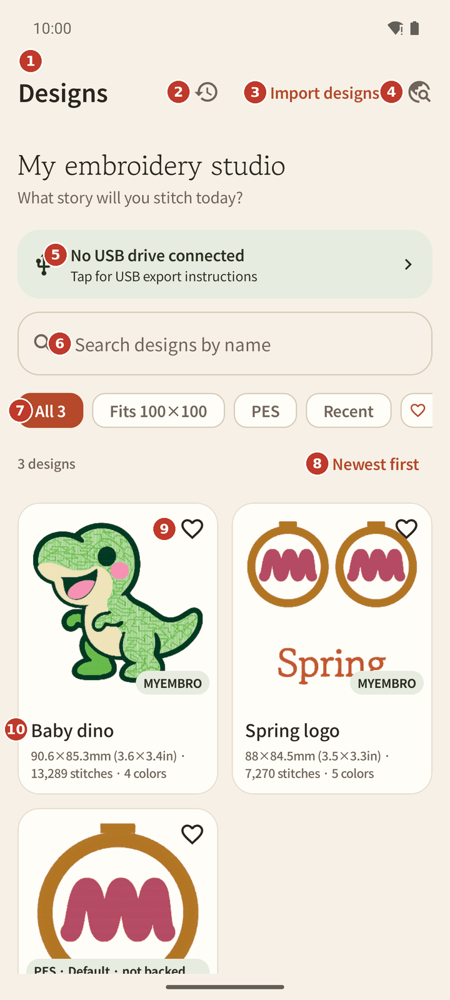

| No. | Name | What it does |
|---|---|---|
| 1 | Designs | Your saved designs and projects. |
| 2 | Transfer history | Shows recent USB transfer results. |
| 3 | Import designs | Adds PES, PEC or DST files from your phone. |
| 4 | Find free designs | A list of free design sites (chapter 11). |
| 5 | USB status | Shows the connected USB. Tap it for USB export instructions. |
| 6 | Search | Search by design name. |
| 7 | Filters | All, Fits 100×100, PES, Recent, favorites. |
| 8 | Sort | Newest first, Name A–Z, Fewest stitches. |
| 9 | Favorite | Tap the heart to make it a favorite. |
| 10 | Design card | Shows size, stitch count and colors. Tap it to open the viewer. |

**How to use it**

1. Tap the **Designs** bottom tab.
2. Tap a design to open the viewer.
3. Touch and hold a design for selection mode. Tap other designs to add them.

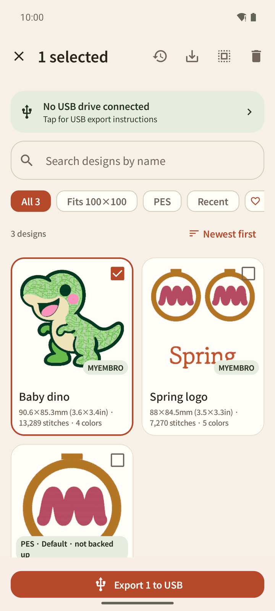

4. At the top of selection mode use **Export files**, **Select all visible designs** and **Delete**. Send with **Export N to USB** at the bottom (chapter 10).
5. Tap the transfer history icon to see the last 20 results.

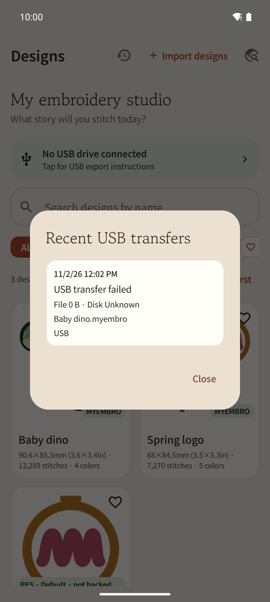

**Good to know**

- **Default · not backed up** means a design that comes with the app, so it is not put in the backup ZIP.
- Designs opened from the samples show a **Sample** badge.
- **Export files** copies the selected files unchanged to a folder. It does not check or convert them.

### 8.2 Viewer

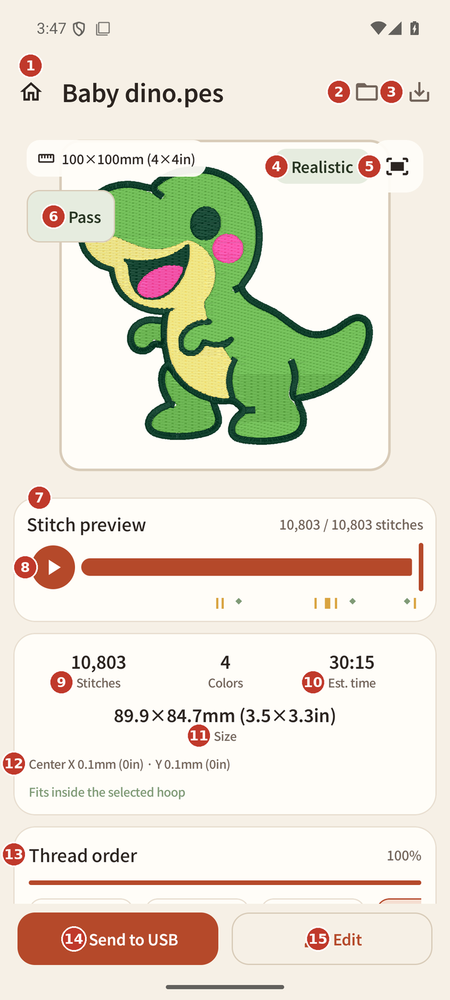

| No. | Name | What it does |
|---|---|---|
| 1 | Home | Goes to the home screen. |
| 2 | Open file | Opens another file. |
| 3 | Export design | Opens the export sheet. |
| 4 | Realistic | Shows how the design looks in thread; it is on by default and turns off when tapped. |
| 5 | Fit to screen | Fits the whole design on the screen. |
| 6 | Sewing check badge | Pass or Blocked. Tap it to open the sew-out check (chapter 9). |
| 7 | Stitch preview | Drag to show the design up to that stitch. |
| 8 | Play | Plays the sewing in order. |
| 9 | Stitches | Total stitches. The color count is next to it. |
| 10 | Estimated time | Roughly how long it takes. |
| 11 | Size | The design size. |
| 12 | Center | Position from the hoop center, and whether it fits the hoop. |
| 13 | Thread order | The order of thread changes. |
| 14 | Send to USB | Sends it to the machine (chapter 10). |
| 15 | Edit | Opens it in the editor. |

**How to use it**

1. Tap a design in the design list.
2. Tap **Play**, or drag the stitch preview, to see the sewing order.
3. Tap **Edit** to change it, or **Send to USB** to send it.
4. Tap **Export design**, pick a format (PES, DST, JEF, EXP or VP3), then choose how to export.
   - **Save**: saves to a folder on your phone or connected storage.
   - **Share file**: sends a copy using another app.
   - **Export to USB**: always sends PES over USB (chapter 10).

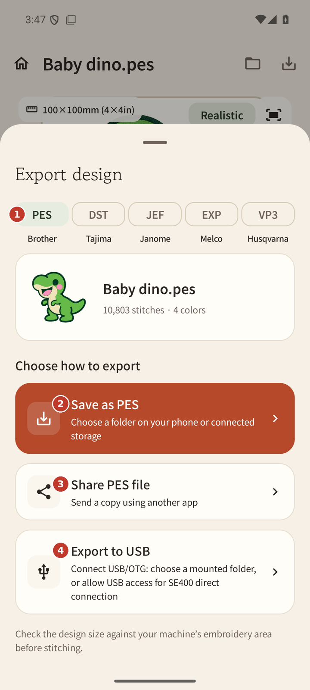

| No. | Name | What it does |
|---|---|---|
| 1 | Format | Chooses the file format for saving or sharing. |
| 2 | Save as PES | Saves in the selected format to your phone or connected storage. |
| 3 | Share PES file | Sends a copy in the selected format using another app. |
| 4 | Export to USB | Always sends PES to USB (chapter 10). |

**Good to know**

- You can open PES (v1–v10), PEC and DST files.

## 9. Sew-out check

Before saving or sending, the app checks for conditions that ruin real sewing.

### Screen layout

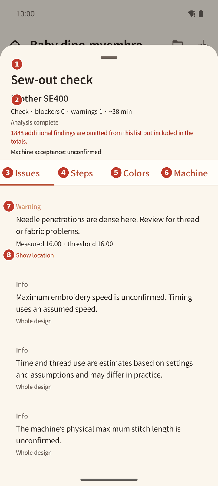

| No. | Name | What it does |
|---|---|---|
| 1 | Sew-out check | The check for the selected machine. |
| 2 | Summary | Blockers, warnings and estimated time. |
| 3 | Issues tab | The list of blockers, warnings and info. |
| 4 | Steps tab | The order of colors and thread cuts. |
| 5 | Colors tab | Stitches and time for each color. |
| 6 | Machine tab | The machine's area and features. |
| 7 | Warning item | What was found, and the measured value. |
| 8 | Show location | Jumps to that stitch. |

### How to use it

1. Tap the check badge in the viewer or on the photo result.
2. Read the items on the **Issues** tab.
3. Tap **Show location** to see the spot. During playback, blocked spots show as red circles.

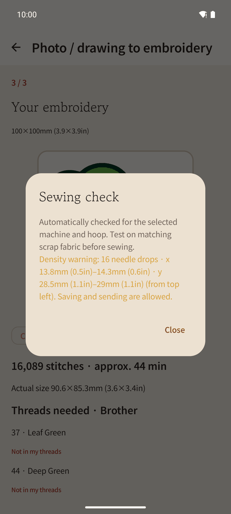

### What is checked

- Too many needle drops in one 0.5mm cell
- The needle going into the same point over and over
- Missing lock stitches at the start or end
- Stitches longer than 12.0mm
- File errors, or stitches outside the hoop

### Good to know

- 16–30 needle drops in a 0.5mm cell is a **warning**. The app shows where, and saving and sending still work.
- More than 30, or any other problem, is a **block**. Saving and sending are stopped.
- Imported PES files are kept as they are. They are blocked only when more than 30 needle drops pile up.
- **Info** items point out machine specs that are not confirmed (for example the maximum sewing speed).

## 10. Sending to the machine

Use **10.1** if your machine connects to a computer with a USB cable (SE400 and similar). Use **10.2** for other machines.

### 10.1 Sending directly over a USB cable (SE400 and similar)

No computer is needed. Tested on a real Brother SE400 with a Galaxy Fold7. The SE425 and Innovis 900 / 900D use the same kind of connection in their manuals, but they have not been tested on real machines yet.

**Watch it first:** [one-minute step-by-step video](../images/usb-direct-en.mp4) (filmed on an SE400 with a phone set to English).

**What you need:** a cable that connects your phone's port (USB-C on most phones) to the square **USB-B** port on the machine. A printer-style USB-A to USB-B cable works with a USB-C OTG adapter on the phone end. A single USB-C to USB-B cable works too.

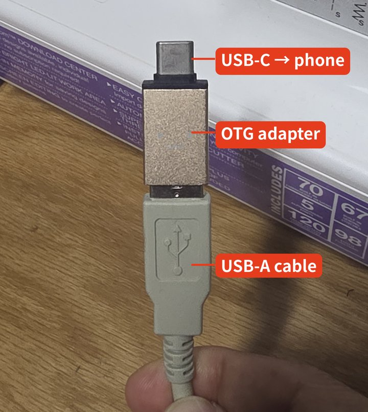

1. **Turn on the machine and plug the square USB-B end into the port on the right side of the machine. Plug the other end into the phone.**
   Success: the machine's screen is on and the cable is in both ports.

   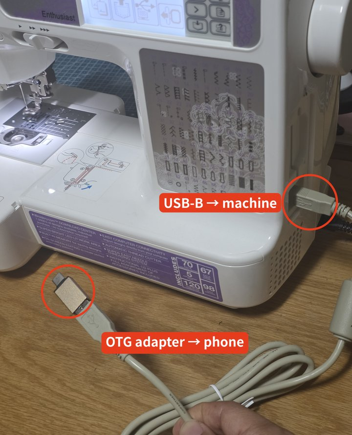

2. **If the phone asks "Choose an app for the USB device", tap myembro, then Just once.** Some phones do not ask; then open myembro yourself.
   Success: myembro opens. Choosing myembro here also gives it access to the machine, so step 4 is skipped.

   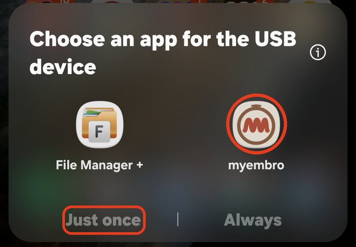

3. **Open the design and tap Send to USB.** To send several designs, go to **Designs**, touch and hold a design, tap the others, then tap **Export 2 to USB** at the bottom (the number follows your selection).
   Success: the banner at the top reads **USB: SE400 direct connection · Sewing machine**. "Sewing machine" is the name the SE400 reports; a long banner is cut off with "…". If you chose myembro in step 2, go straight to step 5.

   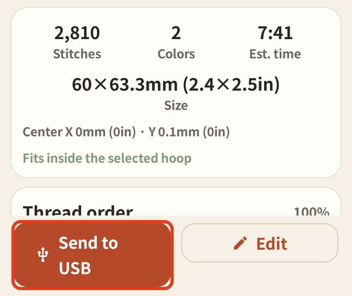

4. **Only if you missed the app choice in step 2:** Android asks **Allow myembro to access Sewing machine?**. Tap **OK**.
   Success: the app starts sending.

   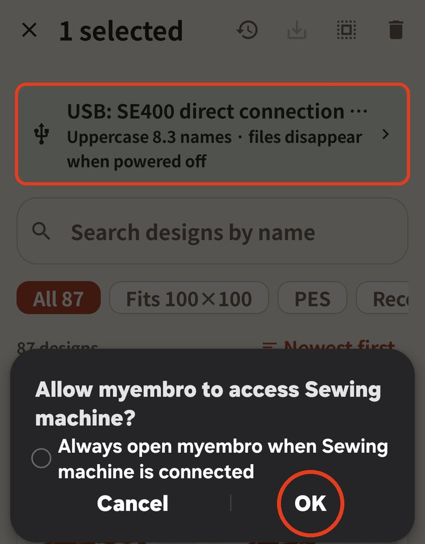

5. **Wait for the result.**
   Success: **✔ myembro 로고.pes sent** appears with the file size and the remaining space. The app has read the file back from the machine to check it. The file keeps its name, Korean included.

   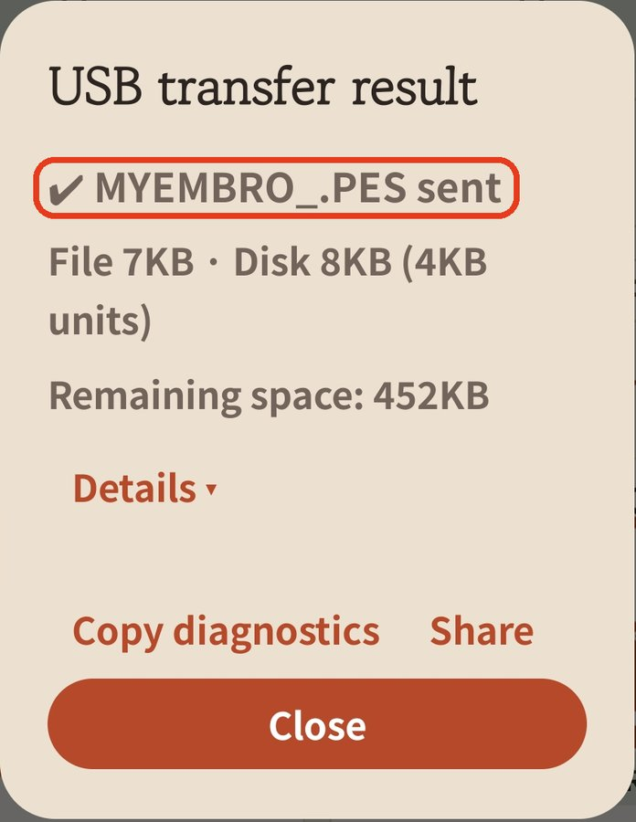

6. **On the machine, tap the USB / computer key.** It is in the bottom row of the first screen, with a USB symbol and a monitor.

   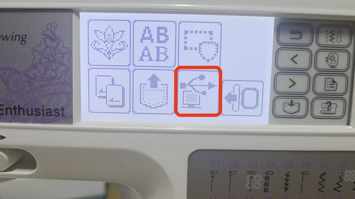

7. **Tap the design (1), then the arrow key at the top (2).** The top left shows the memory in use, for example 8/476KB.

   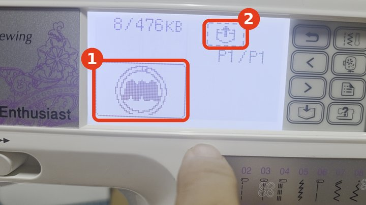

8. **The design opens with its first thread color.** Embroider as usual.
   Success: the design is on the machine's screen.

   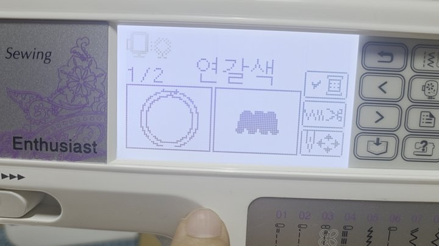

**If the machine is full:** the machine's USB memory holds up to 12 designs (Brother SE400 USB manual). If there is not enough space or not enough slots, nothing is written and the app shows **Not enough space — choose PES files to delete** with the PES files on the machine. Nothing is checked at first. Check the files you no longer need and tap **Delete selected files and export**. The app never deletes anything on its own.

**Files disappear when the machine is turned off.** Save the design to the machine's internal memory if you want to keep it there.

**If you get stuck**

- **You missed the app choice, or tapped Cancel in the access window:** tap **Send to USB** (or **Export to USB**) again, and tap **OK** when asked for access.
- **The banner still says No USB drive connected:** many cables only charge. Try a cable that has carried files before. Check that the machine is on.
- **The drive does not appear after plugging in:** tap the banner, then **Refresh USB status**. If it still does not appear, unplug both ends, wait a few seconds, and plug them in again with the machine on.

### 10.2 Sending with a USB flash drive (other machines)

1. Connect a USB flash drive to the phone (OTG).
2. In **Designs**, touch and hold a design and select the designs to send (8.1).
3. Tap **Export N to USB** and allow access to a folder on the drive.
4. Eject the drive, then plug it into the machine.

If sending fails, the result window shows the reason with **Details**, **Copy diagnostics** and **Share**. The result is also kept in the transfer history (8.1).

**Other machines:** the machine list has 58 Brother embroidery models sold in the United States and Korea (chapter 12). Only the SE400 is tested on a real machine; the others follow Brother's manuals and product pages.

## 11. Find free designs

### Screen layout

| No. | Name | What it does |
|---|---|---|
| 1 | How to import | Download a PES, then Share → myembro to add it to your design list. |
| 2 | Site name | A place that offers free designs. |
| 3 | Open website | Opens the site in your browser. |
| 4 | Terms tags | PES available, personal use only, whether an account is needed, and so on. |
| 5 | Read usage terms | Opens the site's terms page. |

### How to use it

1. Tap **Find free designs** in **Quick start** on the home screen or at the top of the design list.
2. Check the terms and open a site.
3. Download a design from the site.
4. Share the downloaded file and choose myembro. It goes into the design list.

### Good to know

- You download designs from the designer's site yourself. The app does not download them for you.
- PES, PEC, DST and ZIP are supported.
- Follow each site's terms. Most do not allow sharing or selling the design files.

## 12. Settings

### Screen layout

| No. | Name | What it does |
|---|---|---|
| 1 | Backup | Keeps designs, projects, downloaded fonts and settings in one ZIP. |
| 2 | Save backup | Makes the ZIP. Keep it outside the app. |
| 3 | Restore ZIP | Reads the ZIP back. |
| 4 | AI connection (experimental) | See chapter 14. |
| 5 | Machine and embroidery | Machine and hoop settings. |
| 6 | Machine model | Choose your embroidery machine. |

| No. | Name | What it does |
|---|---|---|
| 1 | Add custom frame | Makes a frame size of your own. |
| 2 | Thread brand | Brother, Madeira or Isacord. |
| 3 | PES output version | v1 minimal (default) or v6 compatible (with thread names and colors). |
| 4 | Choose my threads | Tick the threads you own. |
| 5 | Display theme | Light (default), Dark or Follow system. |
| 6 | About | App description, licenses and version. |

### How to use it

**Backup and restore**

1. Tap **Save backup** and choose where to save the ZIP.
2. After reinstalling or changing phones, tap **Restore ZIP** and choose that ZIP.

**Machine and embroidery**

1. Tap **Machine model** and choose your machine. Its maximum embroidery area and connection notes appear.

   

2. Under **Default hoop**, choose the hoop for new projects.
3. Tap **Add custom frame**, enter a name, unit (mm or in), width and height, and tap **Save**. It appears in the editor's hoop menu.

   

**Threads**

1. Choose a **Thread brand**.
2. Choose a **PES output version**. If unsure, keep the default (v1).
3. Turn on **My threads** and tap **Choose threads**.
4. Tick the threads you own. Search by name or number. Tap **OK**.

   

**Display theme and About**

1. Tap **Display theme** and choose Light, Dark or Follow system.

   

2. **About** at the very bottom shows the app license (GPL-3.0-or-later), open-source licenses and the version.

   

### Good to know

- The machine list has 58 Brother embroidery models: 30 sold in the United States (SE, PE, NS, NQ, XE, XJ, XP, EV, PR) and 28 sold in Korea (M, LB, Innovis, F, PR). The list with sources is in [machines.md](../machines.md).
- Models larger than 100×100mm are marked **Not verified on a physical machine**.
- Designs must stay inside the hoop. On a 100mm hoop the largest design is 99.9mm, and the app keeps to it automatically.
- An empty My threads list uses all colors. My threads is used by color drawings and the color sheet, and it is kept in the backup.
- The AI connection address and APP_KEY are not in the backup.

## 13. Ask AI

Use any chatbot app on your phone (Gemini, ChatGPT, Claude and others) to change your design. myembro has no AI built in and stores no account or key.

### Screen layout

| No. | Name | What it does |
|---|---|---|
| 1 | Request | Type what should change. |
| 2 | Speak | Say it with the microphone. |
| 3 | Attach photo | Attach a photo to put in the design. The photo stays on this phone; the chatbot only gets its number and size. |
| 4 | What the chatbot will see | Shows the text sent to the chatbot. |
| 5 | Copy | Copies the text to send. |
| 6 | Share to chatbot | Sends it straight to a chatbot app. |

### How to use it

1. Tap **Ask AI** in the editor's top bar.
2. Type what should change. For example: *Put "Mina" under the logo in red*
3. Tap **Share to chatbot** and choose a chatbot app. Or tap **Copy** and paste it yourself.
4. A **Waiting for the chatbot's reply (p-…)** bar appears. The code ties the reply to the request.
5. Copy the chatbot's whole reply. Share it to myembro, or tap **Paste reply** in the bar and then **Check**.
6. **Check the changes** shows before and after pictures, the list of changes and the sew-out check result. Nothing has changed yet.
7. Tap **Apply**, **Cancel** or **Ask for changes**.
8. One undo takes back everything that was applied.

### Good to know

- What the chatbot receives: the app instructions and command list, the hoop name and size, for each object its handle, type, text, font, position, size, rotation, thread colors, order and whether it is hidden, the fonts and built-in designs you can use, and your request.
- No stitches, pictures or files are sent. The chatbot cannot reach your phone.
- Deleting objects, saving, sharing and USB transfer are confirmed one by one in the app after you apply.
- If a reply cannot be used, the app says why and changes nothing. Use **Copy a fix-up request** to ask the chatbot again.
- The chatbot cannot see attached photos and cannot download fonts. Sizes and stitch types follow the app's rules and the sew-out check.

## 14. AI connection (experimental)

Without copy and paste, a chatbot changes the open design directly. You need your own relay server ([relay/README.md](../../relay/README.md)) and a chatbot that supports connectors, such as Claude.

### How to use it

1. In **Settings**, turn on **AI connection (experimental)**.
2. Enter the **Relay address** (wss://…) and the **APP_KEY**.
3. Add the relay server to your chatbot as a connector. A notification shows while connected.

### Good to know

- The address and key stay on this phone and are not in backups. After reinstalling or changing phones, enter them again.
- The chatbot reads and changes the design open in the editor. Each change is one undo step. Changes that fail the sew-out check are not made.
- Pictures the chatbot draws (SVG, PNG, JPEG) open on the photo screen first, so you check them before they are added.
- Deleting objects asks you on the phone first (answer within 90 seconds). Saving, sharing and USB transfer are always done by you.

## 15. Known limitations

- Only the SE400 is tested on a real machine. Other models follow Brother's published specifications.
- In color drawings, small pieces are merged into the colors around them.
- Very complex pictures can stop with "too complex". Lower the resolution, raise the piece size, or crop smaller.
- Density in block editing is Normal only for now.
- Chinese (Han character) lettering is in development.

## Appendix. How stitches are made

### Automatic underlay

Before a fill is sewn on top, an underlay goes down first to hold the fabric. Satin lettering uses the underlay and pull compensation set in the font. Korean satin lettering has no underlay and no pull compensation.

### Connected sewing

When one region is split into several sections, the thread is not cut between them. To reach the next section, the needle travels under a spot that is not filled yet, so the travel thread is covered by later stitches and does not show.

### Outlines twice

In color drawings and silhouettes, each filled region gets a same-color running outline twice. The second pass is offset by half a stitch, so the edge is crisp.

### Korean satin, top-left to bottom-right

Korean satin lettering is sewn as satin along the middle line of each stroke. Inside a group of touching strokes the thread is not cut. Groups are sewn in the basic stroke order, from top-left to bottom-right; some letters are really written in a different order. The thread is cut only between groups.

### Trims only between separate parts

A thread-cut command is added only when the needle moves to a separate part. Letters closer than 3mm are sewn through without a cut. Whether the thread is really cut depends on whether your machine has a thread cutter. In photo embroidery, separate pieces are sewn nearest first; in the pictures we tested, this cut the length of thread jumping across by about 16% for silhouettes and about 19% for color drawings.

### Automatic lock stitches

Lock stitches are added where the thread starts and ends and on both sides of every thread cut, so nothing unravels. If a design the app made is missing a lock stitch, saving and sending are blocked. The app places lock stitches itself; you cannot move them.

### Change any block

In **Block editing** you can change each region's stitch type (Fill, Satin, Running or Empty), fill texture (Basic, Pattern, Contour or Circular), direction (Auto or Manual) and sewing order. For how to use it, see [chapter 4](#4-block-editing).
