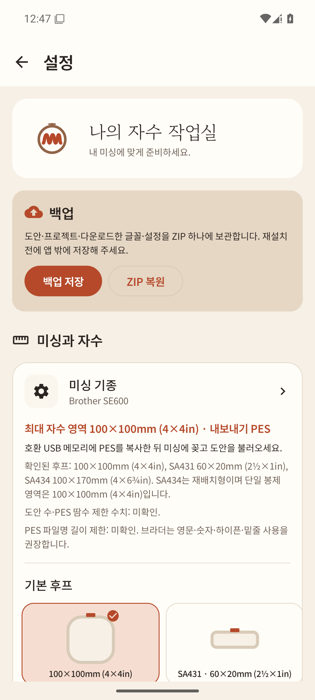
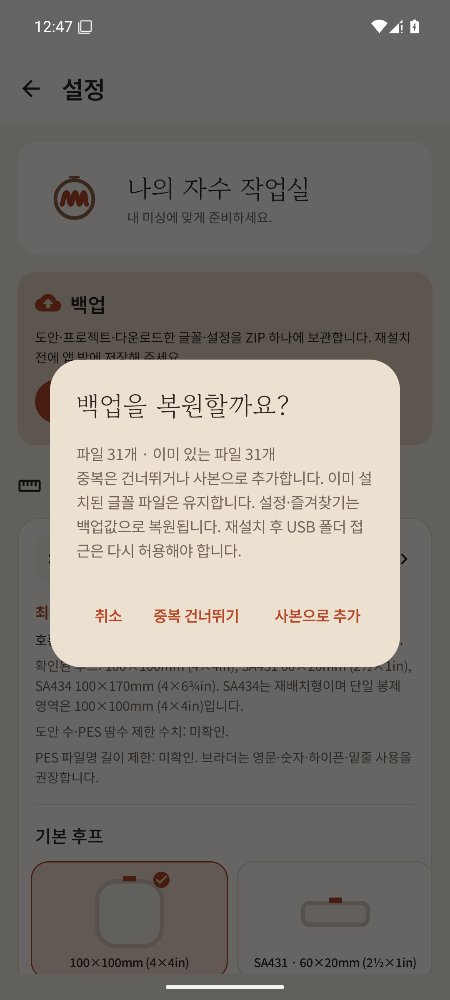
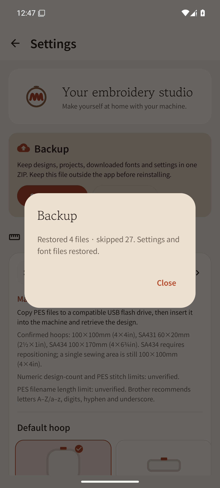

# Full backup/restore QA

Started from main `b95f2be`. Signing configuration/keys were not changed.

Settings → **Save backup** saves a ZIP outside the app (for example, Downloads) through SAF.
After reinstalling, select it through Settings → **Restore ZIP** and choose Skip duplicates/Add
copies. Cancel restores nothing. Settings and favorites are restored from the backup as explained
in the confirmation dialog.

## Preserved scope

- `files/designs`, `projects`, `drafts`: preserve original PES and editing projects byte for byte, without parsing/re-encoding.
- `files/fonts`: includes downloaded/user fonts, metadata, licenses, quality information, and the font-file list in the manifest.
- Typed SharedPreferences in `myembro_settings`, `myembro_library`, `lettering`, `generated_pes_origins`: machine/hoop/theme/favorites/recent fonts/generated-design provenance.
- USB transfer-history files are also included. Cache, unfinished tmp/part files, and USB SAF permissions are excluded. USB folder permission must be granted again after reinstalling.
- Duplicate copies add designs/projects as `이름 (1).확장자`. **Existing fonts are retained**, and missing font files restored, because they consist of IDs and sidecar files. Merely renaming font files would create broken copies and is not done.

A ZIP is applied only after version/filename/size/SHA-256 manifest validation. Path traversal,
duplicate ZIP entries, corruption, and unsupported versions are rejected. Only new files are created;
existing files are never overwritten. On failure, files created by this restore are removed. If
saving settings fails, recovery of previous settings is also attempted. Limits are 256MiB per file,
2GiB total, and 2 × ten thousand files; I/O runs on Dispatchers.IO.

## Automated verification

```sh
JAVA_HOME=/home/gosh2/.jdks/jdk-17.0.20.1+1 ./gradlew check :app:assembleDebug
```

`BackupArchiveTest`, 4 cases: backup including public PES → delete the whole data directory →
restore with matching file count/bytes; skip/copy duplicates; cancellation/failure rollback;
path-traversal/version/checksum-corruption rejection.

Actual Android verification ran only with separate applicationId
**`io.github.linker2k.myembro.backupsmoke`**. The user's installed app/data were not deleted.
`BackupInstrumentation` backs up actual filesDir and SharedPreferences, deletes/clears them,
and restores them. It compares strings, Hangul string sets, boolean, int, long, and float.

```
BACKUP_DELETE_RESTORE_PASS files=4 byte_equal=true typed_preferences_equal=true
INSTRUMENTATION_CODE: -1
```

The committed instrumentation is restricted to the `.backupsmoke` package. Change applicationId
with a local Gradle init script and build with
`-PmyembroTestRunner=io.github.linker2k.myembro.backup.BackupInstrumentation :app:assembleDebug :app:assembleDebugAndroidTest`.
Default app/release signing configuration is unchanged.

On emulator-5554, Settings → SAF save → completion dialog → SAF ZIP selection → duplicate
confirmation → skip → restore result were clicked directly. A ZIP of 31 public/synthetic data
files showed `Restored 0 files · skipped 31`. Korean/English screenshots are retained together.
Local logs: `/tmp/myembro-backup-instrumentation.log`, `/tmp/myembro-backup-tests.log`,
`/tmp/myembro-backup-check.log`.

Additionally, actual `pm clear` ran only on the isolated package. The user's normal app was unchanged.

```text
ZIP_MANIFEST_COMPARE_PASS files=31 sha256_equal=true typed_preferences_equal=true
PM_CLEAR_ISOLATED Success
ZIP_MANIFEST_COMPARE_PASS files=31 sha256_equal=true typed_preferences_equal=true
SAF_PM_CLEAR_RESTORE_AND_CANCEL_SMOKE_PASS en_ko=true
```

Reproduce the additional verification with
`tools/smoke_backup_restore.py --zip /sdcard/Download/myembro-backup-2026-10-24.zip`.
First save a synthetic-data backup from the isolated app. Android's `profileInstalled` runtime
marker is unrelated to backup targets and excluded from the count. Actual file/settings comparisons
use the ZIP manifest as the expectation and run again after cancellation. Full `check`/APK builds
succeeded: 640 engine tests, 221 app debug/release tests each, 0 failures.
Log: `/tmp/myembro-backup-real-clear.log`.




