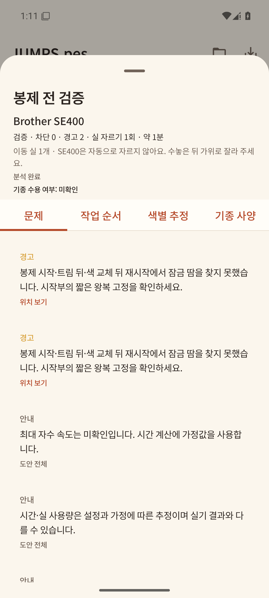
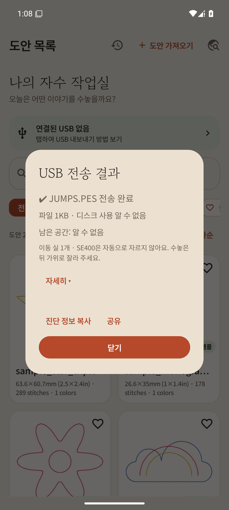
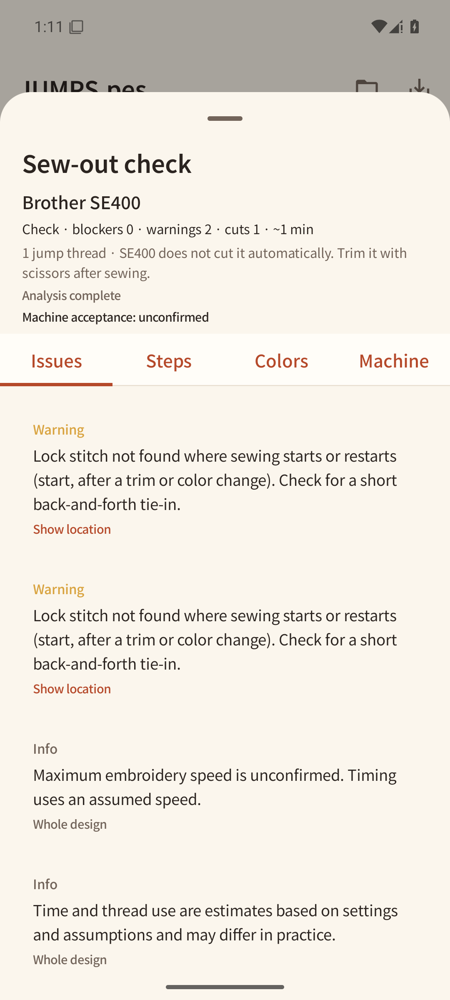
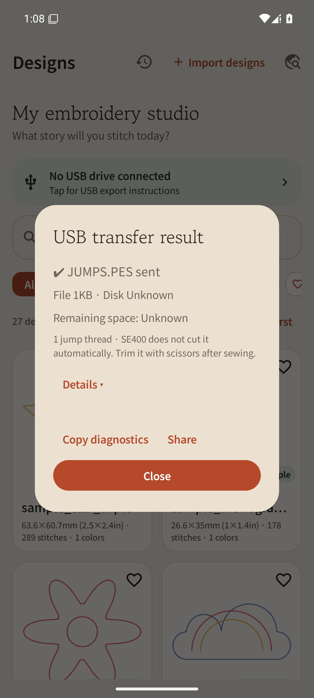

# Manual jump-thread trimming advice

Show the same advice at the top of the viewer's sew-out check and in USB transfer results.

> N jump threads · SE400 does not cut them automatically. Trim them with scissors after sewing.

Display conditions: the profile has `automaticJumpTrim == false`, analysis is complete, and a
confirmed positive count and machine name are available. Hide it for 0 threads, unconfirmed
values, automatic trimming support, or incomplete analysis. Do not change unconfirmed SE600/SE700
automatic-trimming capability to `없음` (absent). English distinguishes 1 thread from multiple threads.

Both direct USB and SAF store the transfer-time machine and automatic-trimming capability with
successful files. Totals cover successful files only. Omit the advice for old records or if any
file's capability/count is unconfirmed. Changing settings later does not change the machine advice
in historical transfer records. Original PES bytes, generation, and gate thresholds are unchanged.

## Verification

```sh
JAVA_HOME=/home/gosh2/.jdks/jdk-17.0.20.1+1 ./gradlew \
  :app:testDebugUnitTest --tests '*ManualJumpAdviceTest' --tests '*UsbTransfer*Test' \
  :app:assembleDebug
```

15 tests / 0 failures / 0 errors. Log: `/tmp/myembro-jump-advice-final.log`.
Tests cover machine false/true/null × count null/negative/0/1/2, viewer SE400/SE600/incomplete,
USB success/partial failure/old records/mixed machines, and record JSON round trips.

The actual UI was opened in the separate applicationId `io.github.linker2k.myembro.jumpadvice`
on emulator-5554 and checked in both ko/en. `JumpAdviceInstrumentation` prepares two original
4×1mm contours (1 jump thread) and an **explicit mock USB success record**. There are no personal
designs, and no claim of physical USB transfer. This instrumentation runs only in the `.jumpadvice`
package. Reproduce by changing applicationId through a local init script and building with
`-PmyembroTestRunner=io.github.linker2k.myembro.ui.JumpAdviceInstrumentation :app:assembleDebug :app:assembleDebugAndroidTest`.

```
JUMP_ADVICE_FIXTURE_READY count=1; synthetic USB record only
USB_EN_ADVICE_PASS
USB_KO_ADVICE_PASS
VIEWER_KO_ADVICE_PASS
VIEWER_EN_ADVICE_PASS
```





